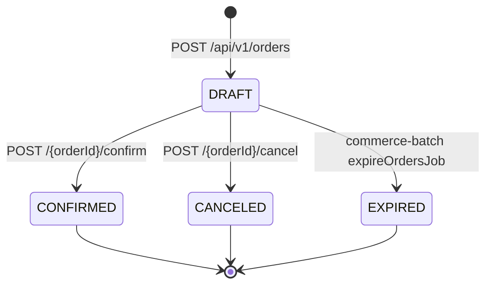

# 주문 상태

> 이 문서는 지금 코드가 어떻게 동작하는지를 정리한 것입니다. 코드가 바뀌면 이 문서도 함께 고쳐 주세요.
> 결정 배경은 코드 주석에 붙은 P-, D-, DS- 번호를 따라 주차별 문서에서 찾을 수 있습니다.

## 전체 흐름

상태를 바꿀 수 있는 건 DRAFT일 때뿐입니다. CONFIRMED, CANCELED, EXPIRED가 되면 더 이상 다른 상태로 바뀌지 않습니다.

## 상태가 바뀌는 곳

| 바뀌는 상태 | 호출하는 곳 | 상태를 바꾸는 코드 | 같이 바뀌는 것 |
| --- | --- | --- | --- |
| 생성 → `DRAFT` | `POST /api/v1/orders` | `Order` 생성 시 기본값 | 재고와 포인트는 그대로입니다. 상품 단가를 주문에 복사하고, 만료 시각을 생성 후 10분으로 저장합니다 |
| `DRAFT` → `CONFIRMED` | `POST /api/v1/orders/{orderId}/confirm` | `OrderFacade.confirm`에서 `Order.confirm()` 호출 | 재고를 줄이고, 포인트를 차감하면서 사용 내역을 남깁니다. `paidAmount`에 합계를, `confirmedAt`에 확정 시각을 저장합니다 |
| `DRAFT` → `CANCELED` | `POST /api/v1/orders/{orderId}/cancel` | `OrderFacade.cancel`에서 `Order.cancel()` 호출 | `canceledAt`만 저장합니다. DRAFT일 때는 차감한 게 없어서 되돌릴 것도 없습니다 |
| `DRAFT` → `EXPIRED` | `commerce-batch`의 `expireOrdersJob` | `OrderJpaRepository.expireDrafts`의 UPDATE 쿼리 | 상태만 바뀝니다. DRAFT는 재고를 잡아두지 않으니 풀어줄 재고도 없습니다 |

확정된 주문은 취소하거나 환불할 수 없습니다.

## 확정할 때 확인하는 순서

`OrderFacade.confirm`은 하나의 트랜잭션으로 묶여 있습니다. 중간에 어느 단계에서 실패하더라도 재고, 잔액, 주문 상태가 모두 확정 전으로 돌아갑니다.

| 순서 | 확인하거나 처리하는 것 | 실패하면 |
| --- | --- | --- |
| 1 | 요청한 사용자가 활성 상태인지 확인 | `USER_NOT_FOUND`, `USER_DEACTIVATED`, `USER_BLOCKED`, `USER_WITHDRAWN` |
| 2 | 본인 주문이면서 DRAFT인지 확인 | `ORDER_NOT_FOUND` (다른 사람의 주문이면 주문이 있다는 것도 알리지 않도록 같은 에러를 줍니다), `ORDER_NOT_DRAFT` |
| 3 | 만료 시각이 지났는지 확인 (만료 시각과 같으면 아직 유효) | `ORDER_EXPIRED` |
| 4 | 주문한 상품이 삭제되지 않았고 판매 중인지 확인 | `PRODUCT_NOT_FOUND`, `PRODUCT_NOT_PURCHASABLE` |
| 5 | 재고 차감 | `OUT_OF_STOCK` |
| 6 | 포인트 차감 | `INSUFFICIENT_BALANCE` |
| 7 | 상태를 `CONFIRMED`로 변경 | 없음 |

- **2번을 3번보다 먼저 하는 이유**: 이미 확정하거나 취소한 주문도 만료 시각은 지나 있습니다. 순서가 반대면 이미 확정한 주문에 "만료됐다"는 에러가 나갑니다.
- **재고(5번)를 잔액(6번)보다 먼저 보는 이유**: 잔액이 부족하면 충전하면 되지만, 재고가 부족하면 고객이 할 수 있는 게 없습니다. 둘 다 부족할 때는 해결할 수 없는 쪽을 먼저 알려 줍니다.
- **3번에서 만료로 거절돼도 주문 상태는 DRAFT로 남습니다.** EXPIRED로 바꾸는 건 배치만 합니다.

## 상태별 응답 값

주문 생성, 단건 조회, 취소 API는 모두 `OrderResponse`를 돌려줍니다.

| 상태 | `totalAmount` | `paidAmount` | `expiresAt` | 의미 |
| --- | --- | --- | --- | --- |
| `DRAFT` | 확정하면 차감될 금액 | 응답에 없음 (`null`) | 이 시각까지 확정해야 함 | 무엇을 얼마에 살지 적어 둔 상태입니다. 재고가 있다는 보장은 아닙니다 |
| `CONFIRMED` | 주문 합계 | 실제로 차감된 금액 (0원 주문이면 `0`) | 의미 없음 | 결제가 끝난 상태입니다 |
| `CANCELED` | 주문 합계 | 응답에 없음 | 의미 없음 | 고객이 직접 취소한 상태입니다 |
| `EXPIRED` | 주문 합계 | 응답에 없음 | 이미 지난 시각 | 10분 안에 확정하지 않아 만료된 상태입니다. 고객이 취소한 경우와 CS 대응이 달라서 따로 둡니다 |

확정 API만 응답 모양이 다릅니다. `ConfirmResponse`는 `status`, `paidAmount`, `balance`를 돌려주고, `balance`는 차감한 뒤의 잔액입니다.

주문 API는 결제 전 잔액이나 확정 후 예상 잔액을 돌려주지 않습니다. 결제 화면에서 잔액을 보여 주려면 `GET /api/v1/points`를 따로 호출해야 합니다.
또 DRAFT는 재고를 잡아 두지 않기 때문에, 재고가 충분한지는 확정을 시도해 봐야 알 수 있습니다.

## 코드 위치

| 내용 | 파일 |
| --- | --- |
| 상태 enum | [`OrderStatus.kt`](../../apps/commerce-api/src/main/kotlin/com/loopers/domain/order/OrderStatus.kt) |
| 상태 변경 메서드, 만료 판단 | [`Order.kt`](../../apps/commerce-api/src/main/kotlin/com/loopers/domain/order/Order.kt) |
| 확정, 취소 처리 순서 | [`OrderFacade.kt`](../../apps/commerce-api/src/main/kotlin/com/loopers/application/order/OrderFacade.kt) |
| DRAFT 주문인지 확인 | [`OrderService.kt`](../../apps/commerce-api/src/main/kotlin/com/loopers/domain/order/OrderService.kt)의 `getDraftOwnedByOrThrow` |
| 만료 배치 쿼리 | [`OrderJpaRepository.kt`](../../apps/commerce-batch/src/main/kotlin/com/loopers/infrastructure/order/OrderJpaRepository.kt)의 `expireDrafts` |
| 응답 형식 | [`OrderV1Dto.kt`](../../apps/commerce-api/src/main/kotlin/com/loopers/interfaces/api/order/OrderV1Dto.kt) |
