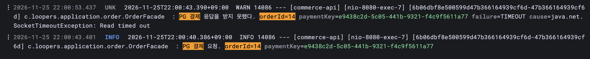
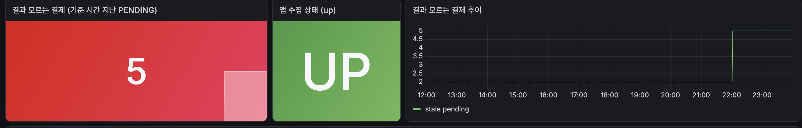
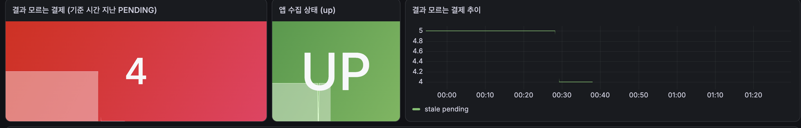
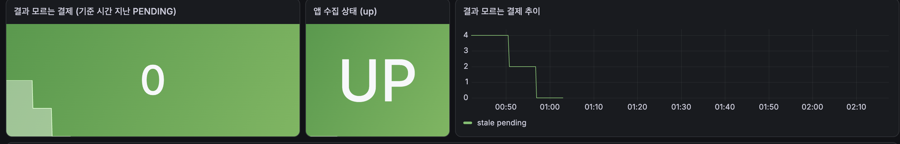
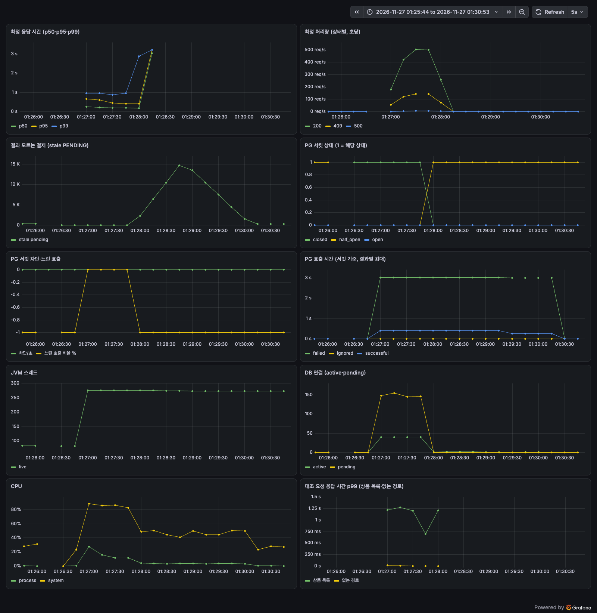
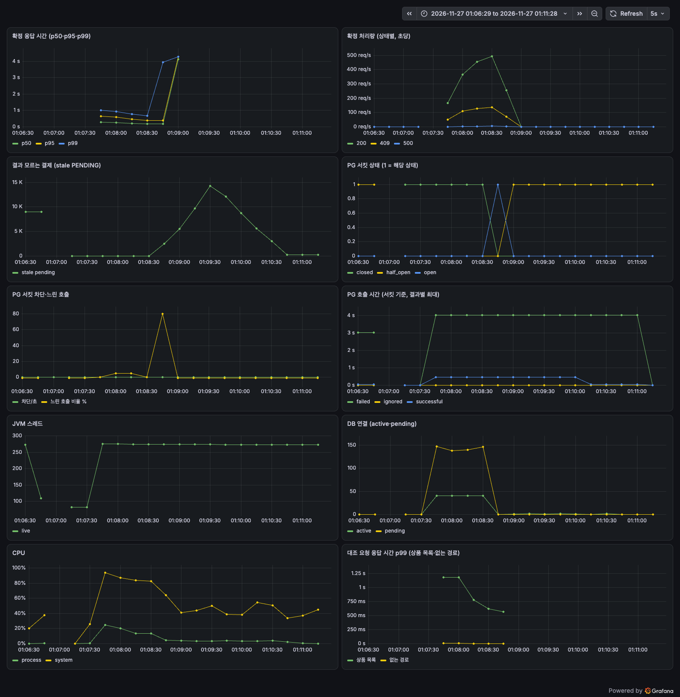
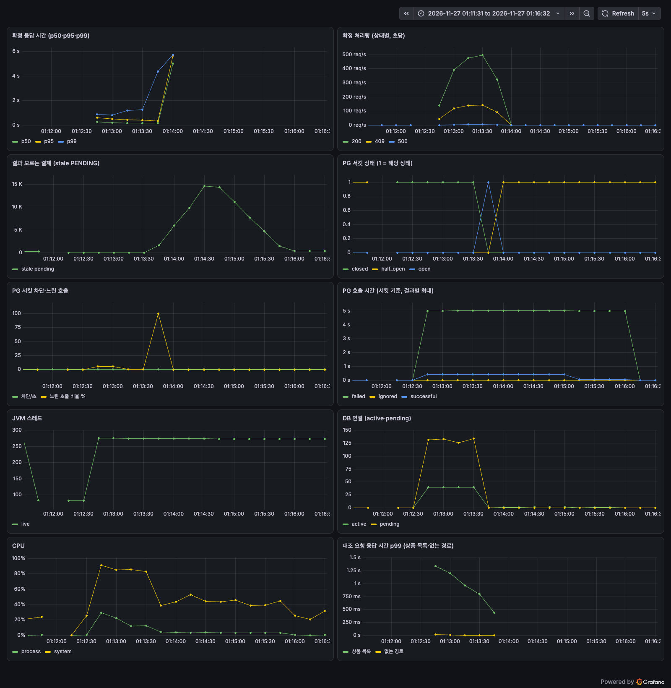
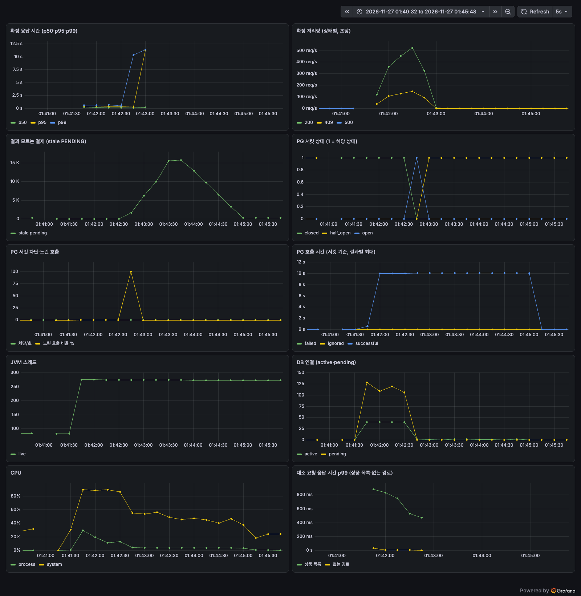
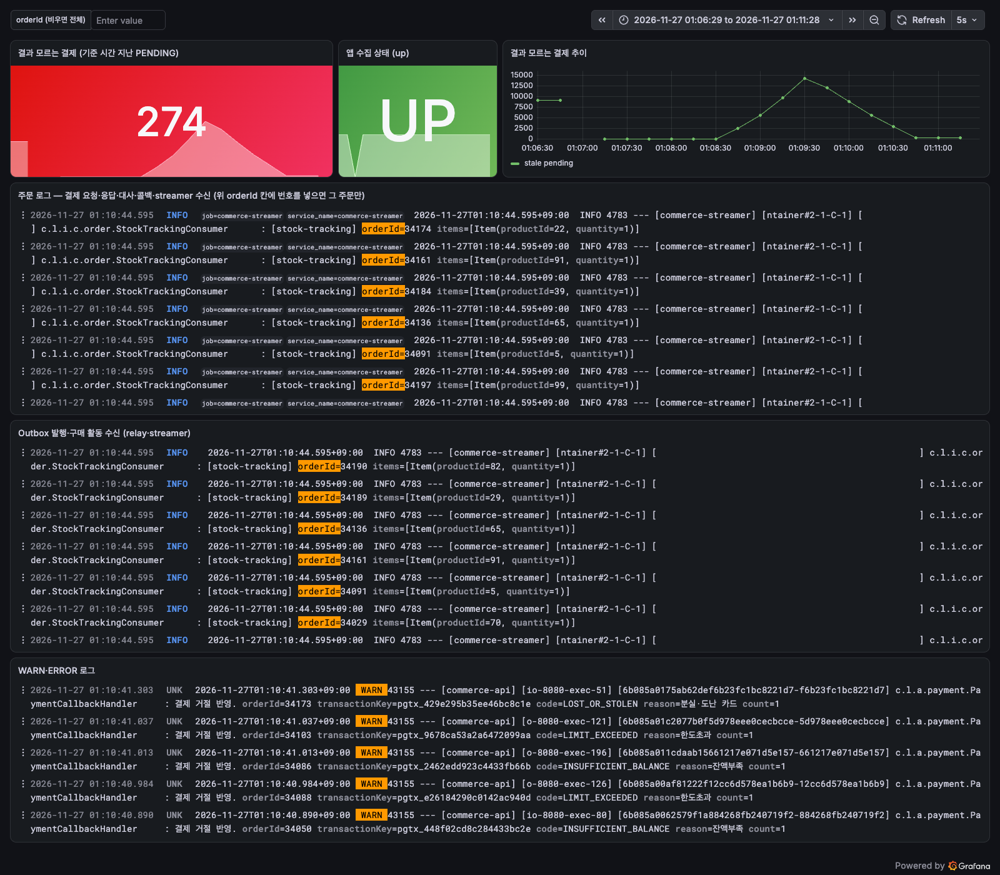

# 결제 응답 유실 사고 실험 일지

[기획](checkout-incident-plan.md)의 단계를 진행하며 한 일, 알게 된 것, 실행 기록을 시간 순서로 남긴다.

## 진행 표

| 날짜 | 단계 | 한 일 | 결과 |
| ---- | ---- | ----- | ---- |
| 2026-11-22 | 1 | `LocalPgFixture`·`LocalPgFixtureTest`·`CheckoutIncidentTest`(baseline) 추가. 프로덕션 코드 변경 없음 | fixture 5개, baseline 1개 통과. ktlint·ArchUnit 통과 |
| 2026-11-23 | 2 | PG 경계 로그 3줄, gauge `payment.pending.stale`, `transactionKey` 전달, 관측 테스트 `observesLostResponse` 추가 | incident 7개 통과. commerce-api 전체 479개 중 8개 실패 — 모두 Outbox·이벤트 테스트이고 변경 전 커밋 d8c12ca 에서도 같은 8개가 실패함. ktlint·ArchUnit 통과 |
| 2026-11-25 | 3 | `keepsIncidentState` 추가(baseline → fault 를 한 테스트에서). baseline 단언은 `runBaseline` 으로 옮겨 두 테스트가 같이 씀. 프로덕션 코드 변경 없음 | incident 8개 통과. 응답 유실 주입을 빼면 실패하는 것 확인. ktlint 통과 |
| 2026-11-26 | 5 준비 | 본인 주문 대사 API `POST /api/v1/orders/{orderId}/reconcile` 추가. 로컬 14번 대사 | 대사 테스트 10개 통과. commerce-api 전체 490개 중 8개 실패(기존 Outbox 8개 동일). 14번 SUCCESS, 새 결제 없음 |
| 2026-11-26 | 6 준비 | 주문 확정 → Outbox 연결 복원. W7(`71f9e0e`)에는 `PaymentSettlement.succeed` 에서 Outbox 에 기록했는데 W8(`f9d2789`)에서 빠졌다. 결제 SUCCESS 반영 시점에 다시 기록한다. `StockReservationService.commit` 이 확정한 예약을 돌려주게 바꿨다 | commerce-api 전체 490개 모두 통과(이전에 실패하던 Outbox·이벤트 8개 포함). 대사 API 도 같은 반영 경로라 복구한 주문도 Outbox 에 기록된다 |
| 2026-11-26 | 5 | 사고 테스트에 복구 단계를 이었다. `keepsIncidentState` → `recoversIncidentWithoutNewPayment`. 한 테스트 안에서 baseline → fault → recovery | incident 8개 통과. Outbox 기록을 빼면 Outbox 단언이 실패하는 것 확인. ktlint 통과 |
| 2026-11-26 | 6 | 사고용 계약 `order-confirmed-incident-2026-08-17.jsonl`(20건)로 W9 연결 5구간을 한 번 더 이었다. 결제 성공 시각을 정하는 `Clock` 을 `PaymentSettlement` 에 주입 | api 491개 모두 통과, relay·streamer·batch 연결 테스트 통과, ktlint 통과. 복구 시각을 고정하지 않으면 1구간이 실패하는 것 확인 |
| 2026-11-27 | 완화 측정 | pg-simulator 0.7.0(응답 유실 1%·거절 5% 확률)으로 VU 1000 부하를 주며 read-timeout 3s·4s·5s·15s 비교 | 미확인 결제는 네 값 모두 약 1% 로 같다. 15s 에서 timeout 은 0 이 됐지만 콜백이 오지 않아 PENDING 으로 남았다. 늘린 만큼 최악 응답 시간만 늘어서 3s 유지 |

## 1번에서 알게 된 것

- 2번 로그 작업 때 주의: PG timeout 은 예외 이름이 아니라 원인이 `SocketTimeoutException` 인지로 판단한다. 실제로는 `ResourceAccessException` 이 아니라 `RestClientException` 으로 와서, 이름으로 가르면 timeout 을 다른 실패로 잘못 기록한다.
- baseline 실측: Payment `SUCCESS` 10, PG 거래 10(모두 `SUCCESS`, 금액 39,000), create 10(중복 0), 재고 예약 `COMMITTED` 10, 상품 재고 30 → 20, 포인트 50,000 그대로, management 포트의 health `UP`.
- 테스트 설정: `pg.read-timeout=500ms`, fixture 의 응답 유실 대기 1.5s, `management.server.port=0`(랜덤).

## 2번에서 알게 된 것

- Spring Boot 테스트는 지표 내보내기를 기본으로 끈다. `/actuator/prometheus` 가 없어서 gauge 가 안 보였다. 관측 테스트에만 `@AutoConfigureObservability(tracing = false)` 를 붙였다.
- 실제 로그: `PG 결제 응답을 받지 못했다. orderId=1 paymentKey=… failure=TIMEOUT cause=java.net.SocketTimeoutException: Read timed out`
- gauge 관찰 범위: 생성 후 `payment.metrics.stale-pending-after`(기본 1m, 테스트 2s)가 지난 PENDING. 갱신 주기: Prometheus 가 수집할 때마다 DB 를 센다(로컬 Prometheus 는 5초 간격). 그래서 실제 값은 기준 시간 + 수집 간격만큼 늦게 오를 수 있다.
- 테스트 사이 주문 ID 가 다시 1 부터 시작해서(TRUNCATE) fixture 거래가 섞일 수 있다. `LocalPgFixture.reset()` 을 추가해 테스트마다 비운다.
- settle 반영 로그는 과제 원문에 없어 넣지 않았다.

### 2번 시작 전 로컬 모니터링 상태 (2026-11-23 확인)

- Prometheus `localhost:9090` 정상, `host.docker.internal:8081/actuator/prometheus` 를 5초마다 수집, target `up`.
- Grafana `localhost:3000` 정상(13.2.1), 데이터소스 Prometheus 연결됨.
- 결제 관련 지표 0개.
- 8080/8081 에 떠 있는 commerce-api 는 11-13 다른 세션이 띄운 예전 jar 다. 2단계 코드를 Grafana 로 보려면 이걸 내리고 이번 코드로 다시 띄워야 한다.

## 3번에서 알게 된 것

- 장애 3건은 응답 유실과 콜백 보류를 **함께** 건다. 과제 원문: "고정한 3개만 거래 SUCCESS 저장 뒤 생성 응답 유실 / 해당 3개의 callback 전달과 자동 reconcile은 관찰 시점까지 보류". 콜백 보류는 별도 원인이 아니라 콜백이 와서 저절로 고쳐지지 않게 막는 장치다.
- 장애 3건은 실제 생성한 주문 ID 목록의 고정 위치(2·5·8번째)로 고른다. 실행 순서의 우연에 기대지 않는다.
- fault 실측: 확정 응답 500 3건·200 7건, Payment `SUCCESS` 7 / `PENDING` 3(정확히 고른 3건), PG 거래 누적 20(장애 집합 10건 모두 `SUCCESS`), create 누적 20(중복 0), 장애 3건 재고 예약 `RESERVED` 유지·7건 `COMMITTED`, 재고 30 → 10, 포인트 그대로, gauge 3, health `UP`, 장애 3건 모두 `failure=TIMEOUT` 로그.
- `finally` 에서 주입만 끄고(`clearFaults`) 거래·DB 는 지우지 않는다. 테스트가 끝난 뒤 `@AfterEach` 가 비우는 건 다음 테스트를 위한 정리다. 실행 증거를 파일로 남기는 건 7단계에서 한다.
- 로컬 앱 재현(2026-11-25): pg-simulator 에 테스트 카드 `3333`(접수 응답 10초 지연 + 콜백 안 보냄, 0.6.0)을 추가하고 콜백 주소를 8080 으로 바꿔 재시작했다. 정상 10건(주문 3–12) 모두 `SUCCESS`. 장애 집합 10건(주문 13–22) 중 `3333` 카드 3건(14·17·20)은 확정 응답 500, `failure=TIMEOUT` 로그, Payment `PENDING`, 재고 예약 `RESERVED`, pg-simulator 조회는 `SUCCESS`. 나머지 7건은 `SUCCESS`·`COMMITTED`. 재고 28 → 8, health `UP`. gauge 는 5(이전 실행의 PENDING 주문 1·2 포함)이고 Prometheus 도 5.

## 4번 경쟁 가설 (2026-11-25–26, 로컬 앱의 사고 주문 14·17·20 으로 직접 진단)

- 역할을 나눴다. 1–3단계(실험 장치)는 AI 가 만든다. 4단계 가설·판정과 5단계 복구 범위·중단 조건은 사람이 정한다. AI 는 어디를 보면 되는지와 증거가 결론까지 닿는지만 되묻는다. 과제 원문: "상태 변경 조치는 사람이 범위·중단 조건을 확인한 뒤 수행합니다."
- PG 조회(`GET /api/v1/payments?orderId=14`)가 `SUCCESS`라서 **PG 처리 지연 가설은 탈락**했다. 조회는 읽기만 해서 사고 상태를 바꾸지 않는다.
- 남은 두 가설(응답 유실 / 내부 반영 실패)은 "PG SUCCESS + 내부 PENDING"이라는 같은 조합을 만든다. 이것만으로는 구분할 수 없다.
- 로그에서 요청에서 `failure=TIMEOUT` 까지 정확히 3초가 걸렸다(14번 22:00:40.386 → 22:00:43.390). `pg.read-timeout` 3초와 같다. 응답 유실 쪽을 지지한다.
- readTimeout 은 **우리 서버 기준**이다. "3초 안에 답을 못 받았다"는 뜻일 뿐, PG 가 처리했는지는 알려 주지 않는다. 그래서 PG 조회가 따로 필요했다.
- 주입 지식(`3333` 카드는 10초 지연 뒤 거래를 저장한다)은 판정 근거로 쓰지 않는다. 우리 쪽 증거만으로는 "PG 가 왜 3초를 넘겼나"를 말할 수 없다.
- **아직 확인하지 않은 것**: timeout 이후 반영 시도가 있었는지. 정상 주문 13번에는 `PaymentCallbackHandler` 의 `결제 승인 반영. orderId=13` 줄이 있다. 사고 주문에 이 줄이 없는지 확인하면 내부 반영 실패 가설을 지울 수 있는지 판단할 수 있다.
- readiness·liveness 로는 해결되지 않는다. 앱을 재시작하거나 트래픽을 끊는 조치라서 DB 의 PENDING 과 PG 의 SUCCESS 는 그대로 남는다.
- read-timeout 을 늘리는 건 앞으로 들어올 주문을 위한 **완화**다. 이미 PENDING 인 주문은 **복구**하지 못한다. 그리고 원격 호출에서 응답을 못 받는 경우는 timeout 을 얼마로 하든 없어지지 않는다. 그래서 복구 수단(reconcile)이 반드시 있어야 한다는 결론에 이르렀다.

### 판정

| 가설 | 예상 | 본 것 | 판정 |
| ---- | ---- | ---- | ---- |
| PG 처리 지연 | PG 조회 PENDING | PG 조회 SUCCESS | 아님 |
| PG 성공 응답 유실 | PG SUCCESS · 내부 PENDING · 생성 응답 timeout | PG SUCCESS, 내부 PENDING, 요청 3초 뒤 `failure=TIMEOUT`, PG `requestedAt` 이 우리 timeout 보다 늦음 | **맞음** |
| 성공 결과의 내부 반영 실패 | PG SUCCESS · 반영 시도 · DB rollback | timeout 예외로 그 요청은 `settle` 까지 가지 않았고, 이후 반영 시도(콜백·에러) 로그도 없음 | 아님 |

부족한 증거: PG 가 왜 3초를 넘겼는지는 우리 쪽 증거로 알 수 없다. traceId 가 PG 호출에서 끊겨 PG 내부 시간은 보이지 않는다.

### 조치 선택

- 후보: 완화(read-timeout 늘리기)와 복구(같은 거래를 조회해 맞추기).
- 완화는 이미 PENDING 인 주문을 고치지 못하고, timeout 을 얼마로 하든 응답을 못 받는 경우는 다시 생긴다.
- 그래서 **복구**를 골랐다. 대사 API 로 새 결제 없이 같은 주문을 마무리한다. 완화(read-timeout 재검토)는 버린 게 아니라 후속 개선으로 미뤘다.
- 뒤에 완화를 실제로 측정했다. 아래 "완화 측정 — read-timeout 3s·4s·5s·15s" 참고.

## 로컬 관측에서 알게 된 것

- Grafana 로그 줄의 맨 앞 시각은 **Loki 가 받은 시각**이다. Alloy 가 모아서 보내기 때문에 몇 초씩 밀린다. 실제 시각은 줄 안쪽에 앱이 쓴 시각이다. 레벨이 `unk` 로 보이는 것도 같은 이유로, Alloy 가 줄을 해석하지 않아서다.

  

  | 줄 | 맨 앞 (Loki 수신) | 줄 안쪽 (앱 기록) |
  | ---- | ---- | ---- |
  | PG 결제 요청 | 22:00:43.401 | 22:00:40.386 |
  | PG 결제 응답을 받지 못했다 `failure=TIMEOUT` | 22:00:53.437 | 22:00:43.390 |
  | 간격 | 약 10초 (수신이 밀린 것) | **3.0초** (`pg.read-timeout`) |

  맨 앞 시각으로 재면 10초가 나와서 `3333` 카드의 지연 10초와 헷갈리기 쉽다. 우연히 비슷한 숫자다. 두 줄의 traceId(`6b06dbf8e500…`)가 같으니 한 요청 안의 일이다. 이 화면에는 timeout 뒤의 반영 시도 줄이 없다. 다만 패널이 `PG 결제` 글자로 거르기 때문에, 그 줄이 정말 없는지는 원본 로그에서 확인해야 한다.

- 같은 시각 지표와 앱 상태를 함께 보면, 결과를 모르는 결제는 5건인데 앱은 UP 이다. 과제가 말하는 "health 가 정상인 결제 사고"가 화면 하나에 담긴다.

  

  | 시각 (Prometheus) | `payment_pending_stale` | 의미 |
  | ---- | ---- | ---- |
  | 22:00:00 | 2 | 11-23 실험에서 남은 PENDING 주문 1·2 |
  | 22:01:45 | 4 | 14번(요청 22:00:40)·17번(22:00:43)이 1분 기준을 넘음 |
  | 22:01:50 | 5 | 20번(22:00:46)이 1분 기준을 넘음 |

  사고가 난 22:00:40–49 보다 약 1분 늦게 오른다. gauge 는 "생성 후 1분이 지난 PENDING"만 세고, Prometheus 는 5초마다 수집하기 때문이다. 2단계에 적은 "기준 시간 + 수집 간격만큼 늦게 오른다"가 실제로 이렇게 보였다.
  "앱 수집 상태(up)"는 Prometheus 가 앱의 지표를 긁어 가는 데 성공했는지를 보여 준다. actuator health 와는 다른 값이다. health 도 같은 시각에 UP 이었다(3단계 로컬 재현).
  12:00–21:00 구간의 선이 점선처럼 끊긴 건 Prometheus 에 수집값이 비어 있는 구간이다. 원인은 확인하지 않았다(노트북 절전 등으로 추정).
- 대시보드가 5초마다 새로고침되고 시간 범위가 "지금부터 30분 전까지"라서 화면이 위로 튀고, 30분이 지나면 사고가 범위에서 빠진다. 볼 때는 시간 범위를 고정하고 새로고침을 끈다.
- traceId 는 요청 하나 안에서만 이어진다. 정상 주문 13번도 결제 요청과 콜백의 traceId 가 다르다. PG 호출, 콜백, reconcile, Outbox 경계에서 모두 끊긴다. 주문을 따라갈 때는 orderId·paymentKey 를 쓴다.

## 대사 API (2026-11-26, 5단계 준비)

- `POST /api/v1/orders/{orderId}/reconcile` (헤더 `X-USER-ID`). 과제가 W5 에 있다고 전제한 "본인 주문 reconcile API"가 없어서 새로 만들었다.
- 흐름: 본인 주문 확인(`orderService.get`) → 그 주문의 PENDING 결제 → `PaymentGateway.findByOrderId` 조회 1회 → 주문·금액 일치 확인 → 기존 `PaymentSettlement.reflect` 로 반영(콜백과 같은 경로). 결제 생성(create)은 부르지 않는다.
- 중단 조건 (사용자 결정):
  | PG 조회 결과 | 처리 | outcome |
  | ---- | ---- | ---- |
  | SUCCESS, 주문·금액 일치 | Payment SUCCESS + 예약 COMMITTED | `APPLIED` |
  | FAILED, 주문·금액 일치 | Payment FAILED + 예약 RELEASED (최종 실패도 종결) | `APPLIED` |
  | PENDING | 그대로 둠. 재조회 없이 한 번만 | `STILL_PENDING` |
  | 거래 없음(404) | 그대로 둠 | `TRANSACTION_NOT_FOUND` |
  | 주문·금액 불일치 | 그대로 둠 | `MISMATCH` |
  | 조회 실패(timeout·5xx) | 그대로 둠, 예외로 5xx 응답 | — |
  | 우리 쪽 PENDING 결제가 둘 이상 | 조회하지 않고 그대로 둠 | `MULTIPLE_PENDING` |
  | PENDING 결제 없음(이미 끝남) | 아무것도 안 함. 반복 호출해도 같은 결과 | `NOTHING_PENDING` |
- 반영은 조회가 끝난 뒤 짧은 트랜잭션에서 결제를 다시 읽고, 아직 PENDING 일 때만 한다. 조회와 콜백이 겹쳐도 두 번 반영되지 않는다.
- 로그: `결제 대사. orderId=… paymentKey=… transactionKey=… pgStatus=… outcome=… paymentStatus=…`
- 한계: PG 조회는 주문당 거래 하나만 돌려준다. 과제의 "복수 거래"는 PG 쪽에서 알아낼 수 없다. 반영해도 주문 상태는 바뀌지 않고(이미 CONFIRMED) Outbox 기록도 없다(6단계).
- 테스트: `PaymentReconciliationIntegrationTest` 8개(중단 조건별, 반복 호출, 다른 사용자, create 1회 유지), `OrderReconcileV1ApiE2ETest` 2개(`LocalPgFixture` 실제 HTTP: 응답 유실 주문 → APPLIED, create 1회 / 다른 사용자 404). 금액 확인을 빼면 해당 테스트가 실패하는 것 확인.
- 로컬 앱에서 14번 대사 (2026-11-26 00:29): 대사 전 상태를 레포 밖 `~/w10-observability/evidence/order14-before-reconcile-20261126-002815.txt` 에 먼저 저장했다(DB·PG 조회·로그·지표). 앱을 대사 API 가 들어간 코드로 다시 띄운 뒤 주문 주인(user 3002)으로 호출했다.
  | 호출 | 응답 |
  | ---- | ---- |
  | 14번, user 3002 | `APPLIED` · `SUCCESS` · `pgtx_7d9b9d8d194e…` |
  | 같은 호출 반복 | `NOTHING_PENDING`, 변화 없음 |
  | 17번, user 3002(다른 사람 주문) | 404 |

  | | 대사 전 | 대사 후 |
  | ---- | ---- | ---- |
  | 14번 결제 | PENDING | SUCCESS |
  | 14번 재고 예약 | RESERVED | COMMITTED |
  | 재고 | 8 | 8 (다시 줄지 않음) |
  | PG 거래 | `pgtx_7d9b9d8d194e…` | 같은 거래 |
  | `PG 결제 요청` 로그 | 1줄 | 1줄 (새 결제 없음) |
  | 미확인 결제 지표 | 5 | 4 |

  

  00:28 즈음 선이 끊긴 건 앱을 다시 띄우는 동안 Prometheus 가 수집하지 못한 구간이다. 대사 때문이 아니다. 4 는 장애 집합의 17·20번과 이전 실험의 1·2번이다. 장애 집합 기준으로는 성공 8 / UNKNOWN 2. 17·20번은 비교용으로 PENDING 으로 남겨 두었다.
- 대사 전 증거에서 본 것: PG 의 `requestedAt` 은 22:00:50 이다. 우리 요청(22:00:40)과 timeout(22:00:43)보다 늦다. 우리 쪽 증거만으로 "PG 는 우리가 포기한 뒤 거래를 만들었다"를 확인할 수 있다.

## 로컬 17·20번 대사 (2026-11-26 00:50)

- 대사 전 상태를 `~/w10-observability/evidence/order17-20-before-reconcile-20261126-005018.txt` 에 먼저 저장했다.
- 17번(user 3005) `APPLIED` · `SUCCESS` · `pgtx_441bc466530a…`, 20번(user 3008) `APPLIED` · `SUCCESS` · `pgtx_6d11c4b339e0…`.
- 장애 집합(주문 13–22) 새 DB 조회: 결제 `SUCCESS` 10 / `PENDING` 0, 재고 예약 `COMMITTED` 10. 재고 8 그대로(다시 줄지 않음). 17·20번의 `PG 결제 요청` 로그는 사고 때의 2줄 그대로라 새 결제 생성은 없다.
- 미확인 결제 지표 4 → 2. 남은 2건은 장애 집합에 들어 있지 않은 11-23 실험의 주문 1·2번이다.
- 과제 표의 recovery 줄(같은 장애 집합 10건: 성공 10 / UNKNOWN 0 / PG 성공 거래 10)과 같다. 로컬은 pg-simulator 라 create 수를 직접 셀 수 없어서, 결제 요청 로그 줄 수와 거래 키가 바뀌지 않은 것으로 대신 확인했다.

  

  미확인 결제 지표 4 → 0. 앱은 계속 UP. 4 → 2 는 17·20번 대사, 2 → 0 은 2단계 로컬 테스트 데이터(주문 1·2번)가 빠진 것이다.

## 로컬 1·2번 대사 — 중단 조건이 동작함 (2026-11-26 00:51)

- 11-23 2단계 로컬 확인 때 남은 주문이다. 1번은 당시 pg-simulator 에 남아 있던 예전 거래와 금액이 충돌해 `failure=Conflict`(409), 2번은 SLOW 카드로 `failure=TIMEOUT`. 둘 다 장애 집합 밖이다.
- 대사 전 상태: `~/w10-observability/evidence/order1-2-before-reconcile-20261126-005122.txt`. pg-simulator 를 11-25 에 재시작하면서 메모리 거래가 지워져 PG 조회는 둘 다 404.
- 대사 결과: 1번(user 3001)·2번(user 3002) 모두 `TRANSACTION_NOT_FOUND`, Payment `PENDING`·예약 `RESERVED` 그대로. 정한 중단 조건대로 임의로 성공·실패를 정하지 않았다.
- 이 두 건은 대사로 끝낼 수 없다. PG 쪽 기록이 사라졌기 때문이다. 2단계 로컬 테스트 데이터라 장애 집합 실험과는 관계없다.

## 5번 사고 테스트 복구 단계 (2026-11-26)

`CheckoutIncidentTest.recoversIncidentWithoutNewPayment` 가 fault 단언 뒤 같은 DB·같은 `LocalPgFixture` 거래로 이어서 복구한다.

- 장애 3건을 각 주문 주인으로 대사 API(실제 controller·adapter·DB)로 부른다 → 모두 `APPLIED`.
- 같은 3건을 다시 대사 → `NOTHING_PENDING`. 보류했던 콜백을 뒤늦게 보내도(`pg.settle`) 200 이고 바뀌는 것 없음.
- 장애 집합 10건을 새로 조회해 확인한 것:

  | 항목 | 결과 |
  | ---- | ---- |
  | 결제 SUCCESS / PENDING | 10 / 0 |
  | PG 거래 | 복구 전과 같은 거래 키 10개, 모두 SUCCESS |
  | 복구 중 결제 생성(create) 추가 | 0 (누적 20 그대로, 주문마다 1, 중복 0) |
  | 재고 예약 | COMMITTED 10, 재고 30 → 10 그대로 |
  | 포인트 | 그대로 |
  | Outbox | 장애 집합 주문마다 1건(10건). 반복 대사·늦은 콜백 뒤에도 같은 10건 |
  | 로그 | 장애 3건 모두 `결제 대사. orderId=… outcome=APPLIED` |
  | 미확인 결제 지표 | 0 |
  | health | UP |
- 쿠폰은 이 테스트에서 만들지 않아서 "쿠폰 불변"은 확인하지 않았다.
- Outbox 이후(relay → Kafka → 구매 활동 → 스냅샷 → 랭킹)는 6단계에서 잇는다.

## 6번 후속 결과 연결 (2026-11-26)

W9 처럼 모듈마다 같은 계약 파일을 두고 구간을 잇는다. 사고 테스트가 실제로 만든 Outbox 20건(정상 10, 복구한 장애 10)을 계약 파일로 고정했다.

| 구간 | 모듈 | 테스트 | 확인한 것 |
| ---- | ---- | ---- | ---- |
| 1 | commerce-api | `CheckoutIncidentTest.recoversIncidentWithoutNewPayment` | 정상·장애 20건의 Outbox payload 가 사고용 계약과 글자 그대로 같다 |
| 2 | commerce-relay | `OrderConfirmedRelayConnectionTest.relaysIncidentPayloadAsIs` | 20건이 Kafka 에 키·payload 그대로 도착 |
| 3 | commerce-streamer | `OrderConfirmedStreamerConnectionTest.recordsIncidentActivitiesOnce` | 구매 활동이 주문마다 한 번씩 20건, 다시 받아도 20건 |
| 4 | commerce-batch | `IncidentWeeklyRankingConnectionTest.ranksIncidentActivities` | 새 스냅샷에 주문 20건이 모두 입력되고 상품 점수 20, 1위, 포인터 PUBLISHED |
| 5 | commerce-api | `WeeklyRankingApiConnectionTest.returnsIncidentRankingWrittenByBatch` | 랭킹 API 가 점수 20, 1위를 돌려준다 |

- 시각: 결제 성공 시각(`confirmedAt`)이 실행마다 달라지지 않도록 `PaymentSettlement` 가 `Clock` 빈으로 시각을 정하게 바꿨다(사용자 결정). 운영은 `Clock.systemDefaultZone()`. 사고 테스트는 고정 시계로 정상 반영 2026-08-18, 장애 중 정상 반영 2026-08-19, 대사 복구 2026-08-20 (모두 10:00Z, 같은 주 2026-08-17).
- 복구한 3건(주문 12·15·18)의 `confirmedAt` 은 대사 시각(2026-08-20)이다. 결제 성공을 처음 저장한 시각이고 덮어쓰지 않는다. 같은 주라 점수 20 에 들어간다. 사고와 복구 사이에 주가 바뀌면 다음 주로 집계된다.
- 2구간 relay 테스트는 로컬 Kafka(19092–19094)를 쓴다.
- 구간 사이는 계약 파일로 이어지고, 한 실행에서 실제 Kafka 를 거쳐 끝까지 흐르는 테스트는 아니다. W9 와 같은 방식이고 과제의 "production application 끼리의 의존성을 억지로 추가하지 않습니다"에 맞춘 선택이다.

## 로컬 후속 결과 확인 — 구매 활동까지 (2026-11-26 01:40)

commerce-api(Outbox 연결 복원 코드), commerce-relay(10초 주기), commerce-streamer 를 로컬에서 띄우고 새 장애 집합으로 다시 돌렸다. 다른 세션 앱과 MySQL 커넥션을 나눠 쓰느라 relay·streamer 는 커넥션 풀을 줄여 띄웠다.

- 주문 23–32(user 5001–5010), 2·5·8번째(24·27·30)만 `3333` 카드.
- 장애 상태(대사 전): 결제 SUCCESS 7 / PENDING 3(24·27·30), Outbox SENT 7, 구매 활동 7. PG 조회는 세 건 모두 SUCCESS. 증거: `~/w10-observability/evidence/orders23-32-fault-20261126-014040.txt`.
- 24·27·30 을 각 주인으로 대사 → 모두 `APPLIED`.
- 대사 뒤: 결제 SUCCESS 10, Outbox SENT 10, 구매 활동 10(주문마다 한 번, 상품 1, 수량 1), 처리 기록 10. 대사한 세 건의 `confirmedAt` 은 대사 시각(01:40:52 KST)이다.
- 같은 3건을 다시 대사 → `NOTHING_PENDING`. Outbox·구매 활동 모두 10 그대로.
- 24·27·30 의 `PG 결제 요청` 로그는 사고 때의 3줄 그대로라 새 결제 생성은 없다.
- 주간 배치·랭킹은 로컬에서 돌리지 않았다. 로컬 주문은 이번 주라 지난주를 집계하는 배치 대상이 아니다. 랭킹 점수는 6번 연결 테스트(4·5구간)로 확인했다.

## 로컬 전체 흐름 — 정상 10 + 장애 10 → 복구 → 구매 활동 → 랭킹 API (2026-11-26 01:54)

commerce-api, commerce-relay, commerce-streamer 를 띄운 상태에서 새 상품 2번(재고 20)으로 과제 시나리오를 그대로 돌리고, 주간 배치와 랭킹 API 까지 확인했다.

- 정상 집합: 주문 33–42 (user 7001–7010). 장애 집합: 주문 43–52 (user 8001–8010), 그중 44·47·50 만 `3333` 카드.
- 증거: `~/w10-observability/evidence/run-20261126-0154-fault.txt`(대사 전), `run-20261126-0154-recovery.txt`(대사·배치 뒤), 각각 `.sha256` 파일에 해시.

| 단계 | 결제 SUCCESS / PENDING | 재고 예약 | Outbox SENT | 구매 활동 | 미확인 지표 | health |
| ---- | ---- | ---- | ---- | ---- | ---- | ---- |
| 정상 | 10 / 0 | COMMITTED 10 | 10 | 10 | 0 | UP |
| 장애 | 장애 집합 7 / 3 (44·47·50) | 장애 집합 COMMITTED 7, RESERVED 3 | 17 | 17 | 3 (1분 뒤) | UP |
| 복구 | 20 / 0 | COMMITTED 20 | 20 | 20 (주문마다 1, 처리 기록 20) | 0 | UP |

- 장애 3건: PG 조회 SUCCESS, 로그 `failure=TIMEOUT`. 각 주인으로 대사 → `APPLIED`, 다시 대사 → 변화 없음. `PG 결제 요청` 로그는 3줄 그대로라 새 결제 생성 없음. 복구 3건의 `confirmedAt` 은 대사 시각(01:56:13 KST).
- 주간 배치: `requestDate=2026-11-30`, `snapshotId=2026_11_4_r1` 로 직접 실행 → COMPLETED. 입력 30건(이번 20건 + 앞선 로컬 실행의 상품 1번 10건).
- 랭킹 API `GET /api/v1/rankings/weekly?periodStart=2026-11-23`: **상품 2번 점수 20, 1위**. 상품 1번은 앞선 로컬 실행분 10점, 2위.
- 한계: 주가 끝나기 전에 그 주를 집계했다. 이후 이번 주에 들어오는 구매는 r1 에 들어가지 않고 늦은 revision(r2) 대상이다. 로컬 확인용 지름길이다.

## 완화 측정 — read-timeout 3s·4s·5s·15s (2026-11-27 01:02–01:47)

4단계에서 미룬 완화(read-timeout 늘리기)를 부하를 주며 재 봤다. 질문은 "3s 에서 5s 까지 올리면 시스템 부하는 어떻게 변하고, 어느 값이 적절한가"다. 5s 까지 미확인이 줄지 않아서, pg-simulator 의 유실 지연(10초)보다 긴 15s 도 재 봤다.

### 조건

- pg-simulator 0.7.0. 카드 규칙에 걸리지 않는 결제에 확률을 건다.
  - 응답 유실 1%: 응답을 10초 늦게 주고 콜백을 보내지 않는다(`3333` 카드와 같은 동작).
  - 거절 5%: 한도초과 2.27% · 잔액부족 2.27% · 분실 0.46%.
- 부하: `docs/week5/k6-payment-ramp.js`, VU 1000, 60초. 상품 102개, 재고 1,000,000.
- read-timeout 만 `PG_READ_TIMEOUT` 으로 바꿔 commerce-api 를 다시 띄웠다. 코드는 그대로다.
- 회차마다 DB·Kafka·pg-simulator 를 비우고, 콜백이 멈출 때까지 기다린 뒤 집계했다.
- 서킷 설정은 그대로다(느린 호출 기준 2s, 열린 상태 10s).

### 결과

| 항목 | 3s | 4s | 5s | 15s |
| ---- | ---- | ---- | ---- | ---- |
| 처리량 (반복/초) | 646 | 563 | 619 | 563 |
| 확정 응답 p50 / p99 | 790ms / 2.3s | 861ms / 2.3s | 764ms / 2.2s | 781ms / 2.5s |
| 확정 응답 최대 | 5.2s | 6.1s | 7.2s | 12.4s |
| timeout 난 결제 | 272 | 274 | 322 | 0 |
| 결제 대비 timeout 비율 | 1.0% | 1.0% | 1.1% | 0% |
| 최종 미확인 결제 | 275 | 274 | 323 | 281 |
| 서킷이 막은 호출 | 0 | 0 | 0 | 0 |
| JVM 스레드 최대 | 276 | 275 | 275 | 275 |
| DB 연결 대기 최대 (active 40) | 155 | 151 | 157 | 152 |
| 프로세스 CPU 최대 | 29% | 33% | 35% | 33% |
| 대조 요청 p99 (상품 목록 / 없는 경로) | 2.2s / 1.7s | 2.2s / 1.7s | 2.2s / 1.6s | 2.7s / 1.8s |

부하 비교 대시보드(`W10 read-timeout 비교`):

결제 대시보드(미확인 추이·로그):

### 읽은 것

- timeout 을 늘려도 미확인 결제는 줄지 않았다. 응답 유실 요청은 PG 가 10초 뒤에 응답하고 콜백도 보내지 않아서, 3s·4s·5s 어느 값이든 timeout 이 나고 PENDING 으로 남는다.
- 15s 에서는 timeout 이 0 이 됐다. 유실 요청 281건 중 280건이 10초 뒤에 응답(PENDING·거래키)을 받았다. 그래도 PG 가 콜백을 보내지 않아 그대로 PENDING 이다. 미확인의 모양만 "timeout 뒤 PENDING" 에서 "거래키는 있는데 콜백이 오지 않은 PENDING" 으로 바뀌었다. 응답은 "접수했다"는 뜻이고 최종 결과는 콜백으로 오기 때문에, timeout 은 언제 포기하느냐만 바꾸고 결과를 아느냐는 바꾸지 못한다.
- 늘린 만큼 커진 건 최악 응답 시간이다. 확정 응답 최대가 5.2s → 6.1s → 7.2s 로 1초씩 늘었고, 15s 에서는 12.4s 였다. 서킷 기준 PG 실패 호출 시간도 3s·4s·5s 로 올라갔고, 15s 에서는 성공 호출이 10초까지 올라갔다.
- 스레드·DB 연결·CPU·대조 요청은 차이가 없었다. timeout 까지 기다리는 호출이 초당 5건 정도라, 2초 더 기다려도 동시에 묶이는 스레드는 10개 남짓이다. 그보다 큰 병목이 따로 있다. 네 회차 모두 DB 연결 40개를 다 쓰고 150개 안팎이 기다렸고, 스레드도 275개에서 꽉 찼다.
- 네 회차 모두 부하 초반에 서킷이 10초쯤 열렸다가 HALF_OPEN 으로 넘어갔다. 막힌 호출은 0건이었다.

### 판단

- 이 조건에서는 **3s 를 유지**한다. 미확인과 부하는 같고 최악 응답 시간이 가장 짧다.

  | 하는 것 | 미확인 결제 |
  | ---- | ---- |
  | 완화 (timeout 3s → 15s) | 275 → 281, 그대로 |
  | 복구 (대사) | PG 에 거래가 있는 건 모두 반영할 수 있다 |
- 한계: pg-simulator 의 응답 유실은 "10초 지연 + 콜백 없음" 한 가지뿐이다. 실제 PG 처럼 정상 응답이 3–5초 사이에 오는 경우가 섞여 있다면 4–5s 가 미확인을 줄일 수 있는데, 이번 측정으로는 그 효과를 볼 수 없다. 늘리려면 먼저 PG 응답 시간 분포를 봐야 한다.
- 4단계의 판단과 같은 결론이다. 완화로는 응답 유실을 없앨 수 없어서, 생긴 미확인을 알아채고(`payment_pending_stale`) 대사로 복구하는 쪽이 필요하다.

### 측정 중에 드러난 것

- **pg-simulator 콜백 스레드가 멈춘다.** 부하 실행 중 콜백이 끊겨 미확인이 수천~만 건대에서 멈추는 일이 두 번 있었다(11-26 23:46, 11-27 01:05). 스레드 덤프를 보면 콜백 스레드 하나가 api 응답을 기다리며 그대로 서 있다(`PgCallbackSender.kt:57`). 콜백 요청에 timeout 이 없고(`RestClient.create()`) 콜백 스레드가 하나라, 응답이 안 오는 요청 하나가 뒤의 확정·콜백을 모두 막는다. 이 동안 PG 쪽 거래도 PENDING 이라 대사해도 `STILL_PENDING` 이다. 매번 멈추지는 않는다. 위 표의 네 회차에서는 멈추지 않았다.
- **서킷이 막은 결제도 PENDING 으로 남는다.** 11-27 00:05 실행에서 미확인 339건 가운데 57건은 `failure=CallNotPermittedException`(서킷 HALF_OPEN)이었다. PG 를 부르지 않았으니 PG 조회는 404 이고, 대사하면 `TRANSACTION_NOT_FOUND` 로 그대로 남는다. 나머지 282건은 PG 조회 SUCCESS 263 · FAILED 19 로, 대사로 반영할 수 있는 응답 유실이었다. 서킷이 막은 결제를 재시도할지 실패로 닫을지는 정하지 않았다.
- **거절 콜백이 우리 쪽에서 409 로 막혀 PENDING 으로 남은 결제가 있다.** 미확인 수가 timeout 로그보다 조금 많은 경우가 반복됐다(3s 275 대 272, 5s 323 대 322, 15s 281 대 유실 응답 280). 15s 회차의 1건(주문 185)을 따라가 보니, PG 는 바로 응답했고 결과는 거절(분실 카드)이었다. PG 가 보낸 거절 콜백에 우리 api 가 `409 다른 요청이 먼저 처리되었습니다` 로 응답했고, PG 는 콜백을 다시 보내지 않아 PENDING 으로 남았다. 응답 유실이 아니라 과제의 세 번째 가설인 "결과의 내부 반영 실패"가 실제로 일어난 경우다. PG 조회는 FAILED 라 대사하면 반영된다. 무엇과 충돌했는지, 3s·5s 의 차이도 같은 원인인지는 확인하지 않았다.
- 확정 요청의 약 20% 가 재고 행 낙관적 락 충돌로 409 를 받았고, 주문 생성도 1–3천 건 거절됐다. 주문 생성 거절의 원인은 확인하지 않았다.
- 원본: k6 결과·집계·캡처 원본은 세션 scratchpad `timeout-sweep/` 에 있었고, 캡처만 `docs/week10/images/timeout-*.png` 로 옮겼다.
