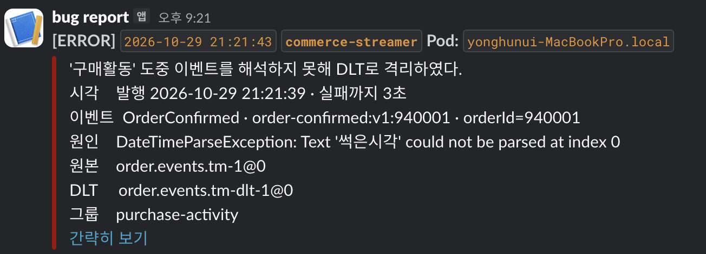

# 장애를 넣어 보고 남긴 것

전달 보장이 어디서 지켜지고 어디서 안 지켜지는지를 실제로 흔들어 확인한 기록이다.
숫자는 모두 로컬 1회 실행의 관찰값이며 성능 비교가 아니다.

## 구성

| 항목 | 값 |
|---|---|
| 브로커 | `kafka-1/2/3` · KRaft · 세 노드 모두 컨트롤러 |
| 토픽 | `order.events.v1` · 파티션 3 · RF 3 · `min.insync.replicas=2` |
| 프로듀서 | `commerce-api` · 결제 성공 시 `PaymentSettlement.succeed()` 에서 발행 |
| 컨슈머 | `commerce-streamer` · `purchase-activity`(DB 저장) · `stock-tracking`(로그) |
| ack | 수동. DB 커밋 뒤 `acknowledge()` |
| 부하 | k6 · 주문 생성 → 확정(POINT) |

## 하나씩에서 셋씩으로 바꾸자 달라진 것

장애를 넣기 전에, 구성을 늘린 것만으로 달라진 결과들이다.

### 키가 파티션을 고르는 것이 처음으로 보였다

```
파티션 1   전부 p0        hash(key) % 1 은 항상 0
파티션 3   p0 +4,299      p1 +4,358     p2 +4,419     합 13,076 = 확정 성공 수
```

`hash(orderId) % 3` 이 실제로 도는 것을 처음 확인했다. 파티션이 하나일 때는 키를 무엇으로
두든 결과가 같아 키 설계를 검증할 방법이 없었다.

### 컨슈머가 처음으로 셋 다 일했다

```
파티션 1 · concurrency 3   p0 → 컨슈머0,  나머지 둘은 partitions assigned: []
파티션 3 · concurrency 3   p0 → 컨슈머0,  p1 → 컨슈머1,  p2 → 컨슈머2
```

`concurrency 3` 은 처음부터 `KafkaConsumer` 를 3개 만들고 있었다. 파티션이 하나라 둘이
놀았을 뿐이다. 프로세스는 하나인데 그룹 멤버는 3명이며, 브로커는 서버 3대와 구분하지 않는다.

컨슈머를 6명으로 늘려도 (streamer 2대) 일하는 수는 3명 그대로다. 나머지 3명은
`#PARTITIONS 0` 으로 남는다. 늘려도 처리 담당자가 늘지 않는 이유가 여기서 눈에 보인다.

### 따라잡기가 병렬이 됐다

```
파티션 1   lag 28,602 → 0      12초    rows 가 계단식으로 증가
파티션 3   lag  9,139 → 0      12초    rows 가 3,937 → 13,076 으로 한 번에 점프
```

세 컨슈머가 각자의 파티션을 동시에 치운다.

### 복제가 생겨 리더 장애를 시험할 수 있게 됐다

```
브로커 1   p0 Leader 1  Isr 1              복제 없음. 장애를 만들 방법도 없음
브로커 3   p0 Leader 2  Isr 2,3,1          리더가 셋에 하나씩 흩어짐
           p1 Leader 3  Isr 3,1,2
           p2 Leader 1  Isr 1,2,3
```

브로커 1 은 p2 의 리더이자 p0·p1 의 팔로워다. "리더 브로커" 라는 것은 없고 리더는 파티션
마다 따로 뽑는 자리라는 것이 배치로 드러난다.

### 테스트가 먼저 깨졌다

구성을 늘리자 테스트 세 개가 깨졌다. 전부 원래 있던 가정이 드러난 것이다.

| 깨진 것 | 드러난 가정 |
|---|---|
| mockk 슬롯 캡처 | 리스너가 한 번만 호출된다 |
| bootstrap 주소 단언 | 브로커가 하나다 |
| 컨슈머 그룹 배정 대기 | 떠 있는 앱과 테스트가 파티션을 다투지 않는다 |

## 실험과 결과

### 1. PG 가 느릴 때 — 유실이 났는데 lag 은 0

`docker pause pg-simulator` 로 PG 를 멈추고 100 VU 를 30초 걸었다.

| 관찰 | 값 |
|---|---|
| 확정 실패(5xx) | 16,103 |
| `stock_reservation` RESERVED 로 남음 | 16,103 |
| `payment` PENDING 으로 남음 | 16,000 |
| 토픽 오프셋 증가 | **0** |
| 컨슈머 lag | **0** |

결제가 SUCCESS 로 가지 않았으므로 발행도 없다. 설계대로다. 문제는 **지표가 아무것도 말하지
않는다**는 점이다. lag 은 "들어온 것 중 안 읽은 양"이라 애초에 안 들어온 것을 셀 수 없다.
응답도 빨랐다(p50 45ms) — 5주차 서킷브레이커가 열려 PG 를 안 부르고 즉시 거절했기 때문이다.

서킷이 앱을 지킨 대가로 재고 16,103 건이 잠겼다. 예약에 만료가 없어 콜백이 오지 않으면
영원히 풀리지 않는다.

### 2. 컨슈머가 죽었을 때 — lag 이 보이고 전부 복구된다

부하 중 `commerce-streamer` 를 강제 종료했다가 다시 띄웠다.

```
죽어 있는 동안   p0 lag=2,995   p1 lag=3,062   p2 lag=3,082   consumer=-
재시작 +3s       총 lag 9,139   rows  3,937
재시작 +9s       총 lag 9,139   rows 13,076    세 컨슈머가 동시에 끝냄
재시작 +12s      총 lag     0   rows 13,076
```

유실 0, 중복 0. 커밋된 오프셋이 브로커에 있어 그 지점부터 이어 읽었다.
파티션이 3 이라 세 컨슈머가 병렬로 치웠다 — 파티션 1 일 때는 계단식으로 올라갔다.

### 3. 인스턴스 하나만 죽었을 때 — 살아남은 쪽도 멈춘다

streamer 를 2대 띄워 컨슈머 6명(파티션 3)을 만든 뒤 한 대만 죽였다.

```
정상      멤버 6   일하는 컨슈머 3   노는 컨슈머 3
t=19s     배정 파티션 0             ← 리밸런스. 살아남은 3명도 안 읽는다
t=30s     배정 파티션 0   lag 5,553
t=32s     배정 파티션 3             ← 약 13초 만에 재배정
t=38s     lag 8,219                   밀린 것과 새 것을 같이 받는 중
t=49s     lag 0
```

부분 장애인데 **그룹 전체가 13초 정지**했다. 리밸런스가 치명적인 이유가 이것이다.
배정은 프로세스 경계를 모른다 — 정상일 때 A 가 1개, B 가 2개를 들고 있었다.

유실 0, 중복 0 (19,272 = 19,272).

### 4. 컨슈머가 느릴 때 — lag 에 잘 안 보인다

`LOCK TABLES product_purchase_activity WRITE` 로 25초 동안 INSERT 를 막았다.

```
t=13s   lag 2,011   저장된 행 5,496
t=38s   lag 1,223   저장된 행 5,496   ← 25초 동안 한 행도 안 늘었다
t=40s   lag 8,029   저장된 행 10,228  ← 잠금 해제
t=45s   lag     0   저장된 행 18,257
```

막힌 구간의 lag 이 **오히려 낮게** 찍혔다. 컨슈머가 막히기 직전 폴링으로 받아둔 배치는
브로커 입장에서 아직 커밋되지 않았을 뿐이고, 생산은 계속되어 로그 끝이 늘어난다.
두 힘이 섞여 톱니에 묻힌다. 멈춘 것은 `저장된 행` 을 봐야 보였다.

### 5. 브로커 리더가 죽었을 때 — 리더가 넘어가고 안 샌다

부하 중 p0 의 리더인 `kafka-2` 를 정지했다.

```
전   p0 Leader 2  Isr 2,3,1    p1 Leader 3  Isr 3,1,2    p2 Leader 1  Isr 1,2,3
후   p0 Leader 3  Isr 3,1      p1 Leader 3  Isr 3,1      p2 Leader 1  Isr 1,3
```

리더가 2 → 3 으로 넘어갔고 ISR 이 3 에서 2 로 줄었다. 발행 실패 로그 0건, 유실 0.
멱등 프로듀서가 기본이라 `acks=all` 로 동작했고, 새 리더가 ISR 에서 뽑혀 모든 메시지를
이미 갖고 있었다.

RF 1 이던 어제까지는 "검증되지 않은 무사고" 였고, 이번은 **실제로 버틴 것**이다.

브로커를 다시 올리면 ISR 은 3 으로 돌아오지만 **리더는 돌아오지 않는다.**

```
복구 후   p0 Leader 3  Isr 3,1,2    p1 Leader 3  Isr 3,1,2    p2 Leader 1  Isr 1,3,2
```

kafka-3 이 리더 2개, kafka-1 이 1개, kafka-2 는 0개다. 장애가 지나간 자리에 쏠림이 남는다.
되돌리려면 preferred leader election 을 따로 돌려야 한다.

### 6. 브로커가 통째로 죽었을 때 — 120초가 경계였다

발행을 커밋 후(`@TransactionalEventListener(AFTER_COMMIT)`)로 옮긴 뒤, 부하 중에 브로커
3대를 전부 정지했다. 정지 시간만 달리해 두 번 쟀다.

| | 45초 정지 | 150초 정지 |
|---|---|---|
| 확정 성공 | 20,980 | 16,803 |
| 발행 증가 | **20,980** | **0** |
| DB 행 증가 | 20,980 | **0** |
| 발행 실패 로그 | 0 | **16,803** |
| confirm p50 | 45.9ms | 43.1ms |
| 5xx | 0 | 0 |

45초일 때는 **한 건도 새지 않았다.** `send()` 가 비동기라 호출은 버퍼에 넣고 바로 돌아오고,
프로듀서가 `delivery.timeout.ms=120000` 동안 들고 재시도한다. 브로커가 돌아오자 밀린 것을
전부 보냈다.

150초일 때는 **16,803 건 전부 사라졌다.** 버퍼가 만료되어 폐기됐고, 브로커를 다시 올려도
복구되지 않는다. 프로듀서 버퍼는 비워졌고 재시도는 끝났으며 메시지는 어디에도 없다.
되감을 로그조차 없다.

경계는 `delivery.timeout.ms` 하나다. 그 안에 복구하면 아무 일 없고 넘기면 전부 잃는다.
중간이 없다.

주문은 멀쩡히 남아 있다. CONFIRMED 주문 16,803 건과 차감된 재고가 DB 에 있고 구매 활동만
없다. 그리고 **서빙은 끝까지 정상이었다** — p50 43ms, 5xx 0 건. 발행 실패를 삼키고 있어
호출한 쪽은 아무것도 몰랐고 에러 로그 16,803 줄만 쌓였다.

이것이 다음 주 Outbox 가 푸는 문제다. 주문 커밋과 같은 트랜잭션에 메시지를 적어 두면
프로듀서 버퍼가 아니라 DB 에 남아 나중에 다시 보낼 수 있다.

누락 구간을 자연 장애로 만들기는 쉽지 않았다. 전송이 비동기이고 120초까지 버티기 때문에,
보통의 재시작·일시 장애로는 재현되지 않는다. 스펙이 "전송 호출 직전을 통제된 hook 에서
중단하거나 전송 실패를 주입" 하라고 쓴 이유가 여기 있다.

## 멱등을 넣고 다시 잰 100 VU

| 항목 | 값 |
|---|---|
| confirm 성공 | 12,109 |
| confirm 거절 (4xx) | 1,805 |
| 5xx | 0 |
| confirm p50 | 108.9ms |
| confirm p95 | 180.1ms |
| 발행 증가 | 12,109 |
| `product_purchase_activity` | 12,109 행 · distinct order 12,109 |
| `processed_order_confirmation` | 12,109 행 |
| 충돌 로그 | 0 |

네 숫자가 모두 같다. 유일 제약을 걸어도 정상 경로에서는 충돌이 나지 않는다. 운영 트래픽은
주문마다 `eventId` 가 다르기 때문이다.

### 테스트가 먼저 무한 루프를 보여줬다

멱등을 넣은 직후 streamer 테스트가 깨졌다. 로그에 같은 줄이 24번 찍혀 있었다.

```
Duplicate entry 'order-confirmed:v1:1' for key 'processed_order_confirmation.uk_processed_confirmation_event'
Duplicate entry 'order-confirmed:v1:2' for key ...
```

지운 재전달 테스트가 토픽에 남긴 메시지 두 건이 원인이다. 컨슈머가 충돌 예외를 던지면
`acknowledge()` 에 닿지 못하고, 오프셋이 그대로라 같은 배치를 다시 읽고 또 터진다.
그 사이 뒤 메시지는 하나도 처리되지 않아 다른 테스트가 30초를 기다리다 떨어졌다.

**독성 메시지 한 건이 파티션 전체를 막는다.** error handler 가 없으면 운영이 되지 않는다는
것을 부하가 아니라 테스트가 먼저 보여줬다.

## 실제로 난 중복

```
order_id=1, product_id=1  →  23 행
```

출처는 브로커 장애가 아니라 commerce-api 통합 테스트다. 테스트가 `truncateAllTables()`
로 주문 id 를 1부터 다시 쓰면서 **실제 브로커로 진짜 이벤트를 발행**하고, 그것을 컨슈머가
주워 담았다.

원인이 무엇이든 결과는 같다. **같은 구매가 23번 저장됐고 아무것도 막지 않았다.**
지금까지 "중복 0" 이 나온 것은 막아서가 아니라 중복이 올 일이 없어서였다.

중복이 오는 경로는 이미 여럿이다 — 테스트 메시지, 프로듀서 재전송, 컨슈머 재전달.
누계 테이블이었다면 더 나빴다. 행은 지울 수 있지만 더해진 숫자는 되돌릴 근거가 없다.

## 유실률이라는 숫자가 잘 맞지 않는다

측정한 모든 구간을 모으면 이렇다.

| 실험 | 확정 성공 | 저장된 행 | 차이 |
|---|---|---|---|
| 100 VU | 18,195 | 18,195 | 0 |
| 10 VU | 11,173 | 11,173 | 0 |
| 10 VU (재측정) | 8,386 | 8,386 | 0 |
| 컨슈머 죽임 (파티션 1) | 35,352 | 35,352 | 0 |
| 컨슈머 죽임 (2회차) | 27,979 | 27,979 | 0 |
| 컨슈머 죽임 (파티션 3) | 13,076 | 13,076 | 0 |
| 인스턴스 하나 죽임 | 19,272 | 19,272 | 0 |
| 테이블 잠금 25초 | 18,257 | 18,257 | 0 |
| 브로커 리더 죽임 | 16,041 | 16,041 | 0 |
| **합계** | **약 168,000** | | **0** |

표의 숫자는 실험마다 테이블을 비우고 잰 값이다. 지금 DB 에 16만 행이 있다는 뜻이 아니다.

카프카 경로의 유실률은 **0%** 다. 중복은 23건이지만 이 비율(0.014%)도 의미가 없다.
확률적으로 생긴 것이 아니라 특정 조건에서 한 번에 들어왔기 때문이다.

유실이 고르게 조금씩 나지 않는다. 평소에는 0 이다가 조건이 갖춰지면 뭉텅이로 난다.

| 상황 | 유실 |
|---|---|
| 정상 · 컨슈머 장애 · 브로커 장애 | 0% |
| PG 미확정 구간 | 그 구간 전부 (16,103 건) |
| 브로커 정지가 delivery.timeout 초과 | 그 구간 전부 (16,803 건) |
| 커밋 전 중단 | 그 배치 전부 — 아직 겪지 않음 |
| 보존 기간 초과 | 안 읽은 것 전부 — 아직 겪지 않음 |

평균을 내면 "거의 안 샌다" 가 되지만 그것은 안심할 근거가 못 된다. 유실률을 지표로 삼으면
0 이 계속 나오다가 어느 날 한 번에 틀어지는 것을 보게 된다.

### 누구 기준의 유실인가

위 0% 는 **카프카 기준**이다. 실험이 끝난 시점의 토픽과 DB 를 맞춰 보면 다르다.

```
토픽   16,149   (p0 5,446 · p1 5,345 · p2 5,358)
DB     16,066
lag         0
차이       83
```

83 건은 컨슈머가 떠 있지 않은 동안 발행된 메시지다. `auto.offset.reset=latest` 라 새로 뜬
컨슈머가 그 지점을 건너뛰었고, lag 은 0 이므로 **앞으로도 읽히지 않는다.**

카프카는 할 일을 다 했다. 메시지를 받아 지금도 전부 들고 있다. 그러나 업무 기준으로는 그
83 건의 구매가 기록되지 않았다. 로그에 남아 있다는 것은 **복구할 수 있다**는 뜻이지
**기록됐다**는 뜻이 아니다.

원인이 평범하다는 점이 중요하다. 사고도 장애도 아니고 배포·재시작으로 컨슈머가 잠시
없었을 뿐이다. `earliest` 로 바꾸면 이 구간은 사라지지만, 새 그룹이 뜰 때마다 처음부터
전부 읽는 문제가 대신 생긴다.

오늘 본 유실 셋은 성격이 다르다.

| | 메시지 | DB | 되돌릴 수 있나 |
|---|---|---|---|
| PG 느림 16,103 | 안 만들어짐 | 없음 | 못 함 |
| 저장 코드 없던 구간 72,238 | 있음 | 없음 | 됨 (오프셋 되감기) |
| 컨슈머 없던 구간 83 | 있음 | 없음 | 됨 (오프셋 되감기) |

아래 둘은 같은 모양이다 — 메시지는 있는데 아무도 읽지 않았고 오프셋만 넘어갔다.
그리고 되감으면 이미 저장된 것까지 다시 들어온다. 멱등이 없으면 복구가 곧 중복이다.

## 지표가 보는 것과 못 보는 것

| 장애 | lag 으로 보이나 | 실제 피해 |
|---|---|---|
| PG 느림 | **안 보임** (0) | 재고 16,103 잠김, 발행 0 |
| 컨슈머 전체 죽음 | 보임 (단조 증가) | 지연만. 전부 복구 |
| 인스턴스 하나 죽음 | 보임 (13초 정지) | 지연만. 전부 복구 |
| 컨슈머 느림 | **잘 안 보임** (톱니에 묻힘) | 지연만. 전부 복구 |
| 브로커 리더 죽음 | 안 보임 (영향 없음) | 없음 |
| 브로커 전체 45초 | 안 보임 | 없음. 버퍼가 버팀 |
| 브로커 전체 150초 | **안 보임** | **16,803 건 영구 유실** |

lag 이 또렷한 쪽이 오히려 안전하다. 로그에 남아 있으니 되살리면 따라잡는다.
위험한 것은 lag 이 조용한 쪽이다.

## 구성이 단순하면 무사고가 증거가 되지 못한다

브로커 1대 · 파티션 1개로 돌 때도 유실 0 · 중복 0 이었다. 그것은 방어가 동작한 증거가
아니라 **사고를 낼 방법이 없었던 것**이다.

- 복제본이 없으니 복제 장애를 만들 수 없고, 못 만드니 나지 않고, 나지 않으니 무사고였다.
- 파티션이 하나라 컨슈머 그룹 실험이 성립하지 않았다. 셋 중 하나만 일하고 둘은 노는 상태를
  "배정" 이라고 부를 수 없다.
- 파티션이 하나라 테스트를 돌릴 때마다 streamer 를 내려야 했다. 그래서 통합 테스트가 실제
  토픽에 발행한 이벤트를 아무도 읽지 않았고, 멱등 방어가 없다는 사실이 드러나지 않았다.

구성을 늘리자 가려져 있던 것들이 한꺼번에 나왔다. 파티션을 3 으로 올리니 리스너가 여러 번
호출되어 테스트의 mockk 슬롯 캡처가 깨졌고, 브로커를 3 으로 올리니 bootstrap 주소를 단언하던
테스트가 깨졌고, streamer 를 켠 채 테스트가 돌면서 중복 23행이 들어왔다. 전부 원래 있던
문제이고 구성이 단순해서 밟히지 않았을 뿐이다.

## 증명하지 못한 것

- **`acks=1` 의 유실.** 메시지가 리더 한 대에만 있는 상태를 만들려면 팔로워 둘이 ISR 에서
  빠져야 하는데, 세 노드가 모두 컨트롤러라 두 대를 내리면 쿼럼(2/3)이 깨진다. 한 번에 한
  대만 내릴 수 있다. 재현하려면 노드를 더 두거나 컨트롤러를 분리해야 한다.
- **`min.insync.replicas` 위반.** 같은 이유로 ISR 을 2 미만으로 떨어뜨리지 못했다.
- **보존 기간 초과 삭제.** `retention.ms` 가 7일이라 이번 실험 길이로는 닿지 않는다.
- **DLT 가 쌓였을 때 누가 보는가.** 레코드는 보존되고 알림도 가지만, DLT 를 다시 흘려보내는
  경로는 만들지 않았다. 지금은 사람이 수동으로 꺼내야 한다.

## 배치를 버리고 record 리스너로 바꾼 뒤 잰 100 VU

error handler 를 붙이면서 `purchase-activity` 를 배치 리스너에서 record 리스너로 옮겼다.
한 건 실패에 3,000 건을 같이 재시도하는 것을 피하려는 것이다. 건당 처리로 바꿔도 부하를
따라잡는지 확인하려고 돌렸다.

### 조건

| 항목 | 값 |
|---|---|
| 프로듀서 | `commerce-api` @ `b14e216` + 작업 트리 · :8097 |
| 컨슈머 | `commerce-streamer` @ `b14e216` + 작업 트리 · :8093 |
| 부하 | 100 VU · 30초 · POINT 결제 |
| 리스너 | record 단위 · `concurrency=3` · `AckMode.MANUAL` |
| 재시도 | `ExponentialBackOff` 1s → 2s → 4s → 8s · 소진 시 컨테이너 중단 |
| 브로커 | 3대 KRaft · 파티션 3 · RF 3 · `min.insync.replicas=2` |

### 네 숫자가 모두 같았다

| 항목 | 값 |
|---|---|
| confirm 성공 | 9,146 |
| 발행 증가 (log-end) | 9,146 |
| `product_purchase_activity` 증가 | 9,146 행 |
| `processed_order_confirmation` 증가 | 9,146 행 |
| confirm 거절 (4xx) | 13 |
| 5xx | 0 |
| 중복 로그 | 0 |
| 재시도·중단 | 0 |

`distinct order_id` 도 행 수와 같다. 유실도 중복도 없다.

### lag

```
 t(s)   committed    log-end     lag
    6       60,842     60,842         0
    9       60,842     61,370       528
   13       60,842     62,178     1,336
   17       61,709     63,277     1,568
   21       62,882     64,107     1,225
   28       64,040     66,543     2,503   ← 최대
   35       67,493     69,049     1,556
   42       69,273     69,988       715
   45       69,988     69,988         0   ← 소진
```

최대 2,503 이고 유입이 끊긴 뒤 4초 안에 0 이 됐다. 건당 처리로 바꿔도 밀리지 않는다.

### record 리스너가 배치 가져오기를 없애지는 않는다

committed 가 여전히 계단으로 뛴다. t=6~13 구간은 아예 멈춰 있다.
`fetch.min.bytes=1MiB` · `fetch.max.wait.ms=5000` 을 두 팩토리가 공유하기 때문이다.

바뀐 것은 **리스너를 부르는 단위**뿐이다. 한 번 폴링에 최대 3,000 건을 여전히 같이
가져오고, `AckMode.MANUAL` 이라 ack 도 다음 폴링에 모아서 커밋된다. "record 리스너로
바꿨으니 한 건씩 오간다" 가 아니다. 재시도 범위가 배치에서 한 건으로 줄어든 것이다.

### 처리량은 이 측정으로 비교할 수 없다

| 측정 | confirm 성공 | 처리량 | p50 | p95 |
|---|---|---|---|---|
| 브로커 1 · 파티션 1 | 18,195 | 597/s | 74.9ms | 168.0ms |
| 브로커 3 · 멱등 추가 | 12,109 | — | 108.9ms | 180.1ms |
| 브로커 3 · record 리스너 | 9,146 | 292/s | 152.8ms | 319.1ms |

세 번에 걸쳐 절반 아래로 떨어졌다. 그러나 **이번 변경이 원인일 수 없다.** 바꾼 것은
컨슈머 쪽이고, 발행은 `send()` 가 비동기라 HTTP 응답을 기다리게 하지 않는다.

같이 변한 것이 너무 많다.

- 브로커가 1대에서 3대로 늘어 JVM 이 둘 더 떠 있다.
- `payment` 가 36만 행이고 `order`·`stock_reservation` 도 그만큼 커졌다. 인덱스 쓰기가 비싸진다.
- 측정마다 머신의 JVM 수와 MySQL 커넥션 사정이 달랐다. 워밍업도 주지 않았다.
- 앞선 측정에서 같은 빌드가 501 ~ 678/s 로 35% 흔들렸다. 그 밴드부터 이미 신뢰할 수 없다.

갈라 재려면 컨슈머를 끈 채와 켠 채를 교대로, 같은 DB 크기에서 재야 한다. 하지 않았다.

### 이 측정이 증명하지 않는 것

**재시도를 한 번도 타지 않았다.** 실패가 0 이라 백오프 1·2·4·8초도, 소진 뒤 컨테이너
중단도 로그에 없다. 에러 핸들러가 붙어 있다는 것만 확인했고 동작은 단위 테스트
(`RetryThenStopErrorHandlerTest`) 로만 고정돼 있다. 장애를 주입해서 봐야 한다.

## 멈추기를 버리고 DLT 로 간 기록

재시도를 다 쓴 레코드를 어떻게 할지 두 번 바꿨다. 바꾼 순서가 그대로 이유다.

| | 동작 | 버린 이유 |
|---|---|---|
| 1. 충돌 던지기 | 중복마다 예외 | 재전달마다 컨슈머가 섰다 |
| 2. 멈추기 | 오프셋 두고 컨테이너 정지 | 파티션 하나 때문에 셋이 섰다 |
| 3. DLT | 레코드 격리 후 계속 | — |

### 1·2·4·8초가 벽시계로는 47초였다

독성 레코드를 버리는 토픽에 넣고 쟀다.

```
02:21:45  주입
02:21:50  재시도 1   (+5초)
02:22:01  재시도 2   (+11초)
02:22:13  재시도 3   (+12초)
02:22:27  재시도 4   (+14초)
02:22:32  DLT 로 보냈다 → 슬랙
```

설정한 백오프 합은 15초인데 47초가 걸렸다. 재배달마다 `fetch.max.wait.ms=5000` 을 기다리기
때문이다. **백오프보다 fetch 설정이 알림 지연을 더 크게 지배한다.** 급하면 백오프를 줄이는
것이 아니라 fetch 대기를 줄여야 한다.

### 멈추기는 파티션 하나로 셋을 세웠다

`CommonContainerStoppingErrorHandler` 가 멈추는 것은 자식이 아니라 **부모 컨테이너**다.
파티션 2 의 레코드 하나 때문에 로그에 이렇게 찍혔다.

```
purchase-activity: Consumer stopped   [ntainer#1-0]
purchase-activity: Consumer stopped   [ntainer#1-1]
purchase-activity: Consumer stopped   [ntainer#1-2]
```

멀쩡한 파티션 둘이 같이 섰다. 유실은 막았지만 가용성으로 치르는 값이 한 파티션이 아니라
그룹 전체였다.

### DLT 로 바꾼 뒤

같은 키로 독성 레코드와 정상 레코드를 연달아 넣었다. 같은 키라 같은 파티션으로 간다.

| 확인 | 결과 |
|---|---|
| DLT 레코드 | 1건. 키 보존 |
| 페이로드 | 원본 JSON 그대로 |
| 진단 헤더 | `exception-fqcn` · `cause-fqcn` · `message` · `stacktrace` |
| 뒤 레코드 | 정상 저장 |
| 컨슈머 | 살아 있음. lag 0 |
| `Consumer stopped` | 없음 |

### 걸린 것 셋

**기본 템플릿으로는 페이로드가 망가진다.** 프로듀서가 `JsonSerializer` 라 원본 `ByteArray`
를 base64 문자열로 한 번 더 감싼다. DLT 용으로 `ByteArraySerializer` 템플릿을 따로 둬야
원본이 남는다.

**`MANUAL` 로는 오프셋이 안 남는다.** 앞서 record 리스너로 옮길 때 "에러 핸들러 직전에
`processCommits()` 가 돌므로 `MANUAL` 로도 멈춘 지점이 정확하다" 고 적었는데, 그것은 **ack
된** 오프셋만 커밋한다. DLT 로 보낸 레코드는 리스너를 다시 타지 않아 ack 가 없다. 그대로
두면 재시작할 때 같은 레코드가 DLT 에 두 번 들어간다. `commitRecovered` 를 켜려면
`MANUAL_IMMEDIATE` 여야 한다는 것이 이 설정의 제약이다.

**접미사는 `.DLT` 가 아니라 `-dlt` 다.** spring-kafka 3.3 의 기본값이고, 테스트가 먼저
잡았다. `NewTopic` 을 직접 만들어 둬야 한다. 기본 resolver 가 원본과 **같은 파티션 번호**
로 보내므로, 자동 생성으로 파티션이 1 개가 되면 1·2 번 파티션의 레코드는 보낼 곳이 없다.

### 알림은 로그 한 줄로 좁혔다

슬랙은 레포에 이미 있던 logback appender 를 쓴다. 처음 나간 메시지는 6,139 바이트였다.
`PatternLayout` 이 스택트레이스를 자동으로 붙이고, Spring 기본 recoverer 가 찍는 로그에는
`group` 도 `key` 도 없었다.

recoverer 를 직접 주고 `%nopex` 를 붙여 445 바이트로 줄였다.

```
재시도를 모두 쓰고 DLT 로 보냈다. group=purchase-activity topic=order.events.v1
partition=0 offset=0 key=99001 cause=DateTimeParseException: Text '썩은시각' ...
```

복구에 필요한 것이 한 줄에 있다. 스택트레이스는 콘솔에만 남는다.

`root` 가 아니라 `com.loopers` 에 붙였다. Hibernate·Kafka 내부 ERROR 까지 채널로 보내면
정작 봐야 할 것이 묻힌다. 프로필을 켜지 않으면 appender 가 붙지 않아 테스트는 영향이 없다.

## 같은 실패가 되돌릴 수 있는 것과 없는 것으로 갈렸다

스키마를 깨서 저장을 실패시키고, 한쪽은 도중에 되돌리고 한쪽은 그대로 뒀다. `quantity` 컬럼
이름을 바꾸면 insert 가 깨진다.

| | 되돌린 경우 | 그대로 둔 경우 |
|---|---|---|
| 장애 길이 | 23초 | 끝까지 |
| 배달 횟수 | 4회 (3실패 + 1성공) | **5회 전부 실패** |
| 걸린 시간 | 31초 | 45초 |
| DLT | 없음 | 1건 |
| 슬랙 | 없음 | 발송 |
| 저장 | 1행 | 0행 |
| 도장 | 1건 | 0건 |

**같은 코드, 같은 원인(`Unknown column 'quantity'`), 정반대 결과.** 차이는 23초 만에 고쳤는지
뿐이다. 핸들러는 스키마 버그와 네트워크 끊김을 구분하지 못한다. **경계는 원인이 아니라 시간이다.**

예산은 배달 5회 · 벽시계 45초다. 그보다 짧은 장애는 지수 백오프가 살려내고, 길면 DLT 로 간다.
지수로 바꾼 것이 실제로 레코드를 살려낸 것은 이때가 처음이었다.

### ddl-auto 가 깨진 스키마를 되살렸다

두 번째 실험에서 깨진 상태로 앱을 재기동했더니 `local` 의 `ddl-auto: update` 가 `quantity` 를
**새로 만들었다.** 컬럼이 둘로 갈려서 실제 값은 `quantity_broken` 에, 새 컬럼은 21,256 행이 전부
0 이었다. 가짜를 drop 하고 원래 것을 rename 해서 복구했다.

실험 순서가 중요하다. **앱을 먼저 띄우고 그 다음에 스키마를 깨야 한다.**

## 계약을 비틀어 조용한 실패를 찾았다

`schemaVersion` 을 바꿔가며 여덟 가지로 때렸다. 토픽을 따로 만들어 돌렸다.

| | 넣은 것 | 도장 | 활동행 | 결과 |
|---|---|---|---|---|
| A | `schemaVersion=2`, 모양 동일 | 1 | 1 | 조용히 처리 |
| **B** | `items` 키 없음 | **1** | **0** | **조용한 유실** |
| C | `couponId`·`discount` 추가 | 1 | 1 | 조용히 버려짐 |
| D | `items` 를 배열 아닌 객체로 | 1 | 1 | 조용히 배열로 감싸짐 |
| E | `quantity` 를 `"5"` 문자열로 | 1 | q5 | 조용히 숫자로 변환 |
| **F** | `orderId` 키 없음 | 1 | 1 | **`order_id=0` 으로 저장** |
| G | `confirmedAt` 키 없음 | 0 | 0 | DLT + 알림 |
| H | `schemaVersion` 키 없음 | 1 | 1 | 0 으로 처리 |

**여덟 중 일곱이 소리 없이 통과했고 그 중 둘은 데이터가 틀렸다.** 큰 소리가 난 것은 G 하나다.

**`schemaVersion` 을 검사하는 코드는 어디에도 없다.** 2 로 올려도, 아예 빼도 같이 처리된다.
필드로만 존재하고 아무도 보지 않는다.

### B 는 멱등이 복구를 막았다

도장만 찍히고 활동이 0 행인 상태에서, 버그를 고쳐 **같은 `eventId` 로 다시 발행**했다.

```
이미 반영한 이벤트라 넘어간다. eventId=order-confirmed:v1:910002
활동 행: 여전히 0
```

도장이 먼저 타버려서 올바른 이벤트가 중복으로 간주됐다. **트랜잭션은 이것을 막지 못한다** —
예외가 나지 않았으니 롤백할 것이 없었다. 트랜잭션이 막아주는 것은 "실패한 실패" 이고,
이것은 **"성공했다고 믿은 실패"** 다.

### 원인은 계약 두 줄에 있었다

```kotlin
val items: List<Item> = emptyList()   // 필드가 없으면 "0개 구매" 로 읽는다
val orderId: Long = 0                 // 없으면 0번 주문
```

기본값이 **"없음" 과 "비어 있음" 을 구분하지 못하게** 만든다. 거기에 Jackson 이
`FAIL_ON_UNKNOWN_PROPERTIES` 꺼짐 · `ACCEPT_SINGLE_VALUE_AS_ARRAY` 켜짐이라 관용이 한 겹 더 쌓인다.

기본값을 모두 지우고 같은 페이로드를 다시 넣었다.

| | 전 | 후 |
|---|---|---|
| B `items` 없음 | 도장 1 · 활동 0 · 조용 | **DLT** · `MissingKotlinParameterException` |
| F `orderId` 없음 | `order_id=0` 저장 · 조용 | **DLT** · `Missing required creator property 'orderId'` |
| H `schemaVersion` 없음 | 0 으로 처리 · 조용 | **DLT** |
| A 정상 | 저장 | 저장 |

가장 중요한 변화는 **도장이 찍히지 않는다**는 것이다. 파싱 단계에서 거부되므로 DLT 에서 꺼내
고쳐 넣으면 그대로 들어간다. 복구 불가에서 **복구 가능으로 바뀌었다.**

C·D·E 는 여전히 조용하다. 누락은 막았지만 **"잘못된 모양" 은 통과한다.** 불변식 검사가 따로 필요하다.

## 파싱 실패에 45초를 쓰고 있었다

기본값을 지우자 파싱 실패가 늘었는데, 건당 재시도 4회에 45초를 쓰고 있었다. 파싱은 재시도해도
절대 성공하지 않는다. `addNotRetryableExceptions` 로 두 개를 등록했다.

```
전   파싱 실패 → 재시도 4회 → 45초 후 DLT
후   파싱 실패 → 재시도 0회 → 3초 후 DLT
```

깨진 레코드 3건(썩은 날짜 · 깨진 바이트 · `items` 누락)을 넣었더니 `Record in retry` 로그가
**0건**이고 13초 안에 셋 다 격리됐다.

`IllegalArgumentException` 은 일부러 등록하지 않았다. 분류기가 `setTraverseCauses(true)` 라
원인 체인을 타고 올라가는데, IAE 는 너무 흔한 상위 타입이다. 재시도로 살릴 수 있는 일시 장애가
체인 어딘가에 IAE 를 품고 있으면 즉시 DLT 로 버려진다. **살릴 수 있는 것을 못 살리는 쪽이 더 나쁘다.**

## 테스트가 네 번 깨진 진짜 이유

통합 테스트가 "컨슈머 그룹이 파티션을 모두 배정받지 못했다" 로 네 번 깨졌다. 세 번은
`session.timeout.ms=60000` 때문이라고 진단했고 재시도하면 통과했으므로 그렇게 믿었다.
**틀린 진단이었다.**

로그를 보니 배정은 6개가 다 됐는데 같은 그룹에 **멤버가 6개** 들어가 리밸런스가 반복되고 있었다.
Spring 컨텍스트가 둘이었다.

```kotlin
@TestPropertySource(properties = ["spring.kafka.listener.auto-startup=false"])
```

이 설정이 **아무 일도 하지 않고 있었다.** 그 속성은 Spring Boot 기본 팩토리만 읽는다. 우리는
`KafkaConfig` 에 커스텀 팩토리를 만들어 쓰면서 `autoStartup` 을 읽은 적이 없다. 리스너가 꺼지지
않고 떠서 두 컨텍스트가 같은 그룹을 다퉜고, 테스트 실행 순서에 따라 통과하거나 깨졌다.

```kotlin
setAutoStartup(kafkaProperties.listener.isAutoStartup)
```

**재시도해서 통과한 것을 근거로 삼은 것이 문제였다.** 깨짐이 재현되지 않는다는 것은 원인을
찾았다는 뜻이 아니다.

## 알림이 읽을 수 있게 되기까지

| | 크기 | 무엇이 문제였나 |
|---|---|---|
| 처음 | 6,139 B | Spring 기본 recoverer 로그 + 스택트레이스 전체 |
| recoverer 교체 + `%nopex` | 445 B | Trace ID 가 빈 백틱으로 남아 메시지와 붙어 보였다 |
| 패턴 정리 | 404 B | 터진 곳이 streamer 인데 `commerce-api` 라고 말했다 |
| 이름 수정 · 시각 추가 | 460 B | — |

최종 모양.

```
*[ERROR]* `2026-10-29 21:21:43` *`commerce-streamer`* *Pod:* `...`
'구매활동' 도중 이벤트를 해석하지 못해 DLT로 격리하였다.
시각    발행 2026-10-29 21:21:39 · 실패까지 3초
이벤트  OrderConfirmed · order-confirmed:v1:940001 · orderId=940001
원인    DateTimeParseException: Text '썩은시각' could not be parsed at index 0
원본    order.events.tm-1@0
DLT     order.events.tm-dlt-1@0
그룹    purchase-activity
```

실제로 채널에 뜬 모습.



첫 줄은 **무엇을 하던 중**이었고 **어느 단계**에서 깨졌는지 말한다. 해석 실패면 재투입해도
또 터지니 계약을 봐야 하고, 저장 실패면 고치고 재투입하면 되니 컨슈머를 봐야 한다. 채널에서
제일 먼저 갈라져야 하는 지점이다.

시각이 둘인 이유는 지연이 필요해서다. "3초" 면 지금 난 사고고 "6시간" 이면 재처리 중이거나
lag 이 쌓인 상태다. 같은 알림이라도 대응이 다르다.

`spring.application.name` 이 `commerce-api` 였던 것은 템플릿 복사 버그다. **알림의 존재 이유가
"어디를 봐야 하는지" 인데 틀린 데를 가리키고 있었다.**

## 전달 보장은 구간마다 다르다

| 구간 | 의미 |
|---|---|
| 발행 (api → 브로커) | at-most-once — `send()` 실패를 로그만 찍고 넘긴다 |
| 소비 (브로커 → DB) | at-least-once — 저장 성공 후 `acknowledge()` |
| DB 효과 | effectively-once — `event_id` 유일 제약이 중복을 흡수 |
| DLT 로 간 레코드 | 적용 안 됨 — 오프셋을 커밋하므로 보관만 된다 |

카프카가 말하는 exactly-once(트랜잭셔널 프로듀서 + `read_committed` + 오프셋을 트랜잭션에 묶기)는
아니다. at-least-once + 멱등 싱크이고, 히스토리성 데이터에는 이쪽이 맞다 — 중복은 흡수할 수 있고
유실은 되돌릴 근거가 없다.

**effectively-once 가 트랜잭션 하나에 매달려 있다.** 도장과 활동이 갈리면 재시도 1 에서 도장만
커밋되고 재시도 2 가 유일 제약에 걸려 스킵된다. 중복 무시와 재시도가 겹쳐 at-least-once 가
유실로 뒤집힌다. 5번 실패해도 도장이 0건이던 것이 이것을 막고 있다는 증거였다.

## 아직 조용한 것과 아직 못 한 것

- **DLT 가 한 통이다.** 재투입해도 되는 것(저장 실패)과 고쳐야 하는 것(해석 실패)이 섞여 있어
  꺼내는 사람이 하나씩 열어봐야 한다. 분류는 이미 있으므로 라우팅만 붙이면 된다.
- **`schemaVersion` 을 검사하지 않는다.**
- **잘못된 모양은 통과한다.** 모르는 필드 무시 · 객체를 배열로 감싸기 · 문자열을 숫자로 변환.
- **DLT 재투입 경로가 없다.** 사람이 수동으로 꺼내야 한다.
- **`session.timeout.ms=60000`.** 재배포마다 최대 1분 소비 공백. 실측 42초.

## 커밋 안 된 창을 눈으로 봤다

수동 커밋이 중복을 만든다는 것을 재현했다. 5,000건을 넣고 처리 도중 `kill -9` 로 끊었다.

```
kill 시점
  저장된 것   1,567
  커밋된 것   1,564      (p0 522 · p1 520 · p2 522)
  차이           3       ← 저장은 끝났는데 커밋 전이던 구간

재시작 후
  "이미 반영한 이벤트라 넘어간다"  3건
  order-confirmed:v1:501486 · 501597 · 501624

최종
  저장 5,000건 · 고유 주문 5,000 · 중복 행 0
```

**창의 크기 3건과 재배달 3건이 정확히 같다.** 저장과 커밋이 서로 다른 시스템에 대한 두 번의
쓰기라 그 사이가 창이 되고, 거기서 죽으면 그만큼 다시 온다. 멱등이 그것을 받아냈다.

창이 3건뿐인 것은 `AckMode` 가 `MANUAL_IMMEDIATE` 이기 때문이다. 한 건 저장할 때마다 바로
커밋하므로 파티션당 1건 안팎이 전부다. `MANUAL` 이면 ack 를 모아뒀다가 다음 `poll` 에
커밋하므로 창이 그 사이에 처리한 전부가 된다. `max.poll.records` 가 3,000 이니 최악의 경우
3,000건이다. **AckMode 가 중복의 크기를 정한다.** 그쪽은 아직 재지 않았다.

## 파티션 2개에 컨슈머를 1→2→3 으로 늘려봤다

파티션 2개짜리 토픽을 따로 만들고, `concurrency=1` 인 인스턴스를 하나씩 올렸다. 같은 그룹이다.

| 컨슈머 | partition 0 | partition 1 | 멤버 |
|---|---|---|---|
| A 하나 | A | A | 1 |
| A · B | A | B | 2 |
| A · B · C | A | B | **3** |

**셋째는 `partitions assigned: []` 를 받았다.** 멤버는 3인데 배정은 2뿐이다. 200건을 넣고
확인하니 A 가 99건, B 가 101건을 처리했고 C 는 하나도 처리하지 않았다.

**노는 컨슈머는 낭비가 아니라 대기다.** B 를 죽였더니 리밸런스가 일어나고 C 가 partition 1 을
그대로 받았다. 저장은 200건 전부 들어갔다.

```
B 종료 →  partition 0 → A
          partition 1 → C      멤버 2
```

**파티션 수가 병렬성의 상한이다.** 컨슈머를 아무리 늘려도 파티션보다 많은 수는 일하지 못한다.
반대로 파티션을 늘리면 컨슈머를 늘릴 수 있는 여지가 생긴다. 앞서 파티션 1개로 돌 때 컨슈머 셋
중 하나만 일하던 것이 이 그림이었다.

### 설정이 또 안 먹고 있었다

이 실험을 하려고 `spring.kafka.listener.concurrency` 를 줬더니 듣지 않았다. 커스텀 팩토리가
`setConcurrency(CONCURRENCY)` 로 상수를 박아 쓰고 있었다. `auto-startup` 과 같은 자리다.

오늘 같은 모양을 네 번 만났다.

| 적어둔 것 | 실제 |
|---|---|
| `spring.kafka.listener.auto-startup` | 안 먹음 → 테스트가 네 번 깨졌다 |
| `spring.kafka.listener.concurrency` | 안 먹음 → 상수 3 으로 고정돼 있었다 |
| `enable-auto-commit` (하이픈) | 안 먹음 → 프레임워크 기본값이 우연히 같았다 |
| `spring.kafka.listener.ack-mode` | 안 먹음 → 코드가 같은 값을 세팅해 결과가 맞다 |

**설정 파일을 읽어서는 알 수 없다.** 네 건 모두 실행 중인 클라이언트 설정을 찍어보고 나서야
드러났다. `acks` 와 멱등도 같은 방식으로 확인했다.

## 남아 있던 재현 코드 셋을 메웠다

스펙 체크리스트에서 "부분" 으로 남아 있던 것들이다. 기능은 있는데 **격리된 환경에서 재현하는
코드**가 없다는 점이 공통이었다.

### 통제된 hook 으로 전송을 막는다

누락 구간을 지금까지 브로커를 통째로 세워서 재현했다. 대량이고 수동이라 회귀로 쓸 수 없었다.

`spring.kafka.producer.bootstrap-servers` 를 따로 줄 수 있다는 점을 쓴다. 프로듀서만 닿지 않는
주소로 돌리고 컨슈머·어드민은 실제 브로커를 그대로 쓴다. `max.block.ms=500` 이라 `send` 가 그
자리에서 `TimeoutException` 을 내고 발행자가 그것을 삼킨다.

```
Topic order.events.unpublished not present in metadata after 500 ms
주문 이벤트 발행 실패. topic=order.events.unpublished type=OrderConfirmed orderId=1
```

**확인한 것은 둘이다.** 주문은 확정 상태로 남고 결제는 SUCCESS 이며 재고도 줄어든 채로 있다.
그리고 그 이벤트는 토픽에 없다 — 실제 브로커 주소로 컨슈머를 따로 띄워 end offset 을 셌다.

발행 실패 로그가 찍히는 것까지 확인했다. **시도조차 하지 않았다면 토픽이 비어 있는 것은
증거가 되지 못한다.**

### 같은 사실과 충돌을 가른다

중복으로 들어온 이벤트를 무조건 넘기고 있었다. 같은 이벤트가 다시 온 것과 **같은 `eventId` 로
다른 내용이 온 것**을 구분하지 못했다. 뒤쪽은 발행자나 계약이 깨진 신호인데 조용히 지나갔다.

이제 중복을 만나면 저장된 구매 활동과 들어온 명령을 비교한다.

| | 판정 |
|---|---|
| 구매자 · 확정 시각 · 품목 집합이 모두 같다 | 같은 사실 → 지금처럼 넘어간다 |
| 하나라도 다르다 | 충돌 → DLT |
| 품목 순서만 다르다 | 집합으로 비교하므로 같은 사실 |
| 같은 `eventId` 로 다른 주문 | 저장된 것이 없으므로 충돌 |

실제로 돌려 보니 같은 사실은 `이미 반영한 이벤트라 넘어간다` 로 지나갔고 DLT 는 0이었다.
수량만 2에서 99로 바꾼 것을 같은 `eventId` 로 보냈더니 DLT 로 갔고 **DB 는 2 그대로였다.**

### 알림이 증상을 가리키고 있었다

처음에는 충돌 예외에 원래 예외를 원인으로 달았다. 그랬더니 알림이 이렇게 나왔다.

```
원인  SQLIntegrityConstraintViolationException: Duplicate entry 'order-confirmed:v1:700001' ...
```

중복 키는 **증상**이다. 진단은 "같은 eventId 인데 내용이 다르다" 쪽인데, 알림이 원인 체인의
가장 깊은 곳을 보여주느라 묻혔다. 원인을 떼어내자 이렇게 바뀌었다.

```
원인  PurchaseConflictException: 같은 eventId 로 다른 구매 사실이 왔다. eventId=...
```

**예외에 원인을 다는 것이 늘 친절한 것은 아니다.** 알림이 가장 깊은 곳을 읽는 구조라면,
진단을 맨 바깥에 두어야 보인다.

### 아직 남은 것

충돌은 재시도해도 풀리지 않는데 재시도 불가로 등록하지 않았다. **44초를 쓰고 DLT 로 간다.**
등록하려면 `modules:kafka` 가 앱의 예외 타입을 알아야 해서 미뤘다.

