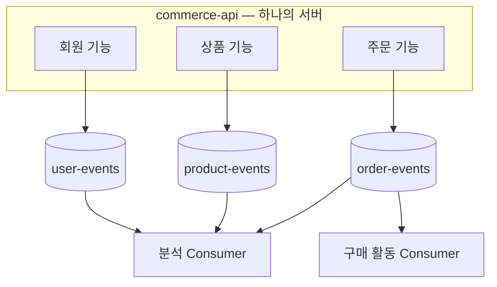

# 6주차 로컬 실행 준비

현재 주문 확정은 포인트 결제를 사용하며, 최초 확정 commit 후 `OrderConfirmed`를 Kafka로 발행한다. Streamer는 구매 활동을 저장한 뒤 ack한다. 중복·재시도·DLT·수동 복구는 [구매 활동 consumer](purchase-consumer.md)를 참고한다.

## 실행 순서

저장소 루트에서 필요한 인프라를 실행한다. 기존 MySQL 3306, Redis 6379·6380, Kafka 19092 포트를 다른 프로젝트가 사용하는지 먼저 확인한다.

```bash
docker compose -f docker/infra-compose.yml up -d --wait
```

3306이 이미 사용 중이면 명령 앞에 `MYSQL_PORT=13306`을 붙인다. API와 streamer 실행에도 같은 값을 지정한다. IDE에서는 각 실행 설정의 환경 변수에 추가한다.

```bash
MYSQL_PORT=13306 docker compose -f docker/infra-compose.yml up -d --wait
MYSQL_PORT=13306 ./gradlew :apps:commerce-api:bootRun
MYSQL_PORT=13306 ./gradlew :apps:commerce-streamer:bootRun
```

MySQL·Redis master/replica·Kafka·Kafka UI를 실행하고, `kafka-init`이 `user-events`, `product-events`, `order-events`, `order-events.DLT`를 준비한다. `kafka-init`의 `Exited (0)`은 초기화 성공 상태다. 이미 있는 topic은 삭제하거나 다시 만들지 않는다.

API와 streamer는 컨테이너에 포함하지 않는다. IDE에서 각 Application을 `local` 프로필로 실행하거나, 서로 다른 터미널에서 다음 명령을 실행한다.

```bash
./gradlew :apps:commerce-api:bootRun
```

```bash
./gradlew :apps:commerce-streamer:bootRun
```

| 대상 | 주소 |
| --- | --- |
| 고객·관리자 API | `http://127.0.0.1:8080` |
| API 상태 확인 | `http://127.0.0.1:8081/actuator/health` |
| Streamer | `http://127.0.0.1:8082` |
| Streamer 상태 확인 | `http://127.0.0.1:8083/actuator/health` |
| Kafka UI | `http://127.0.0.1:9099` |
| 호스트 앱의 Kafka 연결 | `localhost:19092` |
| Compose 내부의 Kafka 연결 | `kafka:9092` |

Compose 초기화 시 네 topic을 각각 partition 2개, replica 1개로 준비한다. Producer·consumer·admin은 같은 bootstrap address를 사용한다. 다른 broker를 쓰려면 두 앱에 동일한 `BOOTSTRAP_SERVERS`를 지정하고 해당 broker에 topic을 준비한다.

두 앱의 로컬 JPA 설정은 `update`다. 앱 재시작으로 기존 테이블을 다시 만들지 않는다. 테스트 프로필은 기존 `create` 설정과 격리된 DB를 사용한다.

상태 확인과 종료는 다음 명령을 사용한다. `down`은 데이터 볼륨을 삭제하지 않는다.

```bash
docker compose -f docker/infra-compose.yml ps -a
docker compose -f docker/infra-compose.yml down
```

## Topic별 이벤트와 구독



| Topic | 이벤트 예시 | 구독 대상 |
| --- | --- | --- |
| `user-events` | 회원가입 시도 `UserSignUpAttempted`, 회원가입 완료 `UserSignedUp` | 분석 consumer, group `analytics` |
| `product-events` | 상품 상세 조회 `ProductDetailQueried`, 상품 목록 조회 `ProductListQueried` | 분석 consumer, group `analytics` |
| `order-events` | 결제 시도 `PaymentAttempted`, 결제 완료 `PaymentSucceeded`, 주문 확정 `OrderConfirmed` | 분석 consumer와 구매 활동 consumer, 서로 다른 group |

이벤트 종류는 해당 도메인의 enum에서 관리한다. 각 enum의 `TOPIC`은 전송할 topic이고, JSON의 `eventType`에는 `OrderConfirmed` 같은 `eventName` 값이 들어간다. 주문·결제의 현재 상태를 나타내는 status와는 구분한다.

| 도메인 | 이벤트 enum | Topic |
| --- | --- | --- |
| 회원 | [`UserEventType`](../../apps/commerce-api/src/main/kotlin/com/loopers/user/domain/event/UserEventType.kt) | `user-events` |
| 상품 | [`ProductEventType`](../../apps/commerce-api/src/main/kotlin/com/loopers/product/domain/event/ProductEventType.kt) | `product-events` |
| 주문 | [`OrderEventType`](../../apps/commerce-api/src/main/kotlin/com/loopers/order/domain/event/OrderEventType.kt) | `order-events` |

분석 consumer는 향후 세 topic을 구독할 대상이며 아직 구현하지 않았다. 구매 활동 consumer는 `order-events` 중 `OrderConfirmed`만 처리하고, 분석 consumer와 서로 다른 group을 사용한다.

회원가입 이벤트 발행 TODO는 `UserKafkaEventPublisher.publishSignedUp` 본문에 두었다. 이 메서드는 미구현 스텁이며, 호출하면 `NotImplementedError`가 발생한다. 회원가입 유스케이스와 기존 요청 흐름에는 아직 연결하지 않았다.

상품은 `ProductFacade.get`의 조회 성공 뒤에 발행 연결 TODO를 표시했다. 상품 상세 API 조회 성공은 실제 화면 노출과 구분한다.

## 주문 확정 이벤트

`OrderFacade.confirm`은 확정 처리 중 저장된 주문과 품목으로 메시지를 구성해 Spring 이벤트로 전달한다. `OrderKafkaEventPublisher`는 `AFTER_COMMIT`에 실행되어 `order-events`로 전송한다. Kafka key는 주문 ID의 문자열이다. rollback되거나 이미 확정된 주문을 재요청하면 새 메시지를 발행하지 않는다.

```json
{
  "eventType": "OrderConfirmed",
  "schemaVersion": 1,
  "eventId": "order-confirmed:v1:42",
  "orderId": 42,
  "confirmedAt": "2026-10-27T01:02:03.123456Z",
  "items": [
    {"productId": 7, "quantity": 2},
    {"productId": 8, "quantity": 1}
  ]
}
```

`eventId`는 버전과 주문 ID에서 고정적으로 만든다. `confirmedAt`은 최초 확정 시각이며 DB의 마이크로초 정밀도에 맞춰 저장한다. 품목은 같은 상품의 주문 수량을 합산하고 상품 ID순으로 정렬한다. `quantity`는 구매한 수량이며 주문 후 남은 재고가 아니다. 현재 상품 조회나 재고 값으로 메시지를 다시 구성하지 않는다.

전송 성공은 실제 topic·partition·offset과 함께 기록하고, 동기 호출 오류와 비동기 전송 실패는 eventId·orderId를 포함해 오류 로그로 남긴다. 전송 실패로 이미 확정된 주문·재고·포인트를 되돌리지 않는다. Producer의 metadata·buffer 대기는 `max.block.ms=5000`으로 제한한다.

DB commit과 Kafka 기록은 원자적이지 않다. commit 후 프로세스 종료나 전송 실패로 이벤트가 누락될 수 있으며, 현재는 Outbox·자동 복구를 구현하지 않았다. 주문 확정 응답은 주문 DB 결과를 의미하고 Kafka 전달 완료를 보장하지 않는다.

## 적용한 설정

| 대상 | 값 | 동작 |
| --- | --- | --- |
| Producer | `acks=all`, `enable.idempotence=true` | broker 확인과 producer 전송 재시도 중복 방지 사용 |
| 전송 형식 | String key, JSON value | 구매 활동 consumer는 JSON을 DTO로 자동 변환한 뒤 검증 |
| Consumer | `enable.auto.commit=false` | 주기적인 자동 offset commit 비활성화 |
| 새 group의 시작 위치 | `earliest` | 저장된 offset이 없으면 보존된 첫 record부터 읽기 |
| Record listener | concurrency 1, `MANUAL_IMMEDIATE` | consumer 스레드의 ack 시점에 offset commit |
| 공통 record listener 오류 | 컨테이너 중단 | 구매 활동 전용 listener의 재시도·DLT 정책은 별도 적용 |
| Streamer group | `purchase-activity` | 구매 활동 listener가 사용할 기본 group |
| 데모 listener | 비활성화 | 출력 후 ack만 하는 기존 데모는 기본 실행에서 제외 |
| 테스트 프로필 | listener·topic 자동 시작 비활성화 | broker가 필요한 테스트만 fixture로 명시적으로 실행 |
| 주문 이벤트 발행 테스트 | `commerce.kafka.order-confirmed-enabled=false` | 일반 테스트에서 Kafka 발행 비활성화, 발행 테스트에서만 명시적으로 활성화 |

`retries=3`, 요청 timeout 20초, retry 간격 500ms는 기존 설정을 유지했다. Producer의 멱등성 설정이 구매 활동 DB의 중복 저장까지 막아주지는 않는다.

## Consumer 연결 기준

- 구매 활동 listener는 `purchaseActivityListenerFactory`를 사용한다. 공통 `KafkaConfig.RECORD_LISTENER`는 기존 중단 정책을 유지한다.
- 구매 활동 listener는 문자열 key와 `OrderEventMessage` DTO를 수신한다. 공통 record·데모 listener는 기존 bytes 형식을 유지한다.
- 자동 offset commit은 꺼져 있다. 업무 DB commit이 끝난 뒤 consumer 스레드에서 ack한다.
- 구매 활동의 일시적인 DB 오류는 1초·2초·4초 간격으로 재시도하고, 소진 시 DLT로 보관한다. 세부 복구 정책은 [구매 활동 consumer](purchase-consumer.md)를 참고한다.
- 기존 데모 listener는 기본 비활성 상태다. 필요하면 `demo-kafka.enabled=true`로 별도 실행한다.

구매 활동 listener가 시작되면 `purchase-activity` group으로 참여한다. DB commit 또는 동일한 구매 활동 확인 후 consumer 스레드에서 ack한다.

## Kafka 연결 검증

```bash
./gradlew :apps:commerce-streamer:test --tests '*KafkaSmokeTest'
```

로컬 개발은 기존 Compose의 `bitnamilegacy/kafka:3.5.1`을 사용한다. 테스트는 Testcontainers로 별도의 `apache/kafka-native:3.8.0` broker를 시작한다. 첫 실행에는 이미지 다운로드가 필요하다. Compose의 Kafka나 업무 topic은 사용하지 않는다. Kafka용 Dockerfile은 추가하지 않았다.

고유한 topic·group에 `SetupProbe`를 보내 실제 record listener의 수신 내용과 committed offset을 확인한다. 구매 활동을 생성하는 테스트는 아니다. 테스트가 끝나면 broker를 정리한다.

일반 테스트 프로필에서는 Kafka listener 자동 시작과 topic 자동 생성을 끈다. Kafka가 필요한 테스트에서만 fixture의 bootstrap address와 시작 설정을 주입한다.

주문 이벤트 검증은 다음 명령을 사용한다.

```bash
./gradlew :apps:commerce-api:test --tests '*OrderConfirmedTest' --tests '*OrderConfirmedPublicationTest'
```

발행 테스트는 실제 주문 API·MySQL·격리된 Kafka를 사용한다. 전송 직전에 별도 DB 연결로 확정 commit을 확인하고, 실제 broker에 저장된 key·payload를 비교한다. 확정 후 rollback, 중복 확정, 재고 부족, 동기·비동기 전송 실패도 검증한다. 테스트 topic은 `commerce.kafka.order-topic`으로 격리하며 로컬 업무 topic은 사용하지 않는다.

## 구매 활동 검증

`./gradlew :apps:commerce-streamer:check`로 입력 계약·중복·동시성·rollback·재전달·DLT·주문 원본 복구를 검증한다. 저장 테이블은 `purchase_activity` 하나이며 별도 처리 완료 테이블은 없다.

단일 broker 세팅으로 다중 broker의 복제 장애 내구성까지 검증할 수는 없다.

## 추가 실습

- [파티션·컨슈머 배정 실험](partition-experiment.md): 파티션 2개에서 같은 group의 consumer를 1→2→3개로 늘리고 key별 실제 전송 위치를 확인한다.
- [주문 발행 누락·정상 소비 재현](order-delivery-reproduction.md): 현재 포인트 결제 경로로 두 주문을 확정하고 DB·broker·구매 활동 결과를 비교한다.
