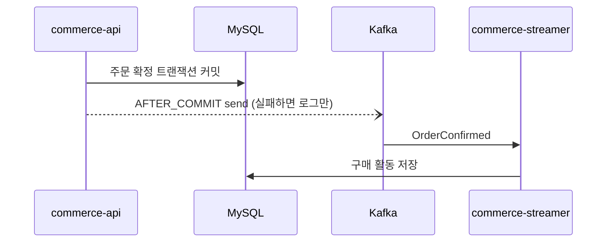
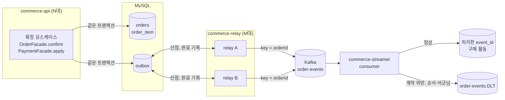
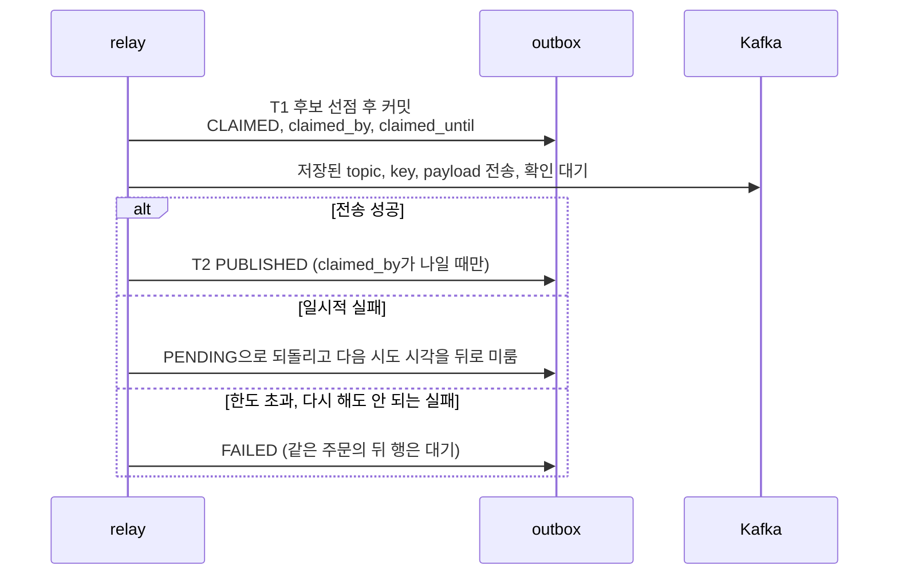
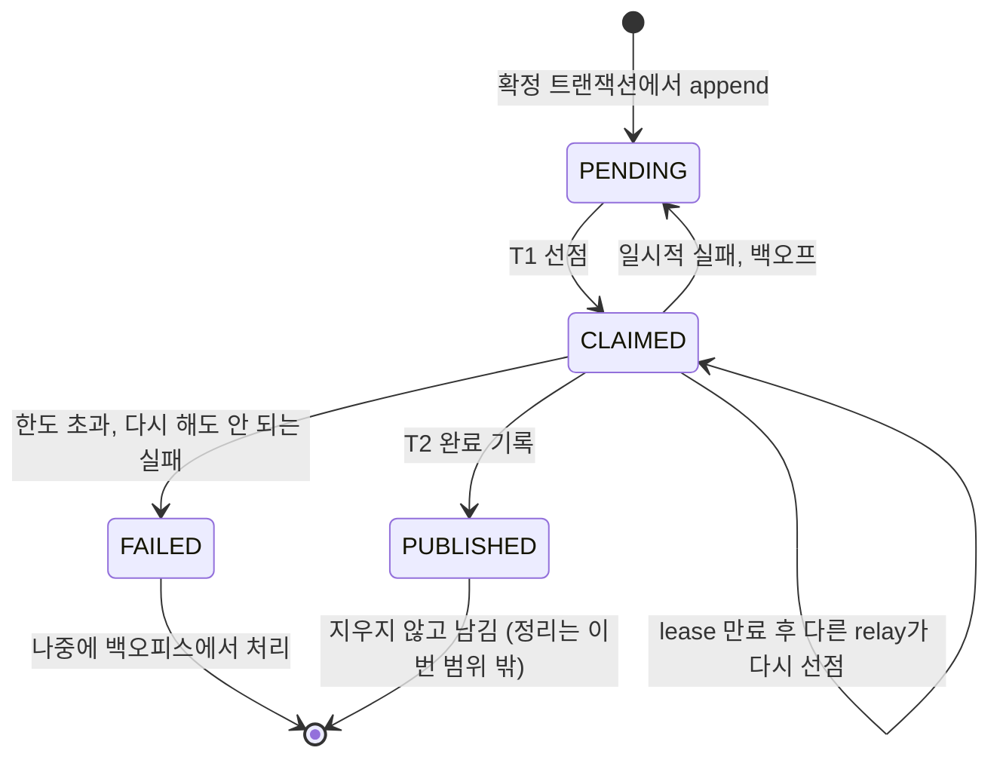

# 7주차 Outbox 구현 계획

주문 확정 이벤트를 AFTER_COMMIT 직접 발행에서 같은 트랜잭션 Outbox와 relay 발행으로 옮긴다. relay는 여러 대가 동시에 떠 있어도 안전하게 동작해야 한다.

각 단계는 테스트가 통과한 상태로 끝내고 커밋 하나로 남긴다. 통과한 테스트는 일부러 깨뜨려서 무엇을 고정하는지 확인한 뒤 넘어간다.

## 흐름 한눈에 보기

### 지금 (6주차)

커밋이 끝난 뒤 메모리에 있는 이벤트를 바로 보낸다. 커밋과 전송 사이에 프로세스가 죽거나 전송이 실패하면 이벤트를 다시 보낼 주체가 없다.

### 최종 구조

확정 트랜잭션은 outbox에 행을 쓰기만 하고, 전송은 별도 앱 commerce-relay가 맡는다. relay 대수는 API 대수와 따로 정하고, 여러 대는 outbox의 선점 상태로 조정한다.

### relay 한 회차 (5단계 이후 최종)

### outbox 행의 상태

### 단계마다 달라지는 흐름

| 단계 | 확정 뒤 이벤트가 나가는 경로 | 이 단계에서 달라지는 것 |
|---|---|---|
| 시작 | AFTER_COMMIT send | |
| 1 | AFTER_COMMIT send | `event_id` 형식 유지, 코드 변경 없음 |
| 2 | AFTER_COMMIT send | outbox 테이블만 생기고 아무도 쓰지 않음 |
| 3 | AFTER_COMMIT send | 확정할 때 outbox에 `PENDING` 행이 쌓임. 아직 보내는 주체는 없음 |
| 4 | relay 한 대 | relay가 생기고 직접 발행이 사라짐. 선점 없이 읽고 보내고 `PUBLISHED`로 바꿈 |
| 4.5 | relay 한 대 (별도 앱) | relay가 commerce-relay로 옮겨 감. API에는 발행 코드와 relay 설정이 없음. 직접 확인해 보는 지점 |
| 5 | relay 여러 대 | 장치 없이 띄운 중복 재현 → 잠금을 잡은 채 전송과 비교 → 선점과 lease로 전환. 직접 확인해 보는 지점 |
| 6 | relay 여러 대 | consumer가 `event_id`로 중복을 거르고 순서가 어긋난 주문을 DLT로 보냄 |
| 7 | relay 여러 대 | 하지 않음. `PUBLISHED` 행은 지우지 않고 남긴다 |

## 정해진 것

- 공통 `outbox` 패키지를 만들고 여러 도메인이 같은 테이블을 쓴다
- 보낼 topic, key, payload는 insert할 때 행에 저장하고 relay는 저장된 그대로 보낸다
- relay 여러 대 처리는 제품 코드에 넣는다
- relay는 DB 선점 상태(`CLAIMED`, `claimed_by`, `claimed_until`)로 조정한다. Redis 락이나 relay별 담당 분할은 쓰지 않는다
- 같은 key 안에서는 완료되지 않은 가장 앞선 행만 보낸다
- 요청 중복은 항상 일어날 수 있다고 전제하고 쓰기 쪽, outbox, consumer 세 곳에서 막는다
- `event_id`는 같은 사실이면 같은 값이 나오도록 결정적으로 만든다. 형식은 지금의 `order-confirmed:v1:{orderId}`를 유지한다
- 실패가 쌓인 행은 `FAILED`로 빼고 같은 key만 멈춘다. 다른 key는 계속 흐른다
- `FAILED` 행은 그대로 둔다. 다시 보내는 처리는 나중에 백오피스에서 다루고 이번 범위에 넣지 않는다. 그동안 같은 주문의 뒤 행도 함께 멈춘다
- relay 도입과 직접 발행 제거는 한 단계에서 한다. 이유와 실제 배포 순서는 4단계에 적었다
- relay는 별도 앱 commerce-relay로 띄운다. relay 대수를 API 대수와 따로 정하고, relay만 따로 배포한다
- outbox 도입 전에 빠진 이벤트는 commerce-batch의 일회성 job으로 대상 주문을 지정해 outbox를 채운다. 본문은 확정 때와 같게 만들고, 행이 있으면 비교만 한다. 6주차 코드로 만든 실행물로 누락 상태를 만드는 재현은 하지 않고, 테스트 안에서 outbox 쓰기를 막아 같은 상태를 만든다 (outbox.md "outbox 도입 전에 빠진 이벤트 복구")
- consumer의 순서 판단은 도메인 상태 전이로 한다. 보내는 쪽 순번에 기대지 않고, 받는 쪽이 자기가 아는 상태로 판단한다
- outbox `event_id` unique 위반은 잡지 않는다. 주문, 재고, 포인트까지 전부 롤백되고 전역 예외 처리로 500이 나간다. outbox 행은 확정과 함께만 커밋되므로 위반은 이미 확정됐다는 뜻이고, 재시도하면 주문 상태 확인에서 `ORDER_NOT_DRAFT`로 끝난다

## 1단계: `event_id` 형식 유지

`event_id`는 producer와 consumer 사이의 계약이다. 지금 consumer의 `OrderConfirmedValidator`는 받은 eventId가 `order-confirmed:v1:{orderId}`와 같은지 확인하고, 다르면 계약 위반으로 DLT에 보낸다.

`order-confirmed:v1:{orderId}`를 그대로 쓴다. 계약이 바뀌지 않으니 코드도 바꾸지 않는다. 대신 이미 발행된 사실을 새 스키마 버전으로 다시 만들지 않는다는 규칙을 지킨다.

나중에 형식을 바꾸게 되면 consumer가 두 형식을 모두 받도록 먼저 배포하고, 그다음 producer를 바꾼다. producer를 먼저 바꾸면 새로 확정된 주문의 이벤트가 전부 계약 위반으로 DLT에 쌓이고 구매 활동이 저장되지 않는다.

## 2단계: outbox 테이블과 공통 패키지

컬럼

| 컬럼 | 용도 |
|---|---|
| `id` | 폴링 순서 |
| `event_id` | unique, 같은 사실의 중복 insert 차단 |
| `aggregate_type`, `aggregate_id` | 순서 단위, Kafka key |
| `event_type`, `schema_version` | 헤더로 전달 |
| `topic`, `payload` | 저장된 그대로 발행 |
| `status` | `PENDING`, `CLAIMED`, `PUBLISHED`, `FAILED` |
| `attempt_count`, `next_attempt_at`, `last_error` | 재시도와 백오프 |
| `claimed_by`, `claimed_until` | 선점한 relay와 만료 시각 |
| `created_at`, `published_at` | 지연 측정, 정리 기준 |

인덱스

- 후보 조회: `(status, next_attempt_at)`
- 같은 key의 앞선 행 확인: `(aggregate_type, aggregate_id, id)`

도메인 이벤트에서 행을 만드는 변환과 `append` 하나만 공개한다. 이 단계에서는 아무도 호출하지 않는다.

패키지는 다른 도메인과 같은 계층 규칙을 따른다 (`ArchitectureTest`).

- `outbox.domain`: 행 모델, 상태, repository 약속, 발행 약속(`OutboxPublisher`)
- `outbox.application`: append, relay 한 회차
- `outbox.infrastructure`: JPA 구현, `KafkaTemplate`으로 발행 약속 구현
- `outbox.interfaces`: relay 스케줄러 진입점

application이 `KafkaTemplate`을 직접 쓰면 infrastructure 의존이 생기므로 발행은 domain 약속으로 감싼다.

완료 기준

- 같은 `event_id`를 두 번 append하면 unique 위반이 난다
- payload가 커밋 시점의 직렬화 결과 그대로 저장된다

## 3단계: 확정 트랜잭션에서 outbox append

`OrderFacade.confirm`과 `PaymentFacade.apply`의 성공 분기에서 같은 트랜잭션으로 append한다. 이 단계에서는 AFTER_COMMIT publisher가 그대로 이벤트를 보내고, outbox 행은 쌓이기만 한다. publisher는 4단계에서 relay와 함께 지운다.

요청 중복 방어

- 쓰기 전: 두 경로 모두 주문 행을 `FOR UPDATE`로 잡고 상태를 확인한다 (기존)
- outbox: `event_id` unique가 마지막 방어선이다. 위반은 주문 잠금이 뚫렸다는 신호라 성공으로 바꾸지 않고 롤백과 500으로 둔다

완료 기준

- 확정이 커밋되면 outbox에 `PENDING` 행이 정확히 하나 생긴다
- outbox append가 실패하면 주문, 재고, 포인트, outbox가 모두 롤백된다
- 같은 주문을 동시에 두 번 확정해도 outbox 행은 하나다
- 깨뜨려 보기: append를 트랜잭션 밖으로 옮기면 롤백 테스트가 실패한다

## 4단계: relay 한 대로 전환

relay를 만들고 같은 단계에서 AFTER_COMMIT publisher를 지운다. 이 단계가 끝나면 확정된 주문의 이벤트는 relay를 통해서만 나간다.

relay가 한 대이고 fixedDelay라 같은 행을 동시에 집어 가는 주체가 없다. 그래서 이 단계에서는 선점(`CLAIMED`) 없이 읽고, 보내고, 완료를 기록한다. `claimed_by`, `claimed_until` 컬럼은 5단계에서 쓴다.

한 회차의 흐름

1. 후보를 배치 크기만큼 읽는다. 잠그지 않는다
2. 트랜잭션 밖에서 배치의 행을 모두 `send()`하고 `flush()`로 내보낸 뒤, 결과를 행마다 `.get()`으로 확인한다. 저장된 topic, key, payload를 그대로 쓰고 헤더에 `eventId`, `eventType`, `schemaVersion`을 싣는다
3. 성공한 행을 한 번의 UPDATE로 `PUBLISHED`로 바꾼다. 실패한 행은 아래 실패 처리를 따른다

배치 전송

- `send()`는 레코드를 producer 버퍼에 넣고 바로 돌아오고, producer가 파티션별로 묶어 보낸다. 배치당 네트워크 왕복은 한두 번이고, 결과를 기다리는 시간은 가장 느린 응답 한 번이다
- 결과를 행마다 확인하는 건 어느 행을 `PUBLISHED`로, 어느 행을 백오프로 보낼지 정하기 위해서다. relay 스레드가 결과를 다 받을 때까지 기다리는 동기 방식이라, 실패는 relay 스레드에서 행마다 예외로 잡히고 outbox id, `event_id`, 원인이 로그와 `last_error`에 남는다
- 보낸 뒤 완료를 기록하기 전에 죽으면 행이 `PENDING`으로 남아 재시작한 relay가 다시 보낸다. 같은 key의 행은 한 배치에 하나뿐이라 순서는 깨지지 않고, 중복은 consumer가 흡수한다
- relay의 Kafka 템플릿은 값을 바이트 그대로 보낸다. 기존 JSON 직렬화 템플릿에 저장된 문자열을 넘기면 문자열 전체를 한 번 더 감싸 본문이 달라진다

후보 조건

- `PENDING`이고 `next_attempt_at`이 지났다
- 같은 key에 이 행보다 앞선 미완료(`PENDING`, `FAILED`) 행이 없다. 5단계부터는 `CLAIMED`도 미완료로 본다

실패 처리

- 일시적 오류: `PENDING`으로 두고 `attempt_count`를 올리고 `next_attempt_at`을 지수 백오프로 미룬다
- 최대 횟수 초과 또는 다시 해도 안 되는 오류(직렬화, 메시지 크기 초과 등): `FAILED`
- `FAILED` 뒤의 같은 key 행은 `PENDING` 그대로 두고 후보 조건으로 막는다. 나중에 맨 앞 행을 처리하면 나머지가 순서대로 나갈 수 있게 상태를 바꾸지 않는다

실행

- `@Scheduled` fixedDelay로 돈다. 처음에는 commerce-api 안에 두고 4.5단계에서 commerce-relay로 옮긴다. test 프로필에서는 스케줄러를 끄고 테스트가 한 회차를 직접 부른다
- 한 번 호출 안에서 가져온 행이 배치 크기만큼 꽉 차면 주기를 기다리지 않고 다음 회차를 돈다. 최대 `max-rounds-per-tick`번까지만 돌고, 덜 차면 바로 끝낸다
- 인스턴스마다 relay 스레드는 하나(`scheduling-1`)이고, fixedDelay라 앞 호출이 끝나야 다음 호출이 시작된다. 이벤트가 몰려도 스레드는 늘지 않고, 한 번에 들고 있는 행은 한 배치뿐이다
- 앱을 끌 때는 회차 사이에서 멈춘다

직접 발행 제거

`OrderKafkaEventPublisher`와 `publishEvent` 호출을 지운다. producer 설정은 relay가 쓰므로 남긴다. 6주차 발행 테스트(`OrderConfirmedPublicationTest`, `OrderDeliveryReproductionTest`)를 outbox와 relay 기준으로 바꾼다.

직접 확인할 수 있게 둘 것

- 아래 값을 yml 설정으로 빼고 프로필마다 덮어쓸 수 있게 한다

| 설정 (`outbox.relay.*`) | 기본 | local | test |
|---|---|---|---|
| `enabled` | true | true | false, 테스트가 한 회차를 직접 부름 |
| `poll-interval` | 1s | 1s | |
| `batch-size` | 100 | 10 | 테스트에서 지정 |
| `max-rounds-per-tick` | 10 | 10 | |
| `max-attempts` | 10 | 10 | 테스트에서 지정 |
| `backoff-initial`, `backoff-max` | 1s, 60s | 같음 | 테스트에서 지정 |

- 발행 완료, 재시도 예약, `FAILED` 전환마다 outbox id, `event_id`를 로그로 남긴다. 로그와 Database 창의 outbox 행을 나란히 보며 상태가 바뀌는 순서를 따라간다

완료 기준

- 확정 직후에는 Kafka에 아무것도 없고, relay 한 회차 뒤에 정확히 한 건이 있다
- `PENDING` 행이 발행되고 `PUBLISHED`가 된다
- 브로커가 멈추면 `PENDING`으로 남고 백오프가 늘어나며, 회복되면 발행된다
- 최대 횟수를 넘기면 `FAILED`가 되고, 같은 주문의 뒤 행은 멈추고, 다른 주문은 계속 발행된다

직접 확인해 보기

- 정상 흐름: 확정하면 outbox 행이 `PENDING`으로 생기고, 다음 회차에 `PUBLISHED`가 된다
- 브로커를 120초 넘게 멈추기 (`local-observation.md` 시나리오 4): 직접 발행일 때는 유실됐던 장면이다. 이제는 행이 `PENDING`으로 남아 `attempt_count`가 오르고, 브로커가 돌아오면 발행된다
- 전송 확인을 기다리는 도중 relay를 강제 종료하기: 브로커를 멈춰 두면 relay가 확인을 기다리며 머문다. 그때 relay를 강제 종료해도 행은 `PENDING`으로 남고, 재시작하면 다시 보낸다
- 3단계까지 쌓인 행은 이미 직접 발행으로 나간 이벤트다. relay가 켜지면 이 행을 다시 보내고, 직접 발행 때와 본문이 조금이라도 다르면 consumer가 내용 충돌로 DLT에 보낸다. 깨끗하게 보려면 확인 전에 인프라를 `down -v`로 비우고 시작한다

한 단계로 묶은 이유와 실제 배포 순서

이 저장소는 실제로 배포하거나 롤백하지 않는다. relay와 직접 발행을 함께 두면 같은 이벤트가 두 경로로 나가는데, 두 경로가 만든 본문이 다르면 consumer가 중복이 아니라 내용 충돌로 보고 DLT에 보낸다. 그래서 보내는 길을 처음부터 하나로 둔다.

실제 서비스라면 배포를 나눈다.

1. 3단계 배포: 모든 확정이 outbox에 행을 쓴다. 이벤트는 아직 직접 발행으로 나간다
2. relay 배포: 같은 이벤트가 두 경로로 나가고 consumer가 중복을 흡수한다
3. 확인: outbox 행이 밀리지 않고 `PUBLISHED`가 되는지, 내용 충돌로 DLT에 간 이벤트가 없는지 본다
4. 직접 발행 제거 배포

relay를 먼저 켜 두면 직접 발행을 지운 배포를 되돌려도 relay가 남아 있어서 쌓인 행을 계속 보낸다. 반대로 relay 없이 직접 발행부터 지우면 그동안 확정된 주문의 이벤트를 보낼 주체가 없다.

## 4.5단계: relay 앱 분리

relay를 commerce-api에서 새 앱 commerce-relay로 옮긴다. 동작은 4단계와 같다. API를 늘려도 relay 수는 그대로이고, relay만 따로 늘리거나 배포할 수 있다.

나누는 기준

| 남는 곳 | 내용 |
|---|---|
| commerce-api | `OutboxEvent` 엔티티와 스키마, `OutboxAppender`, `OrderConfirmedOutbox`. 확정과 같은 트랜잭션에서 써야 하므로 옮기지 않는다 |
| commerce-relay | `OutboxRelay`, 스케줄러, Kafka 발행, 재시도 정책, 후보 조회와 결과 기록 쿼리, `outbox.relay.*` 설정 |

- commerce-relay는 웹 서버 없이 뜨는 상주 앱이다. 여러 대를 띄워도 포트가 겹치지 않는다
- outbox 테이블 매핑은 relay에 따로 둔다. streamer가 `orders`를 따로 매핑하는 것과 같은 방식이다
- 스키마는 API가 만든다. relay는 local에서 `ddl-auto: validate`로 뜨고, 매핑이 API 스키마와 다르면 시작하지 않는다

테스트

- API: 확정하면 Kafka에는 아무것도 나가지 않고 outbox 행만 `PENDING`으로 남는다. 본문은 저장된 주문 확정 사실과 같다
- relay: 행을 직접 넣고 브로커까지 바이트 그대로 나가는지, 커밋 전 행을 못 보는지, 전송 실패가 재시도로 기록되는지 확인한다
- 6주차 재현 테스트는 streamer jar처럼 relay jar를 띄운다. 확정 뒤 relay를 띄우기 전에는 `PENDING`, 띄우면 발행된다. relay는 `validate`로 떠서 API가 만든 스키마와 매핑이 맞는지도 함께 확인한다
- 깨뜨려 보기: relay 매핑의 컬럼 이름을 바꾸면 relay가 뜨지 않아 재현 테스트가 실패한다

직접 확인해 보기

- API, relay, streamer를 각각 띄운다. relay는 API가 스키마를 만든 뒤에 띄운다
- relay를 끈 채 주문을 확정하면 outbox 행이 `PENDING`으로 쌓이고, relay를 켜면 `PUBLISHED`로 바뀐다
- 4단계의 직접 확인해 보기를 relay 앱 기준으로 다시 해 본다

## 5단계: relay 여러 대

세 가지 방식을 차례로 띄워 보고 마지막 방식을 제품 코드로 남긴다. 앞의 둘은 테스트 소스에서만 재현한다.

| 순서 | 방식 | 일어나는 일 |
|---|---|---|
| ① 장치 없음 | 4단계 relay를 두 대로 돌린다 | 두 relay가 같은 `PENDING` 행을 동시에 읽고 둘 다 보낸다. 같은 이벤트가 두 번 나간다 |
| ② 잠금을 잡은 채 전송 | `FOR UPDATE SKIP LOCKED`로 읽고 트랜잭션을 연 채 보낸 뒤 커밋한다 | 다른 relay가 잠긴 행을 건너뛰어 중복이 사라진다. 죽으면 롤백으로 잠금이 풀린다. 대신 Kafka 응답을 기다리는 동안(브로커 장애면 최대 120초) DB 연결과 행 잠금을 계속 쥔다 |
| ③ 선점과 lease | 잠깐 잠가 `CLAIMED`로 표시하고 바로 커밋한 뒤 트랜잭션 밖에서 보낸다 | 잠금은 몇 ms뿐이다. 대신 죽으면 `CLAIMED`가 남으므로 lease 만료 회수가 필요하고, 늦게 끝난 relay가 남의 행을 덮어쓰지 않게 `claimed_by = 나` 조건이 필요하다 |

③의 한 회차

1. T1 (READ COMMITTED): 잠그지 않고 후보 id를 `candidate-size`개 고른 뒤, 그 안에서 `FOR UPDATE SKIP LOCKED`로 배치 크기만큼 잠그고(상태 재확인) `CLAIMED`, `claimed_by`, `claimed_until`을 기록한 뒤 바로 커밋한다. 고르기와 잠그기를 한 문장에서 하면 고르려고 읽은 행까지 잠긴다 (relay-comparison.md의 "SQL이 잠그는 범위")
2. 4단계와 같이 배치로 보내고 결과를 행마다 확인한다
3. T2: 성공한 행을 한 번의 UPDATE로 `PUBLISHED`로 바꾼다 (`claimed_by = 나`인 행만). 실패 기록도 같은 조건을 건다

추가할 것

- 후보 조건에 `CLAIMED`이면서 `claimed_until`이 지난 행을 넣고, 같은 key의 앞선 미완료 행에 `CLAIMED`를 포함한다
- T2가 0건을 수정하면 경고 로그를 남긴다. 다른 relay가 이미 처리했거나 다시 선점했다는 뜻이다
- relay 이름은 프로세스가 뜰 때 만든다 (호스트명과 UUID). 재시작하면 새 이름을 받는다
- 후보 수 설정(`outbox.relay.candidate-size`, 기본 300, local 30)을 추가한다. 같은 순간에 선점하는 relay가 나눠 가질 수 있게 `batch-size × 동시에 도는 relay 수` 이상으로 둔다
- lease 설정(`outbox.relay.lease`, 기본 150s)을 추가한다. producer의 `delivery.timeout.ms`보다 길어야 하고, 배치를 모두 보낸 뒤 기다리므로 배치 크기와 상관없이 이 조건 하나로 충분하다. local에서는 실험할 때만 줄인다

완료 기준

- ①: 두 relay가 같은 행을 보내 같은 key의 메시지가 두 건 쌓인다
- ②: 중복은 없지만 전송이 느린 동안 relay가 DB 연결과 잠금을 쥐고 있다
- ③: relay 두 대가 같은 행을 동시에 선점하지 않는다
- ③: relay A가 주문의 1번 행을 쥐고 있는 동안 relay B는 같은 주문의 2번 행을 가져가지 않고 다른 주문을 처리한다
- ③: 전송 후 T2 전에 relay를 죽이면 lease 만료 뒤 다른 relay가 다시 보내고, consumer가 중복을 흡수한다
- ③: lease를 일부러 짧게 잡으면 느린 relay의 T2가 0건이 된다
- 깨뜨려 보기: 후보 조건에서 `CLAIMED`를 빼면 순서 테스트가 실패한다

직접 확인해 보기

- 준비: IntelliJ에서 commerce-relay 실행 설정에 "Allow multiple instances"를 켠다. 웹 서버가 없어 포트 설정은 필요 없다. local 프로필의 lease는 기다릴 수 있을 만큼 짧게 줄인다
- ①: 4단계 코드로 두 대를 띄우고 주문 여러 개를 확정하면 Kafka UI에 같은 key의 메시지가 두 건씩 보인다
- ③ 나눠 가져가기: `http/commerce-relay/outbox-seed.sql`로 실습 토픽(`outbox-relay-lab`)에 행 2000개를 넣고, `claimed_by`에 두 relay 이름이 섞여 나오는지, Kafka UI의 메시지 수가 2000인지 본다. 사용법은 파일 맨 위에 있다
- ③ lease 만료 회수: send와 T2 사이에 브레이크포인트를 걸고 Suspend를 Thread로 둬서 relay A를 그 자리에 붙잡는다. lease가 지나면 relay B가 같은 행을 다시 선점해 보내고, Kafka UI에는 같은 key의 메시지가 두 건, `purchase_activity`에는 한 번만 저장된다
- ③ 늦은 T2: 붙잡아 둔 relay A를 풀면 T2가 0건을 수정하고 경고 로그를 남긴다
- 같은 주문의 순서는 지금 주문마다 행이 하나뿐이라 손으로 재현하기 어렵다. 이 장면은 테스트로 확인한다

비교 기록

- 4단계와 ①②③을 같은 데이터(미리 넣은 `PENDING` 행 여러 개)와 같은 측정 방법으로 돌리고 relay 방식만 바꾼다
- 오류가 났는지가 아니라 숫자를 비교한다. 장치 없이 두 대가 같은 행을 보내도 예외는 없고, 늦게 끝난 쪽의 완료 기록이 0건일 뿐이다
- 기록할 값: Kafka 레코드 수와 고유 `eventId` 수, relay별 완료 기록 행 수, 한 회차 트랜잭션 길이, 그동안의 주문 확정 지연과 잠금 대기(`data_lock_waits`, `Innodb_row_lock%` 전후 차이), relay를 죽인 뒤 다시 나가기까지 걸린 시간
- 테스트는 두 relay가 모두 읽은 뒤에 보내도록 순서를 맞춰 결과가 매번 같게 하고, 결과를 증거 JSON으로 남긴다. 표와 다이어그램은 `docs/week7/relay-comparison.md`에 정리한다
- 실제로 돌려 보니 ②는 REPEATABLE READ에서 두 relay의 완료 UPDATE끼리 데드락이 났고, 롤백된 쪽이 이미 보낸 행을 다시 보내 중복이 생겼다. 숫자와 기록은 비교 문서에 있다

블로그용 실험 (테스트 소스에만 둔다)

- ②, ③처럼 relay가 후보를 잠그며 읽을 때, relay 트랜잭션이 REPEATABLE READ인지 READ COMMITTED인지에 따라 주문 확정의 outbox insert가 막히는지 비교한다
- `SHOW ENGINE INNODB STATUS`와 `data_locks`는 권한이 필요할 수 있어 관찰용 연결은 root로 따로 연다
- 두 연결의 순서를 보여 주는 시퀀스 다이어그램, 그 순서를 그대로 재현하는 테스트 코드, 실행 중에 조회한 `performance_schema.data_locks`와 `data_lock_waits` 결과를 함께 남긴다
- 잠금은 outbox 테이블만 본다. relay가 다른 테이블까지 잠그는 경우는 다루지 않는다

## 6단계: consumer 중복과 순서

중복

- 따로 처리 기록 테이블(inbox)을 두지 않는다. 지금 구현으로 이미 흡수한다
  - `event_id`는 `order-confirmed:v1:{orderId}`라 주문과 1:1이다. "이 이벤트를 처리했나"는 "이 주문의 구매 활동이 있나"와 같은 질문이다
  - `purchase_activity`의 unique 키 `(order_id, product_id)`가 두 번째 저장을 막고, 같은 주문인데 내용이 다르면 내용 충돌로 DLT에 보낸다
- 이미 있는 테스트로 확인된다: 같은 이벤트가 다시 와도 한 번만 저장, 커밋 후 ack 전에 멈췄다 재시작해도 한 번만 저장, 동시에 와도 한 건만 남음, 내용이 다르면 충돌
- 처리 기록이 따로 필요해지는 때: 판매량 누적처럼 결과만 보고 반영 여부를 알 수 없는 처리, 또는 한 주문에 여러 종류의 이벤트가 같은 행을 바꾸게 될 때

순서

- 판단 근거는 도메인 상태 전이다. consumer가 주문별 상태를 알고, 지금 상태에서 올 수 없는 이벤트를 어긋난 것으로 보고 DLT로 보낸다. 그 주문은 막힘으로 기록하고 다른 주문은 정상 처리한다
- outbox에 순번을 넣지 않아 API와 relay는 바꾸지 않는다
- 지금 발행되는 이벤트는 `OrderConfirmed` 한 종류라 판정할 경우가 없다. 두 번째 이벤트 종류(예: 주문 취소)를 넣을 때 전이 규칙과 막힘 처리를 함께 넣는다

## 7단계: 정리 (하지 않음)

과제 범위에 없어 이번에는 `PUBLISHED` 행을 지우지 않는다. 대신 남겨 두는 대가를 8단계 한계에 적는다.

- `PUBLISHED` 행이 계속 쌓여 테이블이 커진다
- 선점 1단계(후보 고르기)는 잠그지는 않지만, 실행 계획에 따라 쌓인 `PUBLISHED` 행을 훑는 비용이 늘 수 있다

나중에 넣는다면 검토했던 방식

- `published_at`이 보관 기간(예: 3일)을 지난 `PUBLISHED`만, 잠그지 않고 id를 고른 뒤 그 id만 상태를 다시 확인하며 지운다. 한 번에 정해진 건수씩 나눠 지운다
- `PENDING`, `CLAIMED`, `FAILED`는 지우지 않는다
- 하루 한 번 도는 정리라 commerce-batch의 job으로 두는 쪽이 relay 스케줄러보다 맞다 (relay가 여러 대면 각자 같은 일을 함)

## 8단계: 문서

- [outbox.md](outbox.md): 지금 구조, outbox 행과 상태, relay 한 회차, 설정, 운영할 때 볼 SQL과 로그, 실제 배포 순서, 한계
- [relay-comparison.md](relay-comparison.md): relay 방식별 비교, 격리 수준과 데드락, 선점 SQL이 잠그는 범위
- [local-observation.md](local-observation.md): 시나리오를 relay 기준으로 고치고, relay를 끄고 확정하기, 브로커가 멈춘 채 relay 띄우기, relay 두 대, lease 만료 장면을 더했다

## 정할 것

- ③의 T2(완료 기록) 격리 수준: 지금은 기본값(REPEATABLE READ)이다. 아직 재지 않았다. 실행 계획이 전체 훑기일 때 T2가 무엇을 잠그는지 측정한 뒤 바꿀지 정한다

## 마지막에 다시 볼 것: 브로커가 멈췄을 때 relay가 기다리는 이유

4.5단계를 직접 확인하다가 나온 질문이다. 구현을 다 마친 뒤 설정을 하나씩 찾아보며 다시 정리한다.

본 장면

- 브로커를 멈춘 뒤 확정한 행은 2분 가까이 `attempt_count`가 0인 채로 있었다. 로그에는 `Node 1 disconnected`만 반복해서 찍혔다
- 브로커를 멈춘 채로 relay를 새로 띄우면 같은 상황인데도 실패가 몇 초 만에 기록되고 `attempt_count`가 빠르게 올라갔다

지금까지 이해한 것

- relay는 `fixedDelay`라서 앞 회차가 끝나야 다음 회차가 시작된다. 한 회차는 읽기, `send()`, `flush()`로 결과 기다리기, DB 기록까지다. 결과를 기다리는 동안에는 DB에 아무것도 남지 않는다
- producer가 토픽 메타데이터(파티션 수, 파티션별 리더 브로커)를 이미 알고 있으면 `send()`는 버퍼에 넣고 바로 돌아온다. 그 뒤 `flush()`가 `delivery.timeout.ms`(기본 120초)가 지나 producer가 포기할 때까지 기다린다
- 메타데이터를 모르면 `send()`가 `max.block.ms`(5초) 동안 메타데이터를 기다리다 바로 실패한다. 그래서 relay를 새로 띄운 경우에는 실패가 빨리 기록됐다
- `Node 1 disconnected` 로그는 producer 네트워크 스레드가 버퍼에 남은 레코드를 보내려고 다시 연결하는 흔적이다. relay가 실패를 처리한 로그가 아니다
- producer는 consumer처럼 살아 있다는 신호(heartbeat)를 보내지 않는다. 맡은 파티션이 없어서 살아 있는지 신경 쓰는 쪽이 없다. 보낼 레코드가 있을 때만 브로커에 연결한다
- 재시도는 두 겹이다. producer 안에서 `delivery.timeout.ms` 동안 버티는 것이 relay 입장에서는 시도 한 번이다. 그 시도가 실패하면 relay가 outbox 백오프(1초부터 두 배씩, 60초 상한, 최대 10번)로 다음 시도를 잡는다. 브로커가 계속 멈춰 있으면 `FAILED`까지 메타데이터가 있을 때 약 24분, 없을 때 약 5분 걸린다

찾아볼 설정

| 설정 | 쪽 | 지금 값 | 볼 것 |
|---|---|---|---|
| `delivery.timeout.ms` | producer | 120000 (기본) | `send()` 뒤 성공이나 실패가 확정되기까지의 상한. relay에서 줄일지, 5단계 lease와의 관계 |
| `request.timeout.ms` | producer | 20000 (`kafka.yml`) | 요청 하나의 응답 대기. `delivery.timeout.ms`는 이 값과 `linger.ms`의 합보다 커야 함 |
| `linger.ms` | producer | 0 (기본) | 배치를 모으려고 기다리는 시간 |
| `max.block.ms` | producer | 5000 (relay `application.yml`) | 메타데이터를 모를 때나 버퍼가 꽉 찼을 때 `send()`가 막히는 상한 |
| `retries`, `retry.backoff.ms` | producer | 3, 500 (`kafka.yml`) | producer 안의 재전송. `delivery.timeout.ms`와 어느 쪽이 먼저 걸리는지 |
| `reconnect.backoff.ms`, `reconnect.backoff.max.ms` | producer | 50, 1000 (기본) | `Node 1 disconnected`가 찍히는 간격 |
| `metadata.max.age.ms` | producer | 300000 (기본) | 메타데이터를 다시 받는 주기 |
| `connections.max.idle.ms` | producer | 540000 (기본) | 쓰지 않는 연결을 닫기까지의 시간 |
| `enable.idempotence` | producer | true (`kafka.yml`) | producer ID로 같은 레코드 재전송을 브로커가 거르는 범위 |
| `heartbeat.interval.ms`, `session.timeout.ms`, `max.poll.interval.ms` | consumer | 기본 | 비교용. consumer가 살아 있음을 알리는 방식 |
