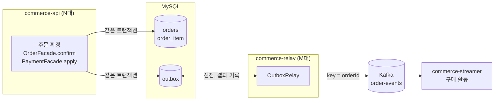
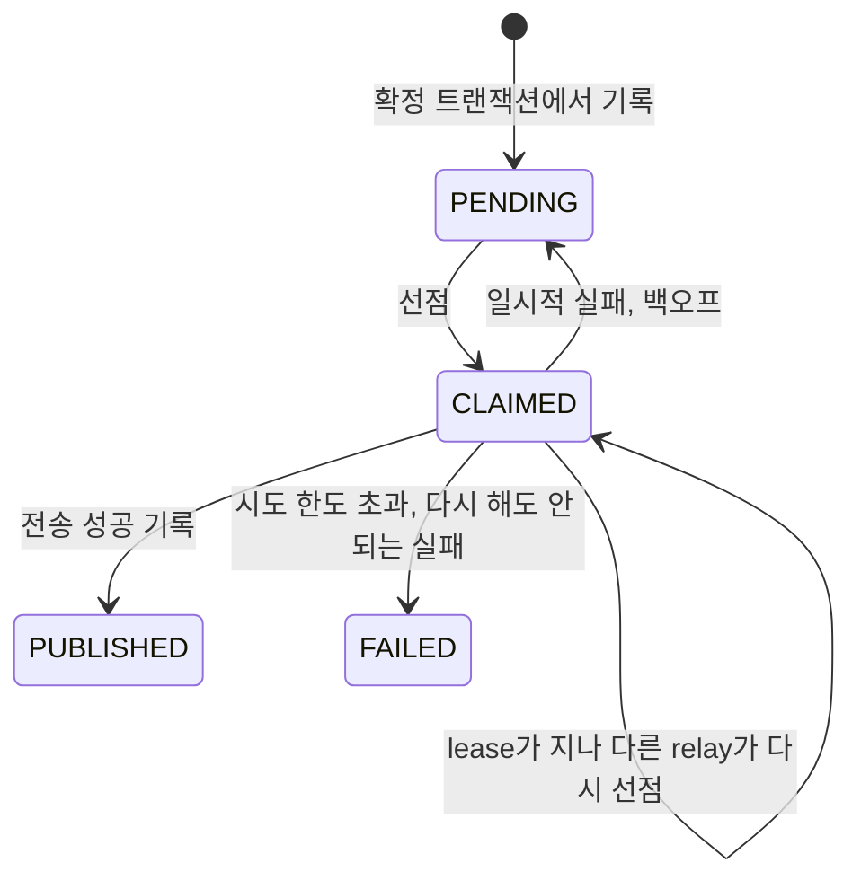
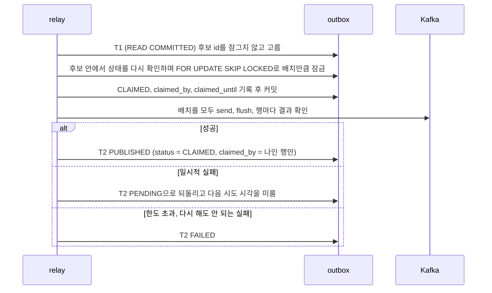

# 주문 확정 이벤트 outbox

주문 확정 이벤트는 확정과 같은 트랜잭션에서 outbox 행으로 남기고, 별도 앱 commerce-relay가 그 행을 읽어 Kafka로 보낸다. 이 문서는 지금 구조와 운영할 때 볼 것을 정리한다. 단계별로 무엇을 왜 바꿨는지는 [outbox-plan.md](outbox-plan.md), relay 방식별 비교와 잠금 측정은 [relay-comparison.md](relay-comparison.md)에 있다.

## 구조



| 앱 | 맡는 일 |
|---|---|
| commerce-api | 확정 트랜잭션 안에서 outbox 행을 쓴다 (`OrderConfirmedOutbox`, `OutboxAppender`). outbox 테이블 스키마도 여기서 만든다. Kafka로 직접 보내지 않는다 |
| commerce-relay | 웹 서버 없이 상주하며 1초마다 outbox 행을 선점해 보내고 결과를 기록한다. outbox 테이블 매핑은 따로 두고, local에서는 `ddl-auto: validate`로 API 스키마와 맞는지 확인한다 |
| commerce-streamer | 이벤트를 받아 구매 활동을 저장한다. 같은 이벤트가 다시 와도 한 번만 저장한다 |

relay 대수는 API 대수와 따로 정한다. relay끼리는 outbox 행의 선점 상태로 조정한다.

## outbox 행

| 컬럼 | 뜻 |
|---|---|
| `event_id` | 같은 사실이면 같은 값 (`order-confirmed:v1:{orderId}`), unique |
| `aggregate_type`, `aggregate_id` | 순서를 지킬 단위. Kafka key로도 쓴다 |
| `topic`, `payload` | 보낼 topic과 본문. 쓸 때 정해 두고 relay는 바이트 그대로 보낸다 |
| `status` | `PENDING` → `CLAIMED` → `PUBLISHED`, 또는 `FAILED` |
| `attempt_count`, `next_attempt_at`, `last_error` | 실패 횟수, 다음 시도 시각, 마지막 실패 원인 (감싼 예외의 안쪽 원인까지) |
| `claimed_by`, `claimed_until` | 선점한 relay 이름과 lease 끝 시각 |
| `published_at` | 발행을 기록한 시각 |



`PUBLISHED`와 `FAILED` 행은 지우지 않는다. `PUBLISHED`는 브로커가 받았다는 뜻이지 소비가 끝났다는 뜻이 아니다. 소비 여부는 consumer lag와 구매 활동으로 따로 본다. consumer는 구매 활동 행 자체로 중복을 거르므로, outbox 행을 언제 지우든 consumer의 중복 판단에는 영향이 없다.

## relay 한 회차



- 후보 조건: `PENDING`이고 다음 시도 시각이 지났거나, `CLAIMED`인데 lease가 지난 행. 같은 key에 앞선 미완료(`PENDING`, `CLAIMED`, `FAILED`) 행이 있으면 제외한다
- 고르기와 잠그기를 나눈 이유: 한 문장으로 고르면서 잠그면 고르려고 읽은 행까지 잠긴다. 나누면 선점한 행의 PRIMARY 행 잠금만 잡는다 (relay-comparison.md "SQL이 잠그는 범위")
- 후보를 배치보다 넉넉히 고르는 이유: 같은 순간에 선점하는 relay도 잠긴 행을 건너뛰고 다음 행을 가져가게 하려고
- 전송은 트랜잭션 밖에서 한다. 결과 기록이 기대보다 적으면(다른 relay가 lease가 지난 행을 다시 가져간 경우) 경고 로그를 남긴다
- 배치가 꽉 차면 주기를 기다리지 않고 이어서 돌고, 한 번에 최대 `max-rounds-per-tick` 회차까지만 돈다

## 설정 (`outbox.relay.*`, commerce-relay)

| 설정 | 기본 | local | 뜻 |
|---|---|---|---|
| `enabled` | true | true | 스케줄러를 켤지. test 프로필은 false이고 테스트가 한 회차를 직접 부른다 |
| `poll-interval` | 1s | 1s | 앞 호출이 끝난 뒤 다음 호출까지 쉬는 시간 |
| `batch-size` | 100 | 10 | 한 회차에 선점하는 행 수 |
| `candidate-size` | 300 | 30 | 선점할 때 고르는 후보 수. `batch-size × 동시에 도는 relay 수` 이상 |
| `max-rounds-per-tick` | 10 | 10 | 배치가 꽉 찰 때 한 호출에 이어서 도는 최대 회차 |
| `max-attempts` | 10 | 10 | 이만큼 실패하면 `FAILED` |
| `backoff-initial`, `backoff-max` | 1s, 60s | 같음 | 1초부터 두 배씩, 60초 상한 |
| `lease` | 150s | 150s | 선점 유지 시간. producer의 `delivery.timeout.ms`(120초)보다 길어야 한다 |

## 운영할 때 볼 것

시각은 UTC로 저장되므로 `UTC_TIMESTAMP()`와 비교한다.

lease가 지났는데 아직 `CLAIMED`인 행. 잠깐 보이는 건 relay가 죽은 뒤 다른 relay가 가져가기 전이고, 계속 남아 있으면 relay가 하나도 돌고 있지 않다는 뜻이다.

```sql
SELECT id, event_id, claimed_by, claimed_until, attempt_count
FROM outbox
WHERE status = 'CLAIMED' AND claimed_until < UTC_TIMESTAMP(6)
ORDER BY id;
```

밀린 `PENDING`. 오래된 행이 계속 남으면 relay가 멈췄거나, 브로커 장애로 재시도 중이거나, 같은 주문의 앞 행이 `FAILED`로 막혀 있다.

```sql
SELECT COUNT(*) AS pending, MIN(created_at) AS oldest
FROM outbox
WHERE status = 'PENDING';
```

`FAILED` 행과 그 뒤에서 멈춘 같은 주문의 행 수.

```sql
SELECT f.id, f.aggregate_id, f.attempt_count, f.last_error,
  (SELECT COUNT(*) FROM outbox p
   WHERE p.aggregate_type = f.aggregate_type AND p.aggregate_id = f.aggregate_id
     AND p.id > f.id AND p.status = 'PENDING') AS blocked_behind
FROM outbox f
WHERE f.status = 'FAILED'
ORDER BY f.id;
```

`FAILED` 행 재개. 원인(브로커 장애, 토픽 설정 등)을 고친 뒤 relay를 `local` 프로필로 띄우며 재개할 `event_id`를 넘긴다. 시작할 때 한 번, 지정한 행 중 `FAILED`인 것만 `PENDING`으로 되돌린다 (`attempt_count` 0, 다음 시도 시각 지금, `last_error`는 남김). 다음 회차에 relay가 보내고, 그 뒤에 멈춰 있던 같은 주문의 행도 이어서 나간다. `FAILED`가 아닌 행이나 없는 `event_id`는 건드리지 않고 경고만 남긴다. local 전용이고 공개 API는 없다.

```
--outbox.resume.event-ids=order-confirmed:v1:5,order-confirmed:v1:7
```

relay 로그

| 로그 | 뜻 |
|---|---|
| `outbox 발행 완료: id=, eventId=` | 전송 성공을 기록함 |
| `outbox 발행 재시도 예약: id=, eventId=, attemptCount=, nextAttemptAt=, error=` | 일시적 실패. `error`에 안쪽 원인까지 남는다 |
| `outbox 발행 중단: id=, eventId=, attemptCount=` (ERROR) | `FAILED`로 바꿈. 스택 트레이스가 함께 남는다 |
| `outbox 재개: eventId=` / `outbox 재개 안 함, FAILED 행이 아님: eventId=` | 재개 결과 |
| `outbox 완료 기록 누락` / `outbox 결과 기록 누락` (WARN) | lease가 지나 다른 relay가 다시 가져간 행. 같은 이벤트가 두 번 나갔을 수 있다 |
| producer의 `Node 1 disconnected` | 브로커에 다시 연결하려는 흔적. relay가 실패를 기록한 것은 아니다 |

## 중단 구간과 확인한 테스트

| 어디서 멈추나 | 남는 상태 | 다시 띄우면 | 확인한 테스트 |
|---|---|---|---|
| 확정 트랜잭션 안에서 outbox 쓰기 전후로 실패 | 주문, 재고, 포인트, outbox 모두 롤백 | 해당 없음 | `OrderTransactionTest` |
| 확정 커밋 뒤, relay가 보내기 전 | 주문 확정, outbox `PENDING` | relay가 그 행을 보내 구매 활동이 생긴다 | `OrderDeliveryReproductionTest` (relay를 띄우기 전과 후) |
| 브로커가 받은 뒤, `PUBLISHED`를 기록하기 전 | outbox `CLAIMED` (`published_at` 없음) | lease가 지난 뒤 새 relay가 같은 사건을 다시 보낸다. 브로커에는 같은 `eventId`가 다른 offset으로 두 번 남고, consumer가 한 번만 반영한다 | `OutboxRelayPublicationTest` (실제 브로커), `OutboxRelayTest` (lease 회수, 늦은 결과 기록) |

과제는 마지막 경우에 행이 `PENDING`으로 남는다고 적었지만, 여기서는 선점을 쓰므로 `CLAIMED`로 남는다. 그래서 바로가 아니라 lease(150초)가 지나야 다시 나간다. 테스트는 DB 상태를 바꾸지 않고, 새로 띄운 relay의 시계만 lease 뒤로 두어 재현한다. 중단은 브로커 확인까지 끝낸 뒤 결과 기록 단계로 넘어가지 못하게 하는 hook이며, 프로세스 강제 종료 시험은 아니다.

## outbox 도입 전에 빠진 이벤트 복구

outbox는 도입한 뒤의 확정만 지켜 준다. 도입 전(직접 발행)에 확정됐는데 전송이 실패해 빠진 이벤트는 outbox 행이 없어서 relay가 모른다. 이런 주문은 일회성 batch job으로 outbox 행을 채워 넣고, 그다음은 relay와 consumer에 맡긴다.

대상 찾기. 확정됐는데 outbox 행이 없고, 받는 쪽(구매 활동)에도 반영되지 않은 주문이다. 받는 쪽 기록과 대조하지 못하면 마지막 조건을 빼고 outbox가 없는 확정 주문 전체를 대상으로 잡아도 된다. consumer가 같은 주문을 한 번만 반영하기 때문이다.

```sql
SELECT o.id, o.confirmed_at
FROM orders o
WHERE o.status = 'CONFIRMED'
  AND NOT EXISTS (SELECT 1 FROM outbox x WHERE x.event_id = CONCAT('order-confirmed:v1:', o.id))
  AND NOT EXISTS (SELECT 1 FROM purchase_activity p WHERE p.order_id = o.id)
ORDER BY o.id;
```

채우기. commerce-batch를 `local` 프로필, `MYSQL_PORT=13306`으로 띄우며 프로그램 인자로 job과 대상 주문을 준다. 주문 id는 세미콜론으로 나눈다 (명령줄 job 파라미터는 쉼표를 타입 구분자로 읽는다). 셸에서 실행하면 `"orderIds=1;2"`처럼 따옴표로 감싼다.

```
--spring.batch.job.name=backfillOrderConfirmedOutboxJob orderIds=1;2
```

job이 주문마다 하는 일 (`OrderConfirmedOutboxBackfill`, 주문마다 따로 커밋)

| 상황 | 결과 |
|---|---|
| 확정 주문이고 outbox 행이 없음 | 저장된 `confirmed_at`, `order_item`으로 확정 때와 같은 본문을 만들어 `PENDING` 행을 넣는다 |
| 같은 `event_id` 행이 있고 본문이 같음 | 건너뛴다. 같은 대상으로 다시 돌려도 행이 늘지 않는다 |
| 같은 `event_id` 행이 있는데 본문이 다름 | 실패. 기존 행은 건드리지 않는다 |
| 주문이 없거나, 확정되지 않았거나, 품목이 없음 | 실패. 원본이 부족하면 추측해서 만들지 않는다 |

- 실패한 주문이 하나라도 있으면 job은 `FAILED`로 끝나고, 같이 지정한 다른 주문의 결과는 남는다
- 주문, 재고, 포인트는 읽기만 한다. 주문을 다시 확정하거나 재고와 포인트를 다시 쓰지 않는다
- 본문은 commerce-api의 `OrderConfirmed` 계약을 batch에 복제해 만든다 (`OrderConfirmedPayload`). 계약을 바꾸면 함께 고쳐야 하고, 본문이 확정 때와 같은지는 batch 테스트가 API가 저장한 본문 형식과 비교해 확인한다
- 시각은 앱과 같이 UTC로 다룬다. JVM 시간대를 거쳐 넣으면 `next_attempt_at`이 9시간 뒤로 들어가 relay가 바로 보내지 않는다
- 7주차 API를 배포한 뒤에 돌린다. 그 전에 돌리면 배포 전까지 직접 발행으로 빠진 주문이 다시 남는다
- 채운 뒤에는 relay가 `PUBLISHED`로 바꿨는지와, 받는 쪽에 구매 활동이 생겼는지를 따로 확인한다. `PUBLISHED`는 소비 완료가 아니다

검증 (`OrderDeliveryReproductionTest`의 복구 사례)

- 확정할 때 outbox를 쓰지 않게 해 직접 발행 시절의 확정을 흉내 내고, 주문 A는 보내지 않고(유실) 주문 B는 직접 발행 방식으로 보내 소비까지 끝낸다
- batch jar를 같은 대상으로 두 번 돌리고 relay를 띄운다
- A는 구매 활동이 생기고, B는 다시 발행돼도 구매 활동이 그대로이며, Kafka에는 A 1건, B 2건(직접 발행 + 복구)이 남는다. 복구 전후로 주문 상태, 재고, 포인트가 같다
- 과제는 6주차 코드로 만든 실행물로 누락 상태를 만들라고 했지만, 여기서는 그 대신 테스트 안에서 outbox 쓰기를 막아 같은 상태를 만들었다. outbox 행을 지우거나 상태를 직접 넣지는 않았다

## 실제로 배포한다면

이 저장소는 relay 도입과 직접 발행 제거를 한 번에 했다. 실제 서비스라면 나눠서 배포한다.

1. API 배포: 모든 확정이 outbox 행을 쓴다. 이벤트는 아직 직접 발행으로 나간다
2. relay 배포: 같은 이벤트가 두 경로로 나가고 consumer가 중복을 흡수한다
3. 확인: outbox 행이 밀리지 않고 `PUBLISHED`가 되는지, 내용 충돌로 DLT에 간 이벤트가 없는지
4. 직접 발행을 지운 API 배포

relay를 먼저 켜 두면, 직접 발행을 지운 배포를 되돌려도 relay가 쌓인 행을 계속 보낸다.

## 한계

- 같은 이벤트가 두 번 나갈 수 있다. relay가 보낸 뒤 결과를 기록하기 전에 죽거나, 전송이 lease보다 오래 걸리면 다른 relay가 다시 보낸다. 이 중복은 consumer가 흡수한다 (구매 활동의 unique 키와 내용 비교)
- `FAILED` 행은 자동으로 다시 보내지 않는다. 원인을 고친 뒤 사람이 `event_id`를 지정해 재개한다 (local 전용 진입점)
- `PUBLISHED` 행이 계속 쌓인다. 테이블이 커지고, 선점의 후보 고르기가 실행 계획에 따라 쌓인 행을 훑는 비용이 늘 수 있다
- 파티션 수를 바꾸는 순간에는 같은 key의 순서가 보장되지 않는다
- 브로커가 멈추면 relay가 한 배치의 결과를 최대 120초(`delivery.timeout.ms`) 기다린다. 그동안 그 relay는 다음 회차를 돌지 않는다
- 결과 기록(T2)은 기본 격리 수준(REPEATABLE READ)이다. 실행 계획이 전체 훑기로 바뀐 상태에서 무엇을 잠그는지는 아직 재지 않았다
