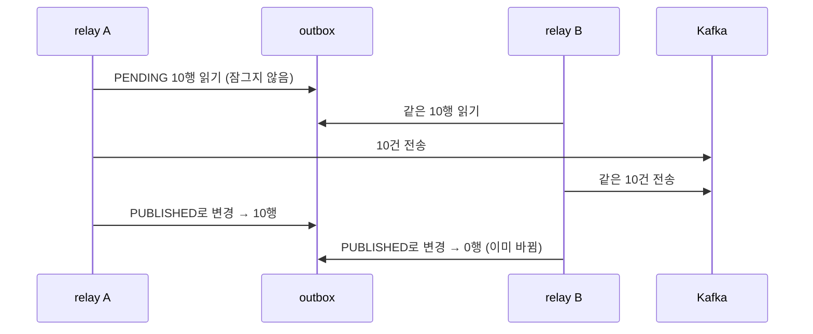
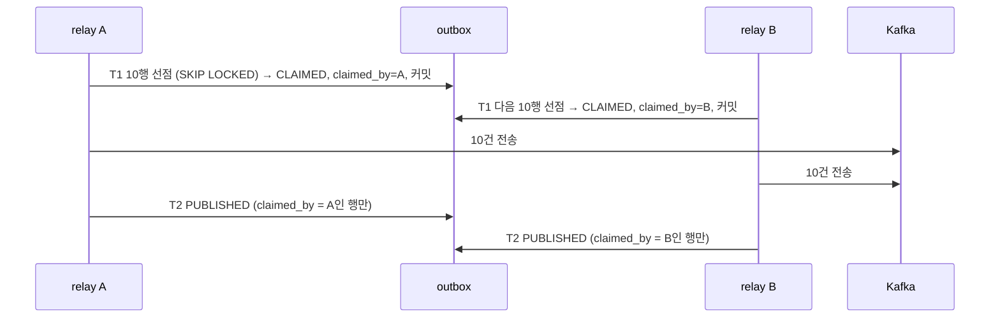
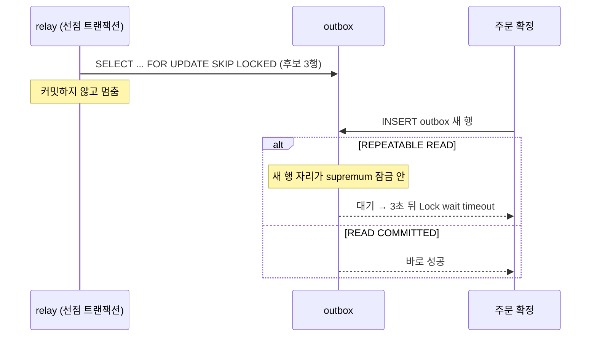
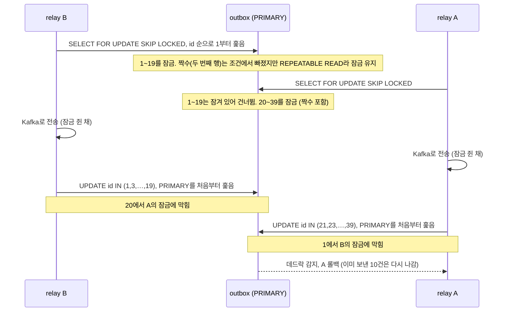
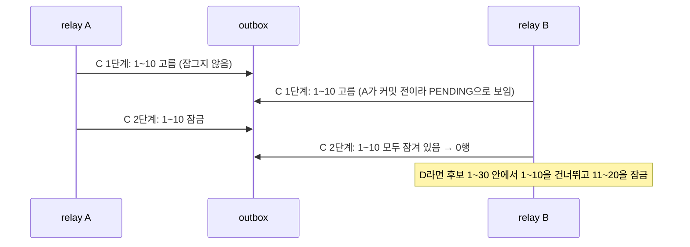

# relay를 여러 대 띄우면

relay 방식만 바꾸고 나머지는 같은 조건으로 돌려서 숫자를 비교한 기록이다. 숫자는 2026-11-05에 돌린 값이고, 실행할 때마다 조금씩 달라진다. 방향은 매번 같았다.

## 실험 조건

- 주문 50개, 주문마다 outbox 행 2개 (같은 주문의 두 번째 행은 첫 번째 행이 끝나야 나간다)
- relay가 도는 동안 주문 확정을 흉내 낸 insert 20건이 20ms 간격으로 들어온다
- 배치 크기 10, 한 배치를 보낼 때마다 50ms 지연을 넣었다 (네트워크 왕복을 흉내 낸 값)
- MySQL 8.0 (기본 격리 수준 REPEATABLE READ), Kafka 3.8 (Testcontainers)

재현: `./gradlew :apps:commerce-relay:test --tests '*RelayComparisonTest'`
결과 파일: `apps/commerce-relay/build/reports/week7/relay-comparison.json`

## 결과

| | 4단계: 한 대 | ① 장치 없이 두 대 | ② 잠금 잡은 채 전송, 두 대 | ②를 READ COMMITTED로 | ③ 선점과 lease, 두 대 |
|---|---|---|---|---|---|
| outbox 행 | 120 | 120 | 120 | 120 | 120 |
| Kafka 레코드 | 120 | 240 | 130 | 120 | 120 |
| 중복 | 0 | 120 | 10 | 0 | 0 |
| relay별 완료 기록 | 120 | 40 / 80 | 45 / 75 | 14 / 106 | 61 / 59 |
| 확정 insert 최대 지연 | 28ms | 34ms | 1601ms | 32ms | 10ms |
| 확정 insert 평균 지연 | 9ms | 8ms | 139ms | 9ms | 5ms |
| 행 잠금 대기 횟수 | 0 | 13 | 12 | 1 | 0 |
| 행 잠금 대기 시간 합 | 0ms | 40ms | 2475ms | 60ms | 0ms |
| 데드락 | 0 | 0 | 1 | 0 | 0 |
| 전체 소요 | 1698ms | 1165ms | 3564ms | 1102ms | 732ms |

③은 아래 "SQL이 잠그는 범위"에서 고친 선점 쿼리(후보를 넉넉히 고른 뒤 그 안에서 건너뛰며 잠그기)로 돌린 값이다.

## 하나씩 보면

### 4단계: 한 대

같은 행을 함께 읽는 주체가 없어서 중복도 잠금 대기도 없다. 대신 한 대가 모든 행을 맡으니 가장 느린 축에 든다.

### ① 장치 없이 두 대

두 relay가 같은 배치를 동시에 읽고 둘 다 보냈다. 120행이 전부 두 번씩 나갔다. 오류는 하나도 나지 않았다. 늦게 끝난 쪽의 완료 기록이 `status = 'PENDING'` 조건에 걸려 0건이 됐을 뿐이다. relay별 완료 기록이 나뉜 건 일을 나눠 한 게 아니라, 먼저 끝난 쪽이 기록을 가져간 결과다.



### ② 잠금을 잡은 채 전송

`FOR UPDATE SKIP LOCKED`로 읽고, 트랜잭션을 연 채 보낸 뒤 커밋한다. 다른 relay는 잠긴 행을 건너뛰어서 중복이 크게 줄었다. 대신 기본 격리 수준(REPEATABLE READ)에서는 두 가지 대가가 숫자로 드러났다.

- 확정 insert가 막혔다. 최대 1601ms, 평균 139ms로 다른 방식보다 열 배 넘게 느렸다
- 데드락이 났다. 롤백된 쪽은 이미 Kafka로 보낸 뒤라, 행이 `PENDING`으로 돌아가 다음 회차에 다시 나갔다. 중복 10건이 여기서 나왔다. 잠금으로 중복을 막으려던 방식인데, 데드락이 나면 오히려 중복을 만든다

같은 방식을 READ COMMITTED로만 바꾸면 데드락과 중복이 0이 되고, 잠금 대기도 거의 없어져 확정 insert 지연이 다른 방식과 비슷해졌다. 원인은 아래 "격리 수준이 무엇을 바꾸나"에서 따로 본다.

그래도 ②는 전송하는 동안 DB 연결과 행 잠금을 계속 쥔다. 이 실험은 전송 지연이 50ms라 티가 나지 않았지만, 브로커가 멈추면 한 번에 최대 120초(`delivery.timeout.ms`)를 쥐고 있게 된다.

### ③ 선점과 lease

잠깐 잠가 `CLAIMED`로 표시하고 바로 커밋한 뒤, 트랜잭션 밖에서 보낸다. 중복, 잠금 대기, 데드락이 모두 0이었고, 일을 고르게 나눠 가장 빨리 끝났다. 선점 트랜잭션은 READ COMMITTED이고, 고른 행의 PRIMARY 행 잠금만 몇 ms 쥔다.



대가는 relay가 보낸 뒤 T2 전에 죽으면 `CLAIMED`가 남는다는 점이다. lease(150초)가 지나면 다른 relay가 다시 선점해 보내고, 그 중복은 consumer가 맡는다. 이 장면은 `OutboxRelayTest`의 lease 회수, 늦은 T2 테스트로 확인했다.

## 격리 수준이 무엇을 바꾸나

### 두 격리 수준이 약속하는 것

- REPEATABLE READ: 한 트랜잭션 안에서 같은 조건으로 다시 읽으면 같은 결과가 나와야 한다. 그래서 잠그며 읽을 때(`FOR UPDATE`, `UPDATE`) 다른 트랜잭션이 그 범위에 새 행을 끼워 넣지 못하게 막는다
- READ COMMITTED: 읽을 때마다 그 순간 커밋된 값을 본다. 다시 읽었을 때 새 행이 보여도 괜찮다고 보고, 고른 행만 잠근다

이 약속의 차이가 잠금의 차이로 이어진다.

| | REPEATABLE READ | READ COMMITTED |
|---|---|---|
| 잠그는 단위 | 행과 그 앞의 틈(gap)을 함께 (next-key) | 행만 (`REC_NOT_GAP`) |
| 훑었지만 조건에 안 맞은 행 | 커밋할 때까지 잠금 유지 | 조건을 보고 바로 잠금 해제 |
| 범위의 끝 (`supremum`) | 잠근다 | 잠그지 않는다 |
| 그 범위에 새 행 insert | 커밋할 때까지 기다림 | 바로 들어감 |

### 그림 1: 같은 쿼리, 다른 잠금

relay가 처음 선점 쿼리(한 문장으로 고르면서 잠그는 `FOR UPDATE SKIP LOCKED`, 아래 "SQL이 잠그는 범위"의 A)로 `PENDING` 3행을 잠근 채 멈춰 있을 때, `idx_outbox_status_next_attempt` 인덱스에 걸린 잠금이다. 인덱스는 `(status, next_attempt_at, id)` 순으로 정렬돼 있다.

```
인덱스 순서 →     ...  ┆gap┆ [PENDING,t1,1] ┆gap┆ [PENDING,t2,2] ┆gap┆ [PENDING,t3,3] ┆gap┆ supremum
                              ▲                 ▲                 ▲                 ▲
REPEATABLE READ   X,GAP   X(행+gap)        X(행+gap)         X(행+gap)         X(끝까지)
                  └──────────────── 이 구간 어디에도 새 행이 들어갈 수 없다 ────────────────┘

READ COMMITTED            X,REC_NOT_GAP    X,REC_NOT_GAP     X,REC_NOT_GAP
                          (행 3개만. 틈과 끝은 비어 있어 새 행이 들어간다)
```

새로 확정된 주문의 outbox 행은 `status = 'PENDING'`이고 `next_attempt_at`이 지금이라, 인덱스에서 맨 끝(`supremum` 바로 앞)에 들어가야 한다. REPEATABLE READ에서는 그 자리가 잠겨 있다.



`performance_schema.data_lock_waits`에 남은 대기 (REPEATABLE READ에서만 나옴)

| 요청한 잠금 | 막은 잠금 |
|---|---|
| `X,INSERT_INTENTION` on `supremum pseudo-record` | `idx_outbox_status_next_attempt`의 `X` on `supremum pseudo-record` |

| | REPEATABLE READ | READ COMMITTED |
|---|---|---|
| 확정 insert | 실패, 3037ms (`Lock wait timeout exceeded`) | 성공, 8ms |

재현: `./gradlew :apps:commerce-relay:test --tests '*IsolationLockTest'`
결과 파일: `apps/commerce-relay/build/reports/week7/isolation-repeatable-read.json`, `isolation-read-committed.json`

### 그림 2: ②에서 데드락이 생긴 순서

데드락 기록에서 각 트랜잭션이 쥔 행과 기다린 행의 id를 뽑으면 이렇다. 행 1~40은 주문 1~20의 행이고, 홀수 id가 주문의 첫 행, 짝수 id가 두 번째 행이다.

| | 바꾸려던 행 | 쥐고 있던 잠금 (PRIMARY) | 기다린 잠금 |
|---|---|---|---|
| relay B | 1, 3, 5, …, 19 | 1~19 전부 | id=20 |
| relay A | 21, 23, …, 39 | 20~39 전부 | id=1 |



두 가지가 겹쳐서 생겼다.

1. REPEATABLE READ라서 조건에 안 맞아 버린 행(짝수, 같은 주문의 두 번째 행)까지 잠금을 끝까지 쥐었다
2. 잠금을 쥔 채로 다음 문장(UPDATE)이 상대가 쥔 행을 또 지나가야 했다. 각자 이미 잡은 것을 놓지 않고 상대 것을 기다리니 순환이 생겼다

UPDATE가 자기 대상과 상관없는 행(A는 id=1)을 기다린 건, 그 실행에서 UPDATE가 PRIMARY를 처음부터 훑었다는 뜻이다. 아래 "SQL이 잠그는 범위"에서 확인했듯, 테이블을 막 채우고 통계를 갱신하기 전에는 `WHERE id IN (...)`인데도 실행 계획이 PRIMARY 전체 훑기(`type=index`)로 나온다. 같은 쿼리라도 실행 계획에 따라 훑는 행이 달라지고, REPEATABLE READ에서는 훑은 행이 곧 잠근 행이 된다.

READ COMMITTED에서는 1번이 사라진다. 조건에 안 맞는 행은 바로 놓고, UPDATE는 남이 잠근 행을 만나면 마지막 커밋 값으로 조건부터 확인해(semi-consistent read) 자기 대상이 아니면 기다리지 않고 지나간다. 그래서 같은 ② 방식인데도 데드락이 0이 됐다.

## SQL이 잠그는 범위

### 여기까지 오게 된 흐름

1. 방식별 비교를 돌렸더니 ②에서 outbox 테이블 하나만으로 데드락이 났다
2. 처음에는 격리 수준(gap 잠금)으로 설명하려 했는데, 데드락 기록에서 쥔 행의 id를 뽑아 보니 각 relay가 보낼 10행보다 훨씬 많은 행(1~19, 20~39)을 쥐고 있었다
3. 그래서 "어느 SQL이, 어떤 실행 계획으로, 몇 행을 잠그나"를 격리 수준과 따로 재 보기로 했다

격리 수준은 "읽은 행 중 무엇을 계속 잠가 두느냐"를 정하고, 몇 행을 읽느냐는 SQL과 실행 계획이 정한다. 둘을 나눠 봐야 했다.

### 어떻게 쟀나

- id 1~200에 `PUBLISHED` 이력, 201~300에 `PENDING` 행(주문 50개 × 2행)을 넣고 `ANALYZE TABLE`로 통계를 갱신했다
- 트랜잭션을 열고(REPEATABLE READ, READ COMMITTED 각각) 선점 SQL을 실행한 뒤 커밋하지 않은 채로 멈춘다
- 그 순간 다른 연결에서 `performance_schema.data_locks`를 조회해 잠금 줄 수와 잠긴 id를 센다. 잠금 한 줄이 행 하나다
- 같은 SQL의 실행 계획은 `EXPLAIN`으로 본다

재현: `./gradlew :apps:commerce-relay:test --tests '*SqlLockFootprintTest'`
결과 파일: `apps/commerce-relay/build/reports/week7/sql-lock-footprint.json`

### 비교한 SQL

```sql
-- A. 한 문장으로 고르면서 잠그기 (처음 ③의 선점 쿼리)
SELECT o.* FROM outbox o
WHERE ((o.status = 'PENDING' AND o.next_attempt_at <= :now)
    OR (o.status = 'CLAIMED' AND o.claimed_until < :now))
  AND NOT EXISTS (같은 key 의 앞선 미완료 행)
ORDER BY o.id LIMIT 10
FOR UPDATE SKIP LOCKED

-- B. A와 같은 모양, 조건만 status = 'PENDING' (② 실험)

-- C. 잠그지 않고 고른 뒤 id로 잠그기
SELECT o.id FROM outbox o WHERE (A와 같은 조건) ORDER BY o.id LIMIT 10;   -- 잠그지 않음
SELECT o.* FROM outbox o
WHERE o.id IN (:고른 id) AND (상태 조건 다시 확인)
FOR UPDATE SKIP LOCKED;

-- D. 후보를 넉넉히(배치의 3배) 고른 뒤 그 안에서 건너뛰며 잠그기 (지금 ③의 선점 쿼리)
SELECT o.id FROM outbox o WHERE (A와 같은 조건) ORDER BY o.id LIMIT 30;   -- 잠그지 않음
SELECT o.* FROM outbox o
WHERE o.id IN (:후보 30개) AND (상태 조건 다시 확인)
ORDER BY o.id LIMIT 10
FOR UPDATE SKIP LOCKED;
```

### 결과

| SQL | 실행 계획 | 돌려준 행 | REPEATABLE READ에서 잠근 행 | READ COMMITTED에서 잠근 행 |
|---|---|---|---|---|
| A | PRIMARY를 id 순서로 처음부터 (`type=index`) | 10 | 221 (id 1~219 + supremum) | 19 (id 201~219) |
| B | status 인덱스로 전부 읽고 정렬 (`Using filesort`) | 10 | 201 (보조 인덱스 100 + gap 1 + PRIMARY 100) | 200 (보조 인덱스 100 + PRIMARY 100) |
| C | PRIMARY range (`rows=10`) | 10 | 10 (PRIMARY `X,REC_NOT_GAP`만) | 10 (같음) |
| D | PRIMARY range (`rows=30`) | 10 | 10 (PRIMARY `X,REC_NOT_GAP`만) | 10 (같음) |

읽는 법

- A는 `ORDER BY id LIMIT 10`을 맞추려고 PRIMARY를 1번부터 훑었다. id 1~200은 `PUBLISHED`라 조건에 안 맞는데도 REPEATABLE READ에서는 읽은 행이라 잠겼다. `PUBLISHED` 이력이 쌓일수록 매 회차에 잠그는 행도 늘어난다. READ COMMITTED에서는 조건에 안 맞는 행을 바로 놓아 19행으로 줄었지만, 같은 주문의 두 번째 행(짝수 id, `NOT EXISTS`에서 빠진 행)은 놓지 않아 여전히 10행보다 많다
- B는 `PENDING` 100행을 다 읽어 정렬한 뒤 10개를 잘랐다. 조건에 맞는 행을 다 읽었으니 READ COMMITTED여도 100행을 그대로 잠갔다. `LIMIT`은 돌려줄 행 수를 줄일 뿐, 잠글 행 수를 줄이지 않는다
- C는 고르기를 잠그지 않는 읽기로 하고, 잠그기는 고른 id를 PRIMARY로 하나씩 찾아가 한다. 읽는 행이 곧 고른 행이라 실행 계획과 격리 수준에 상관없이 10행만 잠갔다
- D도 후보 30개를 PRIMARY로 id 순서대로 찾아가다 10개를 잠그면 멈춰서 10행만 잠갔다

### C만으로는 부족했던 이유: 같은 순간에 돌면 한 대가 논다

C의 고르기는 잠그지 않는 읽기라 남이 잠근 행인지 모른다. 두 relay가 같은 순간에 회차를 시작하면 둘 다 "가장 앞의 10개"를 고르고, 늦은 쪽은 그 10개가 모두 잠겨 있어 0행으로 끝난다. A는 훑다가 잠긴 행을 건너뛰고 다음 행으로 넘어가니 이런 일이 없었다.



D는 후보를 배치보다 넉넉히 골라, 그 안에서 잠긴 행을 건너뛰며 다음 행을 잠근다. 같은 순간에 도는 relay가 `후보 수 / 배치 크기` 대(지금 설정은 3대)까지는 겹치지 않고 나눠 갖는다. 그보다 많으면 넘치는 relay가 그 회차를 쉰다. 다만 선점은 몇 ms 만에 커밋되고, 커밋된 `CLAIMED` 행은 다음 고르기에서 빠지므로 쉬는 건 그 한 회차뿐이다. 후보 수는 `outbox.relay.candidate-size`로 조정한다 (기본 300, local 30).

중복은 늘지 않는다. 고른 뒤 잠그기 전에 다른 relay가 같은 행을 가져가면, 아직 잠겨 있으면 `SKIP LOCKED`가 건너뛰고, 이미 `CLAIMED`로 커밋됐으면 2단계의 상태 재확인에서 빠진다. `FOR UPDATE`는 격리 수준과 상관없이 최신 커밋 값을 읽으므로 REPEATABLE READ여도 같다.

이 세 가지는 테스트로 확인했다.

- A가 쥐고 있는 동안 B는 다음 행을 가져간다 (`OutboxRelayConcurrencyTest`). 후보를 배치 크기만큼만 고르게 바꾸면 이 테스트와 "두 대가 동시에 나눠 가진다" 테스트가 실패한다
- 고른 뒤 잠그기 전에 다른 relay가 선점해 커밋하면 그 행은 잠그지 않는다 (`OutboxRelayTest`). 상태 재확인을 빼면 실패한다
- D 방식의 선점은 REPEATABLE READ여도 PRIMARY 행 잠금만 잡아 확정 insert가 14ms 만에 들어간다 (`IsolationLockTest`)

완료 UPDATE의 실행 계획

| | 실행 계획 |
|---|---|
| 통계 갱신 전 | `type=index key=PRIMARY` (PRIMARY 전체 훑기) |
| 통계 갱신 후 | `type=range key=PRIMARY rows=10` |

`WHERE id IN (10개)`처럼 PRIMARY로 바로 찾을 수 있는 UPDATE도 통계에 따라 전체 훑기가 된다. ②의 데드락에서 A가 상관없는 id=1을 기다린 이유가 이것이다.

### 정리하면

- 데드락과 확정 insert 차단의 뿌리는 "고르기 위해 읽은 행까지 잠그는 SQL"이었다. 격리 수준은 그 피해를 키우거나(REPEATABLE READ) 줄이는(READ COMMITTED) 쪽이었다
- 잠금 범위를 실행 계획에 맡기지 않으려면 고르기와 잠그기를 나눠야 한다. 나누면서도 여러 relay가 동시에 일하려면 후보를 넉넉히 골라야 한다 (D)
- READ COMMITTED는 실행 계획이 나빠졌을 때를 대비한 두 번째 안전장치로 둔다

## 트랜잭션을 짧게 잡으면 데드락이 안 나나

짧게 잡으면 겹칠 시간이 줄어 확률은 낮아진다. 하지만 0이 되지는 않는다. 데드락의 조건은 길이가 아니라 "이미 잡은 잠금을 쥔 채로 다른 잠금을 더 기다린다"는 모양이고, 그 모양이 두 트랜잭션에서 엇갈린 순서로 생기면 몇 ms짜리 트랜잭션끼리도 난다.

이번 실험에서 그 차이가 보였다.

- ①의 완료 UPDATE는 문장 하나짜리 짧은 트랜잭션이다. 먼저 잡아 둔 잠금이 없어서, 같은 행을 만나면 한쪽이 기다리기만 했다 (잠금 대기 12번, 데드락 0)
- ②는 SELECT로 잡은 잠금을 전송 내내 쥔 채 UPDATE로 또 잠근다. 쥔 채 더 잡는 모양이라 데드락이 났다

그래서 줄이는 방법은 세 가지를 같이 보는 것이다.

- 잠그는 범위를 좁힌다: READ COMMITTED로 틈과 조건 밖 행을 잠그지 않는다
- 쥔 채 더 잡지 않는다: ③처럼 선점은 선점대로 바로 커밋하고, 완료 기록은 따로 짧게 한다
- 쥐는 시간을 줄인다: 전송 같은 느린 일을 트랜잭션 밖으로 뺀다

## 어떤 격리 수준이 맞나

relay의 트랜잭션은 READ COMMITTED가 맞다고 본다.

- relay는 같은 트랜잭션 안에서 다시 읽어 같은 결과를 기대하지 않는다. 정확성은 스냅샷이 아니라 행의 상태 조건(`status = CLAIMED`, `claimed_by = 나`)으로 지킨다
- REPEATABLE READ의 gap 잠금은 relay에게 얻는 것 없이 주문 확정 insert만 막는다 (그림 1)
- 조건 밖 행까지 잠그는 성질이 relay끼리 데드락을 만든다 (그림 2)

선점 쿼리를 D로 바꾼 뒤로 T1은 격리 수준과 상관없이 고른 행만 잠근다. 그래도 T1은 READ COMMITTED로 둔다. T2(완료 기록)는 기본값 REPEATABLE READ 그대로이고, 아직 따로 재지 않았다. ②의 데드락은 SELECT로 잡은 잠금을 쥔 채 완료 UPDATE를 하다 났지만, ③의 T2는 T1이 커밋한 뒤라 쥔 잠금 없이 시작한다. 비교 실험에서 ③ 두 대는 잠금 대기와 데드락이 0이었다. 실행 계획이 전체 훑기로 바뀐 상태에서 T2가 무엇을 잠그는지 재 보기 전에는 바꿀 근거가 없다.

주문 확정 쪽 트랜잭션은 이번 범위가 아니다. 주문 행을 `FOR UPDATE`로 잡고 재고와 포인트를 바꾸는 흐름이라 격리 수준을 바꾸려면 따로 따져 봐야 한다.

## outbox 하나만 봐도 데드락이 나나

난다. 데드락은 테이블이 여러 개일 때만 생기는 게 아니라, 두 트랜잭션이 잠금을 서로 엇갈린 순서로 쥐면 생긴다. 이번 ②의 데드락은 orders를 전혀 건드리지 않고 outbox 한 테이블, 그것도 PRIMARY 인덱스 하나 안에서 났다 (그림 2). 한 테이블 안에서도 행 1~19와 20~39는 서로 다른 잠금이다.

## 남은 질문

- 실행 계획이 PRIMARY 전체 훑기일 때 ③의 T2(REPEATABLE READ)가 몇 행을 잠그는지, 확정 insert나 다른 relay의 선점을 막는지. 재 본 뒤 격리 수준을 바꿀지 정한다
