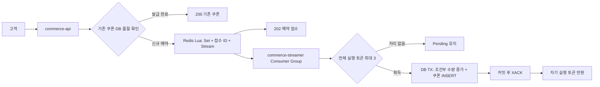

# 쿠폰 예약·비동기 발급 계약

## API

| API | 결과 |
| --- | --- |
| `POST /api/v1/coupon-campaigns/{campaignId}/issues` | 새 예약 202, 같은 예약 200, 발급 완료 시 200과 기존 couponId |
| `GET /api/v1/coupon-campaigns/{campaignId}/issue` | 로그인한 사용자의 PENDING 또는 ISSUED, 완료 시 couponId |
| `GET /api/v1/coupons` | 본인 보유 쿠폰, 발급 시각·ID 내림차순 |

발급된 쿠폰의 만료 시각은 발급 시각으로부터 30일 뒤이며, 쿠폰 응답에 `expiresAt`을 포함한다. 쿠폰 사용 기능은 구현하지 않았다.

기존 `X-USER-ID`로 식별한다. 202는 Redis 예약·작업 기록을 완료했다는 응답이며 쿠폰 발급 성공은 ISSUED로 확인한다. 새 예약에는 숫자 requestId가 없으며 캠페인과 본인을 기준으로 조회한다. 다른 사용자의 예약은 조회할 수 없다.

신규 예약은 비활성·DB 품절·예약 수량 초과 시 409, 수용 닫힘·Redis 상태 불명 시 503이다. Redis 장애 중 발급 완료 결과와 보유 목록은 DB가 정상이라면 조회할 수 있다. 미발급 예약 결과는 Redis가 필요하다.

## 구성

API는 새 DB 접수 행을 만들지 않는다. consumer는 commerce-streamer에서 실행하며 HTTP 요청과 독립적이다. 실행 자리가 부족해도 예약을 취소하거나 발급 실패로 응답하지 않는다. 캠페인별 엄격한 선착순은 보장하지 않는다.

예약 조회·사용자·행사·기존 쿠폰 확인에는 DB 조회가 남아 있다. 실행 제한이 보호하는 범위는 consumer의 발급 TX이며 모든 HTTP 요청과 DB 읽기 부하를 제한하지 않는다.

## Redis 키

모든 앱은 같은 Redis primary·키 접두어·consumer group 설정을 사용한다.

| 키 | 자료형 | 의미 |
| --- | --- | --- |
| `coupon:reservations:{campaignId}:quota` | String | 최대 수량 |
| `coupon:reservations:{campaignId}:members` | Set | 예약 사용자, 발급 후에도 유지 |
| `coupon:reservations:{campaignId}:receipts` | Hash | 사용자 ID → 최초 Stream ID, 기존 발급자는 issued |
| `coupon:reservations:{campaignId}:requests` | Stream | 발급할 예약 작업 |
| `coupon:stream:control:state` | Hash | 전역 수용 상태·epoch·사유 |
| `coupon:stream:control:active` | Set | 전체 consumer 발급 실행 토큰, 최대 3 |

예약 Lua는 중복 확인·SCARD와 quota 비교·Stream 추가·사용자와 접수 ID 기록을 한 번에 수행한다. 서로 다른 Redis 명령 사이에 다른 요청이 끼어들지 않는다. Lua 실행 중 명령 오류에 대한 트랜잭션 롤백은 제공되지 않으므로 타입과 상태를 먼저 확인하고 오류 시 수용을 닫는다. consumer도 접수 ID와 작업 ID의 일치를 확인한다.

예약 사용자·접수 ID·Stream 원본은 ACK 뒤에도 지우지 않는다. `XACK`는 Consumer Group의 미완료 상태만 해제한다. 총량 100장이라는 과제 범위에서 보존하며 만료·운영 삭제 기능은 추가하지 않았다.

전역 제어 키와 캠페인 키를 한 Lua에서 사용하므로 현재 구성은 단일 Redis primary용이다. Redis Cluster의 서로 다른 슬롯에 그대로 적용할 수 없다.

## 발급과 재전달

consumer는 자기 Pending → 일정 시간 이상 미완료인 작업 XAUTOCLAIM → 신규 작업 순서로 읽는다. 작업을 읽어도 실행 토큰을 얻지 못하면 ACK하지 않는다. 다음 시도에 계속 처리한다. Pending 회수는 재전달이며, 토큰 TTL이나 자동 회수 기능이 아니다.

DB는 READ_COMMITTED TX에서 수량 조건부 UPDATE와 쿠폰 INSERT를 함께 수행한다. `(campaign_id, user_id)` 유일 제약과 기존 쿠폰 재조회로 재전달의 중복 효과를 막는다. 예약 이후 행사 비활성화는 기존 예약자의 발급을 취소하지 않는다.

DB 커밋 뒤에만 ACK한다. 커밋 전 종료는 롤백된 작업을 다시 처리하고, 커밋 후 ACK 전 종료는 기존 쿠폰을 확인한 뒤 ACK한다. 확실한 롤백은 작업을 남겨 재시도하고 DB 종료가 불명확하면 실행 토큰도 남긴 채 수용을 닫는다. 영구 오류는 자동으로 완료 처리하지 않으며 로그·Pending·DB를 확인해 원인을 해결해야 한다.

## 장애와 수동 재개

새 배포는 전용 Redis 제어 키가 없으면 닫힘이다. 정상적인 앱 재시작은 저장된 전역 상태를 따른다. Redis 오류를 관찰한 인스턴스는 해당 epoch를 차단하므로 PONG 복구만으로 재개하지 않는다.

close는 모든 앱이 공유하는 신규 예약·consumer의 새 발급 진입을 닫는다. 서버·보유 목록·기존 쿠폰 조회와 진행 중 TX는 유지한다. 운영자는 모든 consumer의 DB 작업 종료와 결과를 별도로 확인하고, 상태 응답의 잔여 토큰 전체를 expectedTokens에 정확히 지정한 뒤 confirmed=true로 재개한다. 이 확인을 자동으로 증명하는 분산 운영 제어기는 아니다.

최초 초기화 여부를 DB 캠페인에 기록한다. 초기화된 행사의 Redis 데이터가 사라졌다면 DB 발급 내역만으로 미발급 예약을 재구성하지 않는다. 재개는 503으로 거절하며 외부 보관 데이터의 검증·복원 없이 새 행사로 취급하지 않는다.

보장 실험 범위는 API·consumer 종료와 저장 디스크가 유지된 단일 Redis 프로세스 재시작이다. AOF always·noeviction 설정을 사용한다. 디스크 유실·노드 유실·자동 failover·다중 broker 내구성은 검증하지 않는다. 공유 인프라와 볼륨은 장애 실험에 사용하지 않는다.

## 품절 캐시

API가 DB의 최종 발급 수를 확인하면 해당 캠페인을 인스턴스 로컬 캐시에 기억한다. 다음 신규 사용자는 Redis에 도달하지 않고 품절 409를 받는다. 기존 발급자에게는 기존 쿠폰을 먼저 반환한다. 예약 100건만으로는 DB 품절 캐시를 채우지 않는다.

시작 시 DB 전체 목록을 읽어 자동 복구하지 않는다. 캐시는 재시작하면 비워진다. 발급 취소·총량 증가가 없는 모델이며 이를 추가하면 캐시 무효화가 필요하다.
